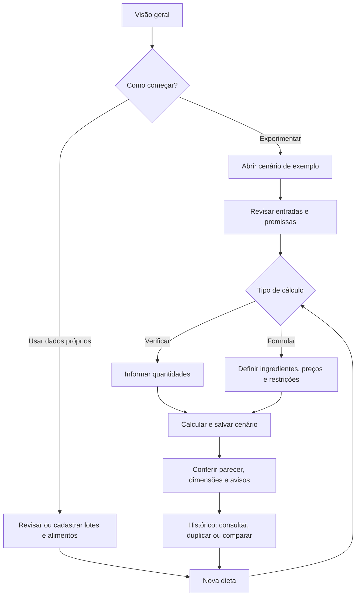

# 🐄 FeedYourCow!

Sistema especialista local para verificar e formular dietas de vacas adultas em lactação.
Oferece cadastros de lotes e alimentos, cálculos explicáveis, comparação de cenários e histórico.
A interface é em português do Brasil e funciona em localhost e sem internet após a instalação.

## Índice

- [Executar](#executar)
- [Usar a aplicação](#usar-a-aplicação)
- [Banco de dados e recuperação](#banco-de-dados-e-recuperação)
- [Distribuição de produção](#distribuição-de-produção)
- [Desenvolvimento e arquitetura](#desenvolvimento-e-arquitetura)
- [Testes e qualidade](#testes-e-qualidade)
- [Documentação](#documentação)

## Executar

Requer Rust/Cargo estáveis e compilador C/linker para as dependências. Na raiz do repositório:

```sh
cargo build --locked
cargo run -- preparar
cargo run -- servir
```

Abra [http://127.0.0.1:3000](http://127.0.0.1:3000). Para encerrar, digite Ctrl+C.
`preparar` aplica migrações e carrega o conhecimento, seis lotes de um animal e quinze alimentos
sintéticos, incluindo duas misturas. Na Visão geral, use **Abrir cenário de exemplo** para calcular
sem cadastrar ou preencher dados previamente. Os exemplos seguem o anexo A de `REQUISITOS.md`.
`demonstrar` acrescenta as fixtures históricas A/B, aviso de extrapolação e bloqueio para regressão
e inspeção.
Esses dados não representam análises ou cotações reais.

A compilação usa metadados SQLx versionados em `.sqlx/`, sem exigir um banco operacional.
O aplicativo não precisa de Node, Python ou solver externo para funcionar.

### Configuração

Configurar variáveis de ambiente é opcional. Quando uma variável não estiver exportada para
o processo, o aplicativo usa o padrão indicado abaixo. Exporte apenas as variáveis que quiser
alterar:

| Variável               | Padrão                    | Finalidade                    |
| ---------------------- | ------------------------- | ----------------------------- |
| `FEEDYOURCOW_BANCO`    | `dados/aplicacao.sqlite3` | Caminho do banco SQLite.      |
| `FEEDYOURCOW_ENDERECO` | `127.0.0.1:3000`          | Endereço e porta do servidor. |
| `RUST_LOG`             | `info`                    | Nível de logs.                |

O aplicativo não carrega arquivos `.env` automaticamente. Para usar os valores de
`.env.example` no Bash, carregue-o no shell antes de preparar e iniciar:

```sh
set -a
. ./.env.example
set +a
cargo run -- preparar
cargo run -- servir
```

O `set -a` exporta as variáveis definidas pelo arquivo para os processos iniciados
nesse mesmo terminal. Alternativamente, configure somente as variáveis desejadas:

```sh
export FEEDYOURCOW_BANCO="$HOME/feedyourcow-dados/aplicacao.sqlite3"
export FEEDYOURCOW_ENDERECO="127.0.0.1:3000"
export RUST_LOG=info
```

No pacote de produção, use `./iniciar.sh preparar` e `./iniciar.sh servir` no lugar dos
comandos `cargo run`. O servidor aceita apenas loopback; o MVP não inclui autenticação ou
acesso compartilhado.

## Usar a aplicação



### Começar pela demonstração

O menu lateral leva à **Visão geral**, aos cadastros, a **Nova dieta**, ao **Histórico e análise**,
ao **Perfil nutricional** e à **Ajuda**. Os formulários de cadastro e o atalho de nova dieta abrem
em outra guia para que seja possível voltar à tarefa em andamento.

Na **Visão geral**, clique em **Abrir cenário de exemplo**. O formulário é preenchido com o lote
de demonstração e os ingredientes sintéticos disponíveis para o exemplo (silagem, milho, soja e
mineral). Revise quantidades, preços e premissas e clique em **Calcular e salvar cenário**. Esse
atalho verifica as quantidades informadas; não as otimiza. Em **Nova dieta**, os botões
**Demonstração A** e **Demonstração B** também preenchem o formulário com duas combinações de
quantidades para comparação. Todos são cenários editáveis. Os dados são sintéticos e não
representam análises ou cotações reais.

### Preparar os cadastros

Em **Lotes de animais**, use **Cadastrar lote**, **Revisar** ou **Criar cópia**. Registre o número
de animais, o peso médio, produção e gordura do leite, dias em lactação, estado produtivo, raça e
condições fisiológicas e de manejo. Marque cada condição como sim, não ou desconhecida; não use
“não” para representar falta de informação. Separe em lotes diferentes grupos com condições
distintas. **Salvar revisão** disponibiliza os dados revisados em cálculos futuros sem alterar as
entradas já preservadas no histórico.

Em **Alimentos**, pesquise por nome e filtre por forragem, concentrado ou suplemento. Confira a
natureza dos valores e abra **Procedência e condições** para ver origem, método, data, evidências
e versão. Matéria natural (MN) inclui água; matéria seca (MS) é a parte sem água. NDT, PB, Ca, P,
FDN, amido e EE são percentuais da MS; MS é percentual da MN. “Desconhecido” não equivale a zero.
Use **Cadastrar composição**, **Criar revisão ou nova análise** ou **Criar cópia**. Registre
fonte, origem, método, data e evidências; para composição real, confira se a análise corresponde
ao produto disponível. Preço e estoque são registrados em cada cenário e não alteram a composição
do catálogo.

### Criar e calcular um cenário

Abra **Nova dieta** ou escolha **Verificar dieta**/**Formular dieta** na Visão geral. Dê um nome,
selecione o lote e escolha o tipo de cálculo. Informe horizonte, data da avaliação e data de
aplicação das regras. Em **Selecionar ingredientes**, marque as composições que entram no
cenário e atualize a seleção; a interface mostra os campos de cada ingrediente marcado. Você
pode cadastrar um alimento em outra guia e usar **Atualizar cadastros** para atualizar as opções
do formulário.

Escolha como interpretar as quantidades informadas: consumo em kg MS/animal/dia, consumo em kg
MN/animal/dia ou oferta em kg MN/animal/dia. Na verificação, preencha a quantidade para cada
ingrediente. Na formulação, essa quantidade é ignorada: o motor calcula as quantidades, então
informe os preços e as restrições que devem limitar a busca. O preço é por kg MN por padrão;
também pode ser informado por tonelada MN ou embalagem, indicando a massa da embalagem. Informe
a origem da cotação, inclusive se o preço for zero.

Em **Configurações avançadas**, indique o consumo-alvo em kg MS/animal/dia ou deixe-o vazio para
usar a estimativa de referência. Também é possível informar consumo observado: MS ofertada e MS
das sobras para o mesmo lote e período, deixando o consumo-alvo vazio. Oferta não é consumo; a
seleção de partículas pode fazer com que a composição ingerida difira da composição média. Registre
sobras planejadas e a origem das sobras e perdas; zero também é uma hipótese. Preço do leite é
opcional e serve para calcular margem sobre alimentação. A referência UE adicional para
contaminantes também é opcional e não representa legislação brasileira.

Para cada ingrediente, confira MS, preço e unidade comercial. Abra **Configurações avançadas do
ingrediente** para informar ajuste de MS usado apenas nesta simulação, perdas anteriores ao
fornecimento, inclusão mínima e máxima e resolução de oferta. Estoque bruto em kg MN fica
junto ao preço, com a opção de disponibilidade ilimitada visível. Estoque
vazio significa desconhecido; marque **Hipótese explícita: disponibilidade sem limite neste
cenário** somente quando essa for a premissa desejada. A quantidade ofertada, as perdas, as sobras,
o número de animais e o horizonte afetam o fornecimento bruto necessário.

**Verificar dieta** aceita até 20 ingredientes e avalia as quantidades fornecidas sem alterá-las.
**Formular dieta** aceita até 10 ingredientes; a busca minimiza o custo sob as restrições do perfil
e do cenário. A solução contínua pode não ser praticável após arredondamento para pesagem. O
parecer informa se o fornecimento prático foi revalidado. Busca inconclusiva ou interrompida não
prova inviabilidade. Confira também os bloqueios de elegibilidade e de ingredientes.

Clique em **Calcular e salvar cenário**. Se o formulário indicar erros, corrija os campos
destacados; os valores válidos permanecem preenchidos. A execução salva no histórico o cenário, o
parecer e as versões de conhecimento e cadastros usadas.

### Ler resultados e continuar a análise

No parecer, comece por **Resultados por dimensão** e pelos avisos. **ATENDE** aplica-se somente às
dimensões avaliadas pelo perfil. **INCONCLUSIVO**, **DESCONHECIDO**, **NÃO AVALIADO**, **FORA DO
PERFIL** e **BLOQUEADO** não são aprovação. Depois confira o balanço de NDT, PB, Ca e P; o custo;
as quantidades de consumo em MS e de oferta em MN por animal, lote e horizonte; e as restrições.
Excesso sobre um requisito mínimo não é, por si só, diagnóstico de intoxicação. Na formulação,
leia o estado de cada subproblema e confirme se o fornecimento prático é válido antes de usar as
quantidades como referência.

Abra **Cálculos e regras aplicadas** para ver o caminho de inferência, verificações, limites e
fontes. **Entradas preservadas nesta execução** e **Fontes e versões preservadas** permitem
conferir os dados efetivamente usados. **Imprimir parecer** abre a impressão do navegador, de onde
é possível imprimir ou salvar como PDF.

Em **Histórico e análise**, filtre pelo nome do lote e/ou pela data da execução e use **Ver
parecer** para abrir uma execução preservada. **Duplicar e simular** abre uma cópia editável, vinculada à
execução de origem, para testar outras quantidades ou premissas sem substituir o original. Na
seção **Comparar duas execuções**, selecione referência e alternativa e clique em **Comparar
premissas e custos**. Confira diferenças de perfil, produção, consumo, horizonte, ingredientes,
preço, perdas e estoque; a tela sinaliza quando as condições não são equivalentes ou quando a
alternativa não tem fornecimento validado.

No parecer, cálculos e regras, entradas preservadas e fontes e versões ficam em cartas
expansíveis. Ao imprimir, o conteúdo dessas cartas é mostrado mesmo quando estavam recolhidas.

Os formulários mostram todos os campos, com grupos secundários recolhidos em seções expansíveis.
Em cadastros, **Preencher com exemplo** abre uma prévia; confirme para preencher e revise os
valores antes de **Salvar revisão**. **Criar cópia** gera um cadastro independente. Exemplos podem
ser removidos das opções; a remoção exige confirmação e preserva o histórico. Para recuperá-los,
use **Restaurar exemplos** e escolha entre criar uma cópia independente ou restaurar o registro
inicial como nova revisão. A ação exige confirmação explícita. Repetir `preparar` não desfaz
alterações nem recria exemplos removidos.

Valores nutricionais, preços e condições sintéticas são hipóteses de demonstração. A procedência
acompanha cadastro e parecer; ausência de laudo continua desconhecida. Para suplemento sintético,
um máximo de inclusão sugerido no cenário é apenas um teto demonstrativo, não um rótulo comercial.
Produtos reais exigem que se informe o limite aplicável do rótulo. Consulte **Ajuda** ou **Ajuda
nesta página** para explicações contextuais; os fluxos essenciais também funcionam sem JavaScript.

Acesse **Ajuda** no menu para consultar as instruções. **Ajuda nesta página** abre a seção
correspondente em uma nova guia, mantendo a tarefa atual aberta.
Os indicadores **?** explicam conceitos na Visão geral, no cenário, no catálogo/cadastro de
alimentos e nos resultados. Cada dimensão do parecer tem uma explicação própria sobre o que
verifica e como interpretar seu estado, incluindo a diferença entre avaliação inconclusiva e
não realizada. Passe o mouse, use o foco do teclado ou toque/clique para ler;
Escape ou clique fora fecha a dica. As cartas correspondentes da Ajuda trazem mais detalhes
e exemplos de unidades, consumo, dados e interpretação do parecer.
Em **Perfil nutricional**, consulte os coeficientes, normas e fontes de referência utilizados.
Os fluxos essenciais também estão disponíveis sem JavaScript.

## Banco de dados e recuperação

O banco ativo fica fora do Git. Lotes e composições têm revisões; cada execução preserva
entradas, versões, fontes e traço em uma transação. Alterações posteriores nos cadastros
não modificam o histórico.

- `migrations/` contém mudanças de estrutura aplicadas pelo SQLx.
- `dados_referencia/` contém cargas versionadas de conhecimento e catálogo.
- `queries/` contém consultas parametrizadas em arquivos SQL, verificadas por macros SQLx.

`preparar` pode ser repetido para aplicar migrações e cargas pendentes.
Cargas têm versão e hash; reaplicações idênticas são aceitas e colisões são rejeitadas.
Para alterar conhecimento já distribuído, crie uma nova carga em vez de editar a anterior.
Uma carga administrativa local também pode ser aplicada pela CLI:

```sh
cargo run -- carregar dados_referencia/001_conhecimento.sql
```

### Backup e restauração

```sh
cargo run -- backup /tmp/feedyourcow-backup
cargo run -- restaurar /tmp/feedyourcow-backup /tmp/feedyourcow-restaurado
```

Use diretórios novos. O backup usa `VACUUM INTO`, inclui documentos locais e gera manifesto
SHA-256. A restauração verifica hashes, integridade e vínculos do SQLite antes de concluir.
Para usar o banco restaurado, configure `FEEDYOURCOW_BANCO` para o arquivo no novo diretório.

## Distribuição de produção

O build requer, além das ferramentas de compilação, `sh`, `tar`, `gzip` e `sha256sum`:

```sh
sh scripts/build_producao.sh
```

O script gera `dist/feedyourcow-<alvo>.tar.gz` e seu arquivo `.sha256`, com build
`--release --locked --no-default-features` e SQLx offline. O autoreload fica desativado.
O pacote inclui executável, inicializador, recursos estáticos, migrações, cargas e documentação;
bancos, backups e ferramentas de desenvolvimento ficam de fora.

A distribuição é nativa para o sistema e a arquitetura da máquina de build. Para Linux,
a máquina de destino precisa ter bibliotecas compatíveis, incluindo glibc quando aplicável.
Não é necessário instalar Rust/Cargo para executar o pacote.

### Instalar

Exemplo para Linux x86-64; ajuste o nome ao alvo gerado:

```sh
cd dist
sha256sum -c feedyourcow-x86_64-unknown-linux-gnu.tar.gz.sha256
mkdir instalacao
tar -xzf feedyourcow-x86_64-unknown-linux-gnu.tar.gz -C instalacao
./instalacao/feedyourcow/iniciar.sh preparar
./instalacao/feedyourcow/iniciar.sh servir
```

Acesse [http://127.0.0.1:3000](http://127.0.0.1:3000). `iniciar.sh` resolve os caminhos em relação
à instalação, mesmo chamado de outro diretório, e aceita todos os comandos administrativos.
O banco padrão fica em `feedyourcow/dados/aplicacao.sqlite3`. Para mantê-lo em outro local,
exporte um caminho absoluto antes de preparar e iniciar:

```sh
export FEEDYOURCOW_BANCO="$HOME/feedyourcow-dados/aplicacao.sqlite3"
```

### Atualizar

Encerre o servidor, faça backup com a versão anterior e extraia a nova versão em outra pasta.
Mantenha o caminho absoluto do banco, execute `iniciar.sh preparar` e depois `iniciar.sh servir`.
Preserve o backup e o pacote anterior. Para voltar a uma versão anterior, restaure seu backup
em um destino novo; não abra um banco já migrado com o executável antigo.

## Desenvolvimento e arquitetura

O monólito usa Rust, Axum com tracing, Maud, SQLite e SQLx. A interface combina renderização
no servidor, htmx v4 e hx-live locais, com CSS plano e variáveis no início do arquivo.
As versões reproduzíveis estão nos lockfiles. Código `unsafe` próprio é proibido.

| Diretório               | Responsabilidade                                                   |
| ----------------------- | ------------------------------------------------------------------ |
| `src/dominio/`          | Unidades, validações, cálculos, inferência e otimização.           |
| `src/aplicacao/`        | Serviços de cadastros, cenários, execução, histórico e comparação. |
| `src/persistencia/`     | Banco, cargas, revisões, histórico e recuperação.                  |
| `src/web/handlers/`     | Rotas por recurso e tratamento HTTP.                               |
| `src/web/entradas/`     | Conversão e validação de formulários HTTP.                         |
| `src/web/templates/`    | Layouts, páginas, formulários e componentes Maud com `Render`.     |
| `static/`               | CSS, JavaScript e dependências locais com licenças.                |
| `tests/`                | Testes Rust e testes de navegador em `javascript/e2e/`.            |
| `scripts/`              | Qualidade, conferência SQLx, distribuição e teste do pacote.       |
| `fontes/`, `hackathon/` | Fontes, pesquisa, requisitos do evento e planos.                   |

As requisições passam pelos handlers e pela conversão das entradas; os serviços coordenam
o domínio e a persistência. Templates recebem dados preparados, sem consultar o banco ou
executar regras de negócio. O servidor mantém validações, decisões e proteção de escrita
por POST, token CSRF e verificação de origem. Recursos estáticos são servidos localmente.

O motor distingue dados desconhecidos, violações e bloqueios, com conclusão por dimensão.
A formulação usa `microlp` para cinco programas lineares, um por degrau de fibra,
e revalida as candidatas. O cálculo roda em processo filho com cancelamento efetivo;
um timeout produz resultado inconclusivo. A alegação de ótimo depende da resolução de todos
os subproblemas. Quantidades arredondadas para fornecimento passam por nova validação.
Preços usam representação decimal; grandezas físicas usam `f64` e as tolerâncias dos requisitos.

Os arquivos Rust começam com docstrings de módulo que descrevem sua responsabilidade. Rotinas
com regras de cálculo, inferência, otimização, conversão de entradas e recuperação documentam
seus comportamentos e limites diretamente junto às funções.

Para recarga automática, habilite o recurso `desenvolvimento`:

```sh
cargo run --features desenvolvimento -- servir
```

Com `bacon` instalado, use `bacon` para acompanhar verificações, `bacon testar` para testes
e `bacon servir` para executar com recarga automática.

## Testes e qualidade

Na raiz do repositório:

```sh
cargo build --locked
cargo test --locked
cargo clippy --locked --all-targets --all-features -- -D warnings
cargo fmt --check
python3 scripts/qualidade.py
python3 scripts/verificar_sqlx.py
RUST_LOG=warn cargo run --quiet -- ensaiar
```

Os testes Rust cobrem cálculos, regras, otimização, persistência, contratos HTTP e recuperação.
`tests/exemplos.rs` verifica catálogo completo, receitas ponderadas, primeiro cálculo, inicialização
atômica, preservação de alterações/exclusões, restauração explícita e backup. As fixtures A/B são
selecionadas por identidade, independentemente do catálogo incluído no primeiro uso.
`qualidade.py` exige até 100 caracteres por linha nos arquivos de código e configuração, exceto
Markdown, e avisa sobre módulos acima de 300 linhas.
`verificar_sqlx.py` recria o banco de compilação e compara as consultas com o cache `.sqlx/`.
`ensaiar` usa banco isolado, cinco aquecimentos e 100 execuções por operação: a meta de p95
é até 1 segundo para verificar 20 ingredientes e 5 segundos para formular com 10 ingredientes.

### Navegadores

```sh
npm ci --ignore-scripts
npx playwright install --with-deps chromium firefox webkit
npm run test:e2e
```

Node/Playwright são ferramentas de teste. `npm test` também executa a suíte completa.
Os testes criam banco e servidor temporários, cobrem Chromium, Firefox e WebKit e produzem
capturas em `output/playwright/` para inspeção visual. Incluem formulários, erros, fragmentos
htmx, histórico, impressão, acessibilidade, layout móvel e uso sem JavaScript.
Consulte [testes JavaScript](tests/javascript/README.md) para contratos e filtros de diagnóstico.

### Pacote de produção

Com Python 3.12+ e o pacote já gerado:

```sh
python3 scripts/testar_producao.py dist/feedyourcow-x86_64-unknown-linux-gnu.tar.gz
```

Ajuste o alvo do arquivo. O teste verifica checksum, conteúdo, preparação, demonstração,
backup/restauração, motor e HTTP em instalação temporária. Para testar a interface com o
binário otimizado no checkout:

```sh
FEEDYOURCOW_BINARIO="$PWD/target/x86_64-unknown-linux-gnu/release/feed-your-cow" npm test
```

O GitHub Actions executa build, testes, clippy, formatação, qualidade textual, SQLx e desempenho
no job Rust. Um segundo job reutiliza o binário para os testes nos três navegadores e preserva
as capturas. O build do pacote de produção é executado localmente.

## Documentação

- [Diagnóstico da formulação](diagnosticos/DIAGNOSTICO_FORMULACAO.md): inspeção do fluxo de menor custo
  nos três navegadores, variações de valores, problemas reproduzidos e evidências locais.
- [Requisitos](docs/REQUISITOS.md) (versão documental 1.5): especificação funcional vigente,
  escopo, regras, limitações e casos de aceitação CT-01 a CT-35. Os requisitos definem o
  comportamento esperado; a implementação está em `src/` e a cobertura automatizada em `tests/`.
  Os testes são a evidência de conformidade. Mudanças de comportamento, regras, escopo ou aceite
  devem atualizar este documento e o README na mesma alteração.
- [Anexo nutricional](docs/tema_2_dietas_literatura_e_motor.md): tabelas, fórmulas e pesquisa.
- [Fontes preservadas](fontes/README.md) e [modelos de preenchimento](fontes/MODELOS.md):
  procedência, unidades, conversões e limitações dos dados.
- [Recursos visuais](static/README.md) e [bibliotecas locais](static/vendor/README.md):
  origens, versões e licenças.
- [Instruções de contribuição](AGENTS.md): stack, documentação, qualidade e commits.

O desenvolvimento teve auxílio de IA, com verificação por compilador e testes.
O cálculo operacional é determinístico e não utiliza modelos de linguagem.

### Preenchimento de novas dietas

As demonstrações A/B exigem confirmação antes de substituir o rascunho, inclusive sem JavaScript.
“Manter rascunho” cancela a troca. O tipo de cálculo escolhido é preservado.
Na formulação, os campos de quantidade inicial ficam ocultos; ao voltar à verificação na mesma
página, seus valores continuam disponíveis. A hipótese de disponibilidade ilimitada fica visível
junto ao estoque. A seleção oferece pesquisa, agrupamento por classe e contador do limite;
filtrar não remove ingredientes marcados. Sem JavaScript, o botão aplica a pesquisa e a seleção.

Durante uma atualização, respostas obsoletas não substituem o rascunho. Uma nova atualização
usa os valores atuais, preservando seleção, nome e preço digitados enquanto a resposta chegava.
Um clique em calcular durante essa espera é retomado após a atualização. O formulário usa
[`hx-sync`](https://four.htmx.org/reference/attributes/hx-sync) e os
[eventos htmx 4](https://four.htmx.org/reference/events) para coordenar as requisições.
O modificador [`settle:0`](https://four.htmx.org/reference/attributes/hx-swap) evita que a
restauração temporária dos atributos antigos altere valores dos controles focados na substituição.
As transições CSS dos expansíveis continuam disponíveis.

A formulação ignora quantidades iniciais no servidor. Uma pesagem parcialmente preenchida exige
os demais dados, em vez de ser descartada. A origem efetiva do consumo é derivada do alvo ou da
pesagem; comentários próprios são preservados. Textos automáticos de estimativa e taxas zero são
atualizados quando deixam de corresponder às entradas. A revalidação arredondada preserva um
parecer separado, com consumo, custo e violações, sem alterar o ótimo contínuo.
O parecer mostra o estado da busca antes dos números. Sem candidata, o diagnóstico das entradas
fica recolhido e identificado como tal. Consumo-alvo, origem efetiva e valor informado aparecem
nas premissas e nas entradas preservadas. Números e estados dos resultados usam apresentação
em português; os IDs técnicos permanecem em atributos e nos detalhes de auditoria.
Histórico, resumo inicial e comparação não apresentam o custo de uma entrada sem candidata como
custo de solução, nem calculam economia com esse valor. O histórico original permanece preservado.

Novas dietas começam com horizonte de um dia, datas civis atuais de São Paulo, consumo
estimado, quantidades em kg MS/animal/dia e hipóteses explícitas de sobras/perdas zero.
Nome, lote, ingredientes, cotação e disponibilidade exigem escolha ou informação do operador.
As opções de datas, consumo, sobras, bases, preço do leite e referência UE ficam em
“Configurações avançadas”. Os valores das demonstrações e cópias são preservados.

Em “Selecionar ingredientes”, marque as composições desejadas. O htmx atualiza o formulário
sem exigir que os demais campos estejam completos; somente os selecionados exibem editores.
Desmarcar preserva o rascunho para uma nova seleção, mas exclui o ingrediente do cálculo.
Sem JavaScript, use “Atualizar ingredientes selecionados”. As configurações avançadas ficam
expostas nessa alternativa. Preços, estoque e disponibilidade ilimitada não são presumidos.
As opções comerciais, MS, perdas, inclusão e resolução ficam no expansível de cada ingrediente.

A seleção usa o evento `change` do [htmx 4](https://four.htmx.org/reference/attributes/hx-trigger)
e a rota existente de atualização, com validação e persistência somente ao calcular.

O seletor de ingredientes usa o mesmo componente expansível dos demais dropdowns, com
transições de abertura/fechamento, teclado, estado preservado após htmx e respeito à preferência
de movimento reduzido. Sem JavaScript e na impressão, seu conteúdo fica disponível.

## Notas

O perfil `E2020_NRC1989_RUMEN_MVP_v1` avalia nutrientes e restrições específicas; não implementa
integralmente NASEM/BR-LEITE. Atendimento químico não significa adequação nutricional integral:
dimensões sem dados suficientes, como fibra física e micronutrientes, permanecem identificadas.
O perfil aceita PV de 300 a 800 kg. As tabelas de referência cobrem apenas 400–700 kg para
exigências e 400–600 kg para consumo; nas extensões, o sistema usa extrapolação linear e exibe
um aviso de menor precisão. O consumo-alvo é opcional e, quando informado, tem precedência.

### Precisão e recomendação de pesagem

Na verificação e na formulação, resolução zero mantém quantidades aproximadas. Para recomendar pesagem,
informe resolução positiva para cada ingrediente usado; ingredientes zerados não exigem resolução.
A aprovação prática depende da revalidação, sem modificar o ótimo contínuo ou suas tolerâncias.
O histórico distingue busca e fornecimento; a comparação considera a validade prática da alternativa.
Valores muito pequenos do balanço usam notação científica quando necessário para explicar violações.

A comparação exibe inclusão mínima/máxima, teto do suplemento, resolução e diagnóstico prático,
além do custo contínuo. Pendências da busca identificam ingrediente e campo a revisar; causas de
inviabilidade só são atribuídas quando demonstradas por um limite superior matemático.
O relatório mostra os valores de FDN, FDN de forragem, amido e EE com a linha efetiva e seus limites.
Em banco recém-preparado, o formulário oferece **Cenário de exemplo** com confirmação do rascunho.
Os atalhos históricos A/B só aparecem quando seus cadastros estão disponíveis.

**Imprimir ficha de fornecimento** gera uma versão operacional curta, com a condição de uso e as
quantidades diárias. A ficha sem resolução ou com restrições traz a recusa de recomendação.
**Imprimir parecer** continua incluindo a auditoria completa. No celular, o fornecimento aparece
por ingrediente, com a pesagem prática antes das aproximações contínuas e unidades por dia.


### Correções do diagnóstico de dietas — 22/10/2026

Duplicar uma simulação de MS preserva as quantidades já convertidas e usa a MS da cópia como
referência de uma nova alteração. A conversão não é reaplicada contra a composição do catálogo.
A referência acompanha o rascunho, inclusive após atualizar ingredientes ou corrigir erros.

Verificar avalia as quantidades informadas; o alvo opcional não impõe igualdade nesse modo.
O parecer identifica consumo estimado de nutrientes, piso global de FDN de forragem e linha
selecionada. Termos de ótimo e solução contínua ficam restritos à formulação. A auditoria prioriza
violações e pendências e inclui ingrediente ou comparação no título de cada regra.

A pesagem exige resolução positiva para todos os ingredientes utilizados, também na verificação.
Sem resolução, o atendimento químico continua visível, mas não há recomendação de pesagem.
Dados ausentes, entrada inválida e violações comprovadas têm resumos distintos, com os motivos.
Números práticos removem resíduos binários sem arredondar na precisão das tabelas de apresentação.
Históricos preservam suas entradas e resultados; o estado operacional é apresentado pela regra
atual de resolução, inclusive para execuções antigas sem precisão de pesagem.

As regressões estão em `tests/diagnostico_dietas.rs` e na suíte Playwright `verificacao-desktop`.
Para repetir somente o diagnóstico em Chromium desktop (1440 × 1000), com banco temporário:

```sh
cargo build --locked
FEEDYOURCOW_NAVEGADORES=chromium FEEDYOURCOW_SUITES=verificacao-desktop npm run test:e2e
```

As capturas ficam em `output/playwright/chromium-verificacao-*.png`.
A suíte cobre cópia com MS alterada, unidades, sobras, alvo, amido, estoque desconhecido/insuficiente,
MS zero, sensibilidade a preço, inviabilidade e recusa de arredondamento incompatível.
