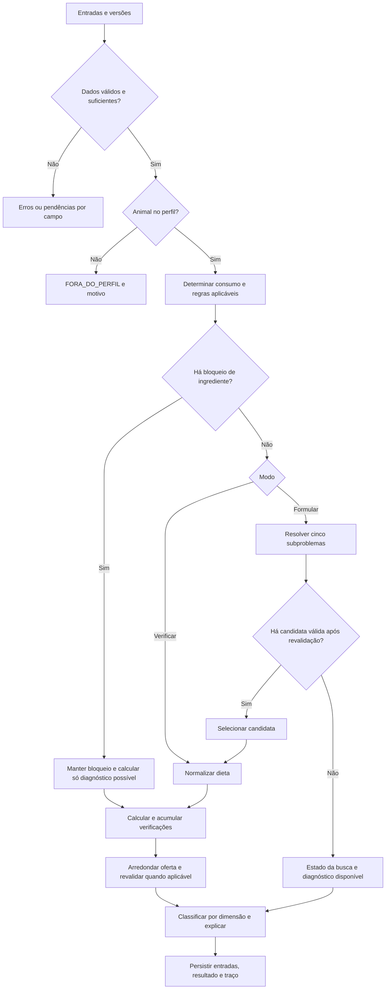

# Requisitos do FeedYourCow: dietas para bovinos leiteiros

**Tema 2 · Hackathon UFJF/RERUM 2026 · Versão documental 1.4 · 21/10/2026**

Este documento especifica o comportamento do FeedYourCow. A implementação está em `src/`;
`README.md` reúne operação, arquitetura, decisões e a cobertura dos testes com sua verificação.
FeedYourCow é o nome do software especialista; a interface usa o tema verde-esmeralda.
As descrições abaixo continuam sendo critérios de aceitação, sem substituir a evidência dos testes.

## 1. Objetivo e referências

O sistema deverá responder a duas perguntas: uma dieta informada atende às restrições do perfil
nutricional escolhido? Quais quantidades dos ingredientes disponíveis atendem a esse perfil pelo
menor custo, dentro das condições do cenário?

O resultado deverá ser explicável: apresentar entradas, cálculos, restrições, fontes, limitações e
caminho de inferência. O sistema apoiará a comparação de cenários, sem prever automaticamente
aumento de leite, resposta clínica ou adequação nutricional integral.

Referências integrantes desta especificação:

- [Instruções do repositório](AGENTS.md): stack, qualidade, testes, documentação e commits.
- [Relatório específico do tema 2](hackathon/TEMA_2_DIETAS_LITERATURA_E_MOTOR.md): literatura,
  normas, tabelas A/B/C, fórmulas F01–F15 e exemplos numéricos.
- [Relatório dos temas e arquitetura](hackathon/RELATORIO_TEMAS_E_ARQUITETURA.md): leitura do
  desafio, componentes do sistema especialista e arquitetura sugerida.
- [Regulamento](hackathon/Hackathon2026.pdf) e
  [apresentação](<hackathon/Apresentação Hackathon2026.pdf>): requisitos do evento.

Para o produto, este documento consolida as escolhas do tema 2 e substitui alternativas genéricas
do relatório inicial, como a base principal em JSON e a formulação inicial somente por grade.
As tabelas e equações do relatório específico são o anexo numérico desta versão. Divergências
devem ser resolvidas e documentadas antes de alterar um perfil, sem escolha silenciosa no código.
As instruções vigentes do usuário e do repositório continuam aplicáveis.

### 1.1. Convenções

- **P0:** obrigatório para considerar o MVP concluído.
- **P1:** evolução posterior; sua ausência não impede a entrega do MVP.
- **RF:** requisito funcional; **RNF:** requisito não funcional; **RN:** regra de negócio.
- **FL:** fluxo de uso; **CT:** caso de aceitação a automatizar na implementação.
- “Deverá” estabelece obrigação. Uma hipótese deverá ser identificada como hipótese.
- IDs de requisitos e regras serão estáveis; alterações materiais exigirão revisão documental.

Salvo indicação P1, todos os requisitos deste documento são P0. Não será necessária consulta
prévia aprofundada a especialistas para desenvolver o MVP definido pela pesquisa. A aprovação de
um cenário significará atendimento ao perfil implementado, com as dimensões avaliadas identificadas.

## 2. Escopo e usuários

### 2.1. Escopo do MVP

O produto será uma aplicação web local para um operador que cadastra lotes, consulta alimentos,
informa custos e disponibilidade, verifica dietas, solicita formulações e consulta o histórico.
O mesmo operador poderá executar comandos locais documentados de instalação, carga e backup.
Após a preparação inicial, uma pessoa sem cadastros prévios deverá poder executar e alterar uma
simulação com lotes, alimentos e cenário de exemplo já disponíveis, sem pré-configuração de campos.
O catálogo inicial obrigatório está no anexo A; os exemplos serão identificados como sintéticos.
Não haverá exigência inicial de usuários, permissões ou colaboração simultânea entre fazendas.

A interface será uma ferramenta de trabalho para quem já adquiriu o software e precisa calcular
a dieta dos animais, como o responsável por uma fazenda. Deverá priorizar acesso às operações,
dados e resultados, sem apresentação comercial ou promoção do nome FeedYourCow.

O núcleo será identificado como **E2020_NRC1989_RUMEN_MVP_v1**:

- Exigências de NDT, PB, Ca e P da Tabela A do relatório específico, transcritas da Embrapa.
- Estimativa de consumo pela Tabela B, quando aplicável.
- Barreiras de FDN total, FDN de forragem, amido e EE da Tabela C e das políticas explícitas.
- Verificação de ingredientes, limites de inclusão, rótulos, disponibilidade e regras aplicáveis.
- Formulação de menor custo por programação linear para cinco subproblemas de fibra.
- Custos por animal/lote, quantidades de fornecimento e comparação entre cenários.
- Persistência local, histórico imutável de execuções e explicação das conclusões.

O perfil contém coeficientes históricos NRC 1989 e barreiras adicionais identificadas; não será
apresentado como implementação integral da NASEM 2021 ou do BR-LEITE 2024.

### 2.2. População atendida

Admitir vacas adultas em lactação, confinadas, com dieta total quantificável, peso estável, sem
gestação nem exigência adicional de crescimento ou mobilização/reposição de reservas.

Os limites serão inclusivos: PV de 400 a 700 kg; gordura do leite de 3 a 5%; LCG4 de 5 a
30 kg/animal/dia; dias em lactação de 60 a 250. A faixa de dias é política de escopo do MVP.
A estimativa pela Tabela B cobrirá somente PV de 400 a 600 kg. Acima de 600 até 700 kg,
exigir consumo-alvo positivo informado explicitamente e com origem registrada.

Necessidade conhecida de correção por ambiente ou atividade produzirá FORA_DO_PERFIL.
Quando essa necessidade não tiver sido avaliada, registrar a hipótese de ausência de correção,
sem apresentá-la como observação confirmada.

### 2.3. Fora do MVP

- Dietas para bezerros, recria, engorda, vacas secas, transição, gestação e pastejo.
- Ajustes de crescimento, reservas corporais, atividade ou estresse térmico.
- Modelos completos de energia líquida, proteína metabolizável e aminoácidos.
- Formulação automática com fontes adicionadas de NNP, subprodutos animais ou medicamentos.
- Diagnóstico de acidose, prescrição clínica e previsão de produção.
- Integrações obrigatórias com APIs, sensores, nuvem ou modelos de linguagem.
- Editor de expressões/regras arbitrárias na interface, interpretação de PDFs durante o cálculo
  e atualização automática de normas pela internet.

Como P1, poderão ser adicionados perfis completos NASEM/BR-LEITE, avaliação física contextual,
diagnóstico quantitativo de ureia, intervalos de composição e exportações CSV/JSON.
As fórmulas de evolução da seção 10 do relatório não poderão classificar o núcleo por padrão.

## 3. Dados, unidades e estados

### 3.1. Dados do lote

O cadastro deverá conter identificação, número de animais, raça/grupo genético, idade, peso médio,
estado produtivo, destinação econômica e produção de leite. Registrar também dias em lactação,
gordura do leite, classe adulta, crescimento, gestação, estabilidade de peso e manejo.

Ordem de parto, dispersão de peso, condição corporal, acesso à água e necessidade de correções
deverão admitir registro complementar. Um dado desconhecido deverá ser explicitamente marcado.
Raça desconhecida não autoriza inventar fator racial; idade isolada não determina gestação ou
estado produtivo. O enquadramento exigirá informações suficientes sobre os estados fisiológicos.
Cadastros de exemplo poderão conter perfis sintéticos completos, com condições fisiológicas e de
manejo assumidas explicitamente. Os seis lotes iniciais terão um animal e atenderão à seção 2.2,
sem exigir consumo-alvo adicional por peso superior a 600 kg. Hipóteses não serão medições reais.

O número de animais será inteiro positivo. Peso e consumo serão positivos. Produção será
expressa em kg/animal/dia. A ausência de gestação/crescimento deverá ser afirmada, não deduzida
de um campo vazio. Grupos heterogêneos deverão poder ser separados em lotes distintos.

### 3.2. Dados dos ingredientes

Separar identidade do alimento, versão de composição e lote físico do produto. Registrar:

- Nome canônico, origem, processamento e classificação como forragem, concentrado ou suplemento.
- MS em matéria natural; NDT, PB, Ca, P, FDN, amido e EE em base de MS.
- Fonte, edição, página/tabela, método, data e natureza: análise, média tabelada ou dado sintético.
- Origem animal e presença de NNP intencionalmente adicionado, com estados explícitos.
- Produto/fornecedor/lote quando aplicáveis; evidência de autorização e condições de uso.
- Limites de inclusão, base da dose, rótulo e restrições por espécie/categoria.
- Preço, moeda, unidade comercial, data e origem da cotação.
- Estoque bruto em MN, perda anterior ao fornecimento e horizonte do cenário.
- Contaminantes, analito, matriz, unidade, umidade, método, laudo e qualificador, se disponíveis.
- Dados de peNDF, peneira e método, se disponíveis; não são obrigatórios para o núcleo químico.

Teor de MS deverá estar em (0, 1]. Frações de PB, Ca, P, FDN, amido e EE do núcleo sem NNP
deverão estar em [0, 1]. NDT deverá ser não negativo e ter definição compatível com o perfil;
não será convertido em energia líquida por uma equivalência presumida.

Garantia mínima, garantia máxima, média tabelada e análise pontual serão naturezas diferentes.
Uma média identificada poderá alimentar um cenário pontual; garantias unilaterais não deverão ser
tratadas como composição exata. Incompatibilidades impedirão as conclusões que dependam do dado.

Os exemplos poderão combinar referências técnicas, sites especializados, blogs e outras fontes
com arredondamentos e aproximações documentadas, sem validação bibliográfica exaustiva. Seus
cadastros finais serão de natureza SINTETICA, com fontes e hipóteses identificadas por campo ou
por conjunto explícito de campos. Todos os campos obrigatórios e os opcionais relevantes do
anexo A deverão estar preenchidos. Unidades, consistência e validações permanecerão obrigatórias.
Essa flexibilidade não altera equações, limites do perfil, políticas ou regras do motor.

### 3.3. Convenções canônicas

Internamente, utilizar kg, dia, animal, kg MS/kg MN, kg nutriente/kg MS e R$/kg MN.
Percentuais deverão ser convertidos em frações nas multiplicações; a gordura do leite na fórmula
de LCG4 será expressa em pontos percentuais, por exemplo 4, e não 0,04.

Registrar valor/unidade originais e normalizados. Quantidades por lote, por animal, de consumo
e de oferta serão campos semanticamente distintos. Litros de leite exigirão densidade informada
ou conversão documentada; não adotar silenciosamente 1 L = 1 kg.
Preços e estoques serão não negativos; densidade e massa de embalagem serão positivas.
O horizonte será um número inteiro positivo de dias.

O cenário terá data de avaliação, data pretendida de aplicação das regras, horizonte em dias,
perfil e versão, origem do consumo-alvo, taxa de sobras, perdas e precisão de fornecimento.
Datas regulatórias serão avaliadas como datas civis no contexto Brasil. Instantes de execução
serão armazenados em UTC e apresentados em America/Sao_Paulo.

### 3.4. Estados de resultado

Uma verificação retornará ATENDE, VIOLA, DESCONHECIDO ou NAO_APLICAVEL.
Uma dimensão será resumida como ATENDE, NAO_ATENDE, INCONCLUSIVO ou NAO_AVALIADO.

Manter e apresentar separadamente:

1. Integridade dos dados e elegibilidade.
2. Atendimento químico a NDT, PB, Ca e P.
3. Barreiras de FDN, amido e EE.
4. Segurança/autorização dos ingredientes e contaminantes.
5. Fibra física, micronutrientes e demais avaliações fora do núcleo.
6. Estado da formulação e alcance da alegação de custo mínimo.

INVALIDO, FORA_DO_PERFIL e BLOQUEADO serão condições explícitas, não sinônimos de déficit.
Um bloqueio impedirá a recomendação automática, ainda que um diagnóstico parcial seja calculável.
Não haverá uma conclusão global denominada “dieta segura”.

## 4. Requisitos funcionais

### RF-01 — Inicialização e base disponível

A aplicação deverá abrir em localhost, verificar a estrutura do banco e disponibilizar o perfil
ativo, o catálogo e os cenários salvos. Uma base ausente/incompatível deverá gerar orientação
de preparação; a aplicação não deverá inventar tabelas nutricionais para continuar.

**Aceite:** uma instalação limpa poderá ser preparada e iniciada seguindo apenas a documentação,
sem acesso à internet durante o uso. A preparação do primeiro banco disponibilizará automaticamente
os cadastros e o cenário de exemplo, sem importação ou ativação adicional pela interface.
Inicializar novamente não duplicará registros nem recriará exemplos removidos. Falha na carga
não deixará o catálogo inicial parcialmente aplicado nem marcado como concluído.

### RF-02 — Cadastro e revisão de lotes

Permitir criar, consultar e editar os lotes com os campos da seção 3.1. Alterações deverão gerar
nova revisão para uso em novos cenários, preservando as entradas de execuções anteriores.
Permitir criar cópia e remover/desativar lotes, inclusive os exemplos, com identidade própria nas
cópias e preservação das revisões referenciadas no histórico.

**Aceite:** alterar o peso atual de um lote não modificará o peso de uma execução histórica.

### RF-03 — Catálogo de alimentos e composições

Permitir pesquisar alimentos, consultar composição/procedência e cadastrar nova análise ou revisão.
Um preço local não deverá modificar a composição científica. Registros referenciados no histórico
deverão ser desativados ou revisados, em vez de apagados fisicamente.
Exemplos terão as mesmas operações dos cadastros manuais, incluindo criar cópia e remover/desativar.
A cópia terá identidade própria, preservará a procedência e não alterará o alimento de origem.

**Aceite:** duas análises de silagem poderão coexistir, e a execução identificará qual utilizou.

### RF-04 — Custos, disponibilidade e inclusão

Permitir informar preços, unidade comercial, estoque, perdas, inclusão mínima/máxima e limites
de rótulo para cada ingrediente do cenário. Disponibilidade sem limite deverá ser uma hipótese
explícita; estoque desconhecido não será convertido em disponibilidade infinita.

**Aceite:** o fornecimento do lote no horizonte deverá respeitar estoque, perdas e sobras.

### RF-05 — Seleção de perfil e consulta do conhecimento

Exibir identificador, versão, população coberta, fontes, coeficientes e políticas do perfil.
A interface deverá distinguir BR_LEGAL, REFERENCIA_ESTRANGEIRA, TECNICA e POLITICA_MVP.
A ativação de referência estrangeira adicional deverá ser explícita e preservada no cenário.

**Aceite:** um teto operacional de amido não aparecerá como limite da legislação brasileira.

### RF-06 — Construção de cenários

Permitir escolher verificar ou formular, lote/revisão, data, horizonte, alimentos e premissas.
Cada execução deverá congelar os valores utilizados, mesmo quando derivados do cadastro.

**Aceite:** as taxas zero de perda/sobra deverão estar registradas como hipóteses explícitas,
quando adotadas; ausência de medição não deverá aparecer como consumo observado.

### RF-07 — Validação e enquadramento

Validar campos, unidades, consistência, cobertura e dependências antes da recomendação.
Mostrar erros junto aos campos e preservar os valores válidos já digitados. A validação do
servidor será obrigatória mesmo quando houver validação no navegador.

**Aceite:** PV 650 kg sem consumo-alvo produzirá pendência de consumo; PV 700,01 kg produzirá
FORA_DO_PERFIL. Dados contraditórios deverão ser resolvidos pelo operador.

### RF-08 — Determinação de consumo

Calcular LCG4 e consumo de referência pela Tabela B, com interpolação sem extrapolação.
Permitir consumo-alvo informado/observado e pesagens de oferta/sobras, com origens distintas.
Exibir aviso de discrepância entre a MS da dieta e a referência conforme RN-07.

**Aceite:** o caso PV 450 kg e LCG4 12,5 kg/dia produzirá 12,7125 kg MS/animal/dia.

### RF-09 — Verificação de dieta informada

Receber quantidades por ingrediente, com unidade e significado de oferta/consumo declarados.
Calcular MS, nutrientes, requisitos, balanços, cobertura, fibra, amido, EE, custo e restrições.
Quando só houver oferta, identificar a hipótese de ingestão ou solicitar dados de sobras;
não apresentar ingestão estimada como medida.

**Aceite:** avaliar todos os grupos aplicáveis, acumulando violações e pendências independentes.
PeNDF ausente não impedirá o cálculo químico, mas continuará NAO_AVALIADO.

### RF-10 — Formulação de menor custo

Formular com variáveis em kg MS/animal/dia, consumo-alvo fixo, coeficientes congelados e restrições
das seções 6 e 7 do relatório específico. Resolver os cinco subproblemas da Tabela C, revalidar
as soluções e selecionar a candidata admissível de menor custo.

**Aceite:** o resultado identificará método, versões, restrições, estados dos subproblemas e
alcance da otimização. Se houver interrupção, não alegará inviabilidade ou ótimo global.

### RF-11 — Fornecimento e arredondamento

Apresentar quantidades de consumo e oferta em MN/MS por animal, lote/dia e horizonte.
Permitir definir resolução de fornecimento por ingrediente e revalidar a dieta arredondada.
Preservar separadamente solução contínua e quantidades práticas.

**Aceite:** uma quantidade arredondada que viole inclusão, nutriente ou estoque não será exibida
como recomendação válida. O estado da solução contínua poderá continuar visível.

### RF-12 — Comparação econômica

Comparar custo de oferta por animal/lote, economia absoluta e, quando calculável, relativa.
Com preço do leite, calcular margem sobre alimentação; com produção positiva, custo por kg de leite.
Identificar os demais custos da fazenda como não incluídos.

**Aceite:** mudar sobras ou perdas alterará o custo coerentemente; reduzir custo não produzirá
previsão automática de aumento de produção.

### RF-13 — Parecer e explicação

Exibir valores de entrada e derivados, regra/versão, condição, limite, unidade/base, fonte,
resultado e diferença calculada. Permitir responder por que uma pergunta é necessária e como
uma conclusão foi obtida, incluindo dependências e nós percorridos.

**Aceite:** uma violação de amido de 26,7778% frente a 25% explicará a diferença em pontos
percentuais e sua natureza de política do MVP.

### RF-14 — Histórico, revisão e reprodução

Listar e abrir execuções anteriores, suas entradas, resultados e explicações. Uma edição deverá
criar execução nova, sem sobrescrever a anterior. Permitir reproduzir uma execução com seus dados
e versões originais, em instalação com artefatos compatíveis preservados.

**Aceite:** alterar catálogo ou preços atuais não alterará o resultado histórico nem sua fonte.

### RF-15 — Simulação de mudanças

Permitir duplicar um cenário e alterar preço, MS, disponibilidade ou outro dado sem modificar
o original. Indicar diferenças de premissas antes de apresentar economia entre cenários.

**Aceite:** variar MS com MN fixa deverá mudar nutrientes; variar MS com consumo de MS fixo
deverá mudar a MN necessária e o custo. A interface indicará a hipótese selecionada.

### RF-16 — Carga versionada de conhecimento

Disponibilizar comando local documentado para validar e carregar os arquivos SQL de referência.
Rejeitar IDs duplicados, fontes ausentes, unidades incompatíveis, parâmetros inválidos e referências
quebradas. Registrar versão, hash, data e conteúdo preservável; aplicar a carga em transação.

**Aceite:** reaplicar a mesma versão não duplicará registros; conteúdo diferente com o mesmo
identificador de versão será rejeitado. Falha não deixará uma base parcialmente ativada.
O catálogo original de exemplos terá versão própria. Sua atualização não sobrescreverá registros
editados, não duplicará os existentes nem restaurará exclusões automaticamente. Novos exemplos
ficarão disponíveis para inclusão explícita em bancos já inicializados. A carga de conhecimento
não será confundida com a recriação dos cadastros de uso do operador.

### RF-17 — Backup e restauração

Disponibilizar procedimento documentado e verificável de backup consistente do SQLite e dos
artefatos de fontes necessários. Restaurar deverá preservar histórico, versões e vínculos.
Uma restauração não deverá sobrescrever silenciosamente um banco existente.

**Aceite:** restaurar em diretório de teste e reproduzir um caso salvo com o mesmo resultado.

### RF-18 — Demonstração e entrega

Fornecer cenários de demonstração identificados como sintéticos, incluindo as dietas A/B e os
quatro ingredientes da seção 9.1 do relatório. Exibir catálogo, formulário, comparação e parecer.
Permitir impressão pelo navegador com identificação da execução e das premissas.
Disponibilizar os seis lotes e quinze alimentos do anexo A e pelo menos um cenário inicial completo,
com lote, ingredientes, quantidades, preços, datas, horizonte e premissas preenchidos. Poderá ser
aproveitado um cenário A/B existente, desde que executável sem cadastro prévio. Preços e demais
condições fictícias serão hipóteses de demonstração. Os casos A/B e seus valores de regressão
serão preservados independentemente das novas composições aproximadas do catálogo inicial.

**Aceite:** demonstrar uma violação, uma candidata que atende ao núcleo, uma pendência e o efeito
da mudança de preço/MS, sem consultas externas ou resultados preparados fora do motor.

### RF-19 — Cadastros de exemplo e reutilização de registros

Criação, revisão e duplicação de cenários deverão abrir em nova guia, sem menu principal.
Após salvar lote/alimento, mostrar confirmação. O cenário de origem deverá atualizar as opções
quando o usuário retornar, preservando o preenchimento; oferecer atualização manual equivalente.

Lotes e alimentos de exemplo estarão cadastrados e selecionáveis desde o primeiro uso.
O usuário poderá criar um cadastro em branco, consultar a prévia e usar “Preencher com exemplo”,
ou usar “Criar cópia” em um cadastro existente. Cópias receberão identidade própria. Exemplos
permitirão as mesmas operações de edição, revisão e remoção/desativação dos cadastros manuais.

O catálogo original permanecerá imutável por versão, separado dos registros editáveis de uso.
Registrar identificação e versão de origem, contexto, fontes, hipóteses, valores originais,
unidades/conversões e valores utilizados, com alterações por campo. Os exemplos serão carregados
por SQL versionado e consultados no SQLite, sem internet durante o uso.

A inicialização ocorrerá uma única vez por banco. Reinícios e atualizações não sobrescreverão
personalizações nem recriarão exclusões. “Restaurar exemplos” permitirá selecionar os registros
a recuperar, preservando dados existentes; conflitos exigirão escolha explícita entre criar cópia
ou revisar o registro selecionado. Restauração não apagará histórico nem alterará execuções.

Exemplos poderão conter condições fisiológicas, de manejo e de uso assumidas para demonstração.
Essas hipóteses alimentarão o cenário sintético sem serem apresentadas como observações, laudos
ou comprovações sobre animais e produtos reais. Campos ausentes permanecerão desconhecidos.
Copiar ou editar não removerá automaticamente a identificação sintética nem a procedência.

Os formulários deverão apresentar todos os campos, sem alternância de modo de preenchimento.
Asteriscos, mensagens acima dos controles e validação do navegador complementarão a validação
obrigatória no servidor. Expansões respeitarão teclado, foco, movimento reduzido, impressão e
alternativa sem JavaScript. Recursos visuais serão locais.

**Aceite:** selecionar silagem já cadastrada deverá dispensar preenchimento prévio. Criar cópia,
editar PB e salvar preservará o registro de origem e registrará a alteração e a procedência.
Aplicar exemplo sobre formulário preenchido exigirá confirmação quando houver perda de alterações;
a substituição limpará os campos anteriores ausentes no novo exemplo, sem herança silenciosa.
Esses fluxos deverão funcionar sem JavaScript e preservar os valores após erro de validação.

## 5. Fluxos de uso

### FL-01 — Preparar a instalação

1. Configurar diretório do banco, endereço local e parâmetros documentados.
2. Aplicar migrações SQLx e validar/carregar uma versão da base de referência.
3. Disponibilizar automaticamente o catálogo e o cenário iniciais, identificados como sintéticos,
   na primeira preparação do banco; registrar a conclusão da carga em transação.
   Em banco já inicializado, preservar alterações, exclusões e registros manuais.
4. Iniciar a aplicação e conferir a versão ativa na interface.
5. Se a preparação falhar, apresentar o erro sem ativar uma base parcial.

### FL-02 — Verificar uma dieta

1. Selecionar um lote existente, inclusive de exemplo, ou cadastrar um novo, em branco ou por cópia.
   Dados do lote selecionado já estarão preenchidos; permitir revisar suas hipóteses e valores.
2. Selecionar perfil, datas, consumo e premissas de sobras/perdas.
3. Selecionar ingredientes e versões já disponíveis ou cadastrar novos, em branco ou por cópia;
   informar quantidades, preços e restrições, ou aproveitar o cenário completo de demonstração.
4. Validar unidades, elegibilidade e segurança; solicitar os dados pendentes.
5. Normalizar, calcular e avaliar todas as regras aplicáveis.
6. Apresentar dimensões, pendências, balanços, custos e explicações.
7. Salvar entradas, versões, resultados e traço em uma transação.

Se houver erro impeditivo, preservar o formulário para correção. Se houver ingrediente bloqueado,
permitir somente diagnóstico claramente identificado quando os dados necessários forem válidos.

### FL-03 — Formular uma candidata

1. Executar a coleta/enquadramento do FL-02, sem exigir dieta inicial nem novo cadastro quando
   forem utilizados lotes e alimentos já disponíveis, inclusive os exemplos.
2. Fixar consumo-alvo, horizonte, preços, composição e restrições do cenário.
3. Excluir da seleção automática ingredientes vedados ou fora do catálogo do MVP.
4. Resolver os cinco subproblemas lineares e registrar seus estados.
5. Revalidar candidatas, selecionar por custo e desempate, converter para oferta e arredondar.
6. Revalidar as quantidades práticas; apresentar a candidata com alcance e limitações.
7. Salvar a execução e o diagnóstico, inclusive quando não houver recomendação válida.

Se um ingrediente excluído tiver inclusão mínima positiva, informar o conflito; não apagar a
exigência do usuário silenciosamente. Uma busca sem solução seguirá os estados de RN-19.

### FL-04 — Comparar alterações

1. Abrir execução e criar novo cenário a partir de suas entradas.
2. Alterar dados, declarando o que permanece fixo.
3. Reexecutar a inferência desde os fatos originais.
4. Comparar premissas, atendimento e custos; manter ambos os resultados.

Uma comparação econômica direta deverá destacar mudanças de produção, consumo, perfil, horizonte
ou critérios de segurança. Não rotular uma dieta inviável mais barata como alternativa equivalente.

### FL-05 — Atualizar o conhecimento

1. Revisar a fonte, a população, a unidade, a vigência e os testes afetados.
2. Criar nova versão dos arquivos de referência e, se necessário, da lógica Rust.
3. Executar validações e casos de regressão antes de ativar a versão.
4. Carregar e ativar em transação; manter os dados antigos disponíveis para o histórico.
5. Recalcular somente em nova execução, mediante ação explícita.

Publicação de norma não deverá ser confundida com início de vigência. A aplicação não precisará
consultar os sites oficiais durante uma execução.

### FL-06 — Consultar, imprimir e recuperar histórico

1. Localizar uma execução pelo lote/data e abrir o parecer preservado.
2. Consultar premissas, fontes, cálculos e regras.
3. Imprimir o parecer ou iniciar reprodução com os mesmos artefatos.
4. Para recuperação de dados, restaurar backup em destino controlado e verificar sua integridade.

### FL-07 — Experimentar e reutilizar exemplos

1. Abrir a aplicação preparada e identificar os cadastros incluídos no sistema.
2. Abrir o cenário inicial completo e executar o cálculo sem cadastrar lote ou alimento.
3. Duplicar o cenário, alterar um valor e executar novamente para comparar os resultados.
4. Opcionalmente criar cadastro em branco, preencher com exemplo ou copiar registro existente.
5. Editar, salvar ou remover/desativar exemplos sem alterar catálogo original ou histórico.
6. Para recuperar exemplos, selecionar explicitamente os desejados e resolver eventuais conflitos.

### 5.1. Fluxo lógico do motor



Pendências que não afetem um cálculo independente não deverão impedir seu diagnóstico parcial.
O diagrama não permite que um resultado nutricional posterior remova um bloqueio anterior.

## 6. Regras de negócio e cálculos

### RN-01 — Aplicabilidade do perfil

Aplicar integralmente o recorte da seção 2.2. Fora dele, não extrapolar nem substituir animal
gestante ou em crescimento por animal de mantença. Raça será característica registrada, sem
multiplicador inventado. A média de um lote heterogêneo não validará todas as suas categorias.

### RN-02 — Dados desconhecidos e inválidos

Campo vazio não será zero, falso ou ausência de risco. Distinguir desconhecido, não medido,
não detectado, abaixo de LOQ, zero e não aplicável. Rejeitar números negativos indevidos,
não finitos, MS zero, unidades incompatíveis e divisões por zero.
Valores assumidos explicitamente em exemplos sintéticos são entradas conhecidas sob hipótese,
diferentes de campos ausentes. A hipótese e sua origem acompanharão cálculo, parecer e histórico.
Ausência de laudo não será convertida em ausência de contaminante; hipótese de uso não será
apresentada como comprovação de autorização de produto real.

Uma condição desconhecida não disparará uma regra como verdadeira; sua negação permanecerá
desconhecida. Na conjunção, uma condição falsa bastará para o resultado falso; sem falsas,
alguma desconhecida tornará o resultado desconhecido. Na disjunção, uma verdadeira bastará;
sem verdadeiras, alguma desconhecida manterá o resultado desconhecido.
Se uma dimensão tiver violação e pendência, mostrar ambas, com resumo NAO_ATENDE.
Sem violação, informação obrigatória desconhecida produzirá INCONCLUSIVO.

### RN-03 — Base e conversões

Converter preço por tonelada dividindo por 1.000; preço por embalagem exigirá massa e base.
Usar 1 kg = 1.000 g e distinguir percentual de fração. Não somar nutrientes em bases diferentes.
Garantir semântica de oferta/consumo em todos os campos e não misturar R$/L com R$/kg.

### RN-04 — MS, nutrientes e custo básico

Se q for kg MN, s a fração de MS, x kg MS, a a fração de nutriente na MS e p o preço R$/kg MN:

```text
x_i = q_i * s_i
D = soma(x_i)
A_j = soma(x_i * a_ij)
C_j_percentual_MS = 100 * A_j / D
custo_base = soma(x_i * p_i / s_i)
```

As concentrações exigirão D > 0. PB não será substituto de proteína metabolizável; NDT não será
somado a energia líquida. A implementação deverá seguir F01/F02 do relatório.

### RN-05 — Exigências nutricionais

Usar todos os coeficientes e nós da Tabela A, sem alterar unidades ou arredondar a origem.
Interpolar linearmente mantença por PV e exigência por kg de leite pela gordura:

```text
requisito_j = mantenca_j(PV) + producao_kg_dia * coeficiente_leite_j(gordura)
```

Usar produção real, não LCG4, nessa expressão. Avaliar NDT, PB, Ca e P separadamente.
O perfil não conterá exigência quantitativa completa de outros nutrientes.

### RN-06 — Interpolação e LCG4

Usar LCG4 = PL * (0,4 + 0,15 * G), com G em pontos percentuais.
Interpolar somente entre nós existentes, usando valor exato nos nós e reduzindo dimensões
nas bordas. Não dividir por intervalo de comprimento zero nem extrapolar tabelas.
Consumo pela Tabela B usará interpolação bilinear por PV e LCG4.

### RN-07 — Escolha de consumo

Na formulação, adotar consumo-alvo igual à referência, salvo escolha explícita de valor informado
ou observado. A verificação calculará a MS da dieta e a comparará à referência disponível.
Diferença relativa absoluta superior a 10% gerará aviso operacional configurável, sem concluir
incapacidade fisiológica de consumo. Exatamente 10% não acionará esse aviso.

Consumo observado por lote será (MS ofertada - MS das sobras)/n. Exigir bases, período e animais
compatíveis; sobras não poderão superar a oferta. Seleção de partículas impedirá inferir
composição ingerida apenas por taxa uniforme de sobras.

### RN-08 — Balanços

Para cada nutriente, calcular balanço = oferta - requisito; déficit = max(0, requisito - oferta);
excesso = max(0, oferta - requisito); cobertura = 100 * oferta/requisito, se requisito > 0.
Excesso acima de um mínimo não significará intoxicação. Um teto exigirá regra própria.

### RN-09 — Fibra, amido e EE

Calcular FDN total e FDN de forragem em % da MS da dieta. A segunda usará somente a FDN dos
ingredientes classificados como forragem, sem confundi-la com % da FDN total ou % de volumoso.
Amido não será estimado como diferença entre PB e FDN.

Selecionar a maior linha cujo limiar de FDN de forragem seja menor ou igual ao valor da dieta:

| Limiar de FDN de forragem, % MS | FDN total mínima, % MS | Amido máximo, % MS |
| ------------------------------: | ---------------------: | -----------------: |
|                              19 |                     25 |                 30 |
|                              18 |                     27 |                 28 |
|                              17 |                     29 |                 26 |
|                              16 |                     31 |                 24 |
|                              15 |                     33 |                 22 |

Abaixo de 15%, a dieta violará o perfil. Sobre a linha selecionada, aplicar FDN mínima =
max(mínimo da linha, 30%); amido máximo = min(máximo da linha, 25%); EE máximo = 6% MS.
Os valores 30%, 25% e 6% serão identificados como POLITICA_MVP, não como lei.

### RN-10 — Fibra física e dimensões não modeladas

PeNDF ausente/incompatível permanecerá NAO_AVALIADO. Não converter automaticamente peneiras
de 1,18 mm e 8 mm, nem equiparar peNDF a paNDF. Não inventar fator físico.
Vitaminas, microminerais, aminoácidos e água não terão aprovação quantitativa no núcleo.
Um resultado químico positivo não apagará essas ausências.

### RN-11 — Segurança dos ingredientes

Proibição brasileira aplicável bloqueará a recomendação, após considerar espécie, finalidade,
vigência e exceções. Identidade/origem/autorização obrigatória desconhecida gerará pendência
e impedirá recomendação final, sem impedir cálculos independentes claramente identificados.

A classificação de segurança será independente da atratividade nutricional e econômica.
Não usar diluição para autorizar ingrediente vedado.

### RN-12 — Políticas de exclusão do MVP

Excluir da formulação automática fontes intencionalmente adicionadas de NNP, incluindo ureia
e amireia, subprodutos animais fora do catálogo inicial e medicamentos.
Não interpretar a política como proibição de todo NNP natural dos vegetais.

Uma exceção legal para derivado animal poderá afastar o bloqueio legal sem afastar a exclusão
por política do MVP. O parecer deverá identificar qual fundamento motivou cada decisão.
Diagnóstico quantitativo contextual de ureia será P1 e não autorizará inclusão automática.

### RN-13 — Normas e versões temporais

Regra normativa terá ID, natureza, jurisdição, ato/dispositivo, versão, publicação, início/fim
de vigência, transição, população, matriz/ingrediente, condições, exceções, evidência e ação.
Avaliar a data de aplicação do cenário; se a condição de transição for desconhecida, não presumir
isenção. Uma execução histórica usará a versão normativa preservada.

O contexto padrão será Brasil. UE/FDA serão referências adicionais explicitamente ativadas.
Não reativar a Portaria 7/1988 como teto brasileiro atual; não aplicar limites de pet food
a bovinos nem limites de AFM1 em leite diretamente como limites de AFB1 em ração.
Os atos/exceções/transições da seção 4 do relatório deverão integrar os testes aplicáveis.

### RN-14 — Contaminantes e laudos

Comparar somente analito, matriz, unidade e base de umidade compatíveis. Para concentração
em MN, usar C_MS = C_MN/s; para base com 12% de umidade, C_12 = 0,88 * C_MS.
Calcular mistura por contribuição em MS sem ignorar restrições próprias de cada ingrediente.

Ausência de laudo não valerá zero. Com resultado abaixo de LOQ, manter qualificador e limite;
se o perfil permitir avaliação conservadora, usar LOQ como limite superior identificado.
Limite inferior ao LOQ sem evidência suficiente não permitirá declarar atendimento.
AFB1, soma de aflatoxinas e AFM1 serão analitos distintos.

### RN-15 — Sobras, perdas e fornecimento

Exigir 0 <= r < 1 para sobra planejada em fração da MS ofertada e 0 <= l_i < 1 para perda
de estoque. Sob hipótese explícita de mistura homogênea:

```text
oferta_MN_i = x_i / (s_i * (1 - r))
custo_oferta = soma(x_i * p_i / (s_i * (1 - l_i))) / (1 - r)
necessidade_bruta_MN_i = horizonte * numero_animais * x_i / (s_i * (1 - r) * (1 - l_i))
```

Não cobrar a mesma perda duas vezes. Considerar eventual aproveitamento econômico de sobras
somente em cenário separado. Sem dados de sobras, não afirmar ingestão observada.

### RN-16 — Inclusão e estoque

Respeitar mínimo/máximo por ingrediente na base declarada, convertendo para a unidade do modelo.
Em MN bruta, necessidade no horizonte não poderá superar estoque disponível.
Para suplemento concentrado, limite de rótulo ausente não será substituído por inclusão de 100%.
Em cenário com composição SINTETICA, admitir o máximo de inclusão informado explicitamente como
hipótese de teto demonstrativo, identificado no parecer; nunca como rótulo comercial. Sem esse
máximo nem rótulo, a pendência permanece. Essa hipótese não se aplica a produtos de natureza real.
Exigir mínimo <= máximo; para frações da MS, exigir 0 <= mínimo <= máximo <= 1.

Para alimento comum sem restrição específica, o intervalo matemático poderá ser de zero ao
consumo-alvo, identificado como ausência de restrição adicional e não como garantia fisiológica.
Mínimo positivo significará inclusão obrigatória; mínimo zero permitirá ausência.
Executar um cenário não dará baixa no estoque nem efetuará compras. A disponibilidade cadastrada
só mudará por atualização explícita; cálculos de necessidade serão planejamento.

### RN-17 — Problema de formulação

Minimizar custo de oferta de RN-15, com x_i >= 0 e soma(x_i) = consumo-alvo.
Impor mínimos NDT/PB/Ca/P, barreiras RN-09, limites RN-16, regras legais e rótulos aplicáveis.
Não variar consumo, composição ou coeficientes dentro do mesmo problema linear.

Resolver um subproblema por linha de fibra, impondo o respectivo mínimo de FDN de forragem,
FDN total e teto de amido, mais as políticas ativas. A união dos cinco subproblemas cobrirá o
perfil em degraus. Recalcular a linha efetiva e revalidar cada candidata antes de selecioná-la.
Não relaxar automaticamente regra nutricional, legal ou sanitária para produzir uma solução.

### RN-18 — Seleção e desempate

Entre candidatas retornadas e validadas, preferir menor custo não arredondado; em empate segundo
a precisão declarada, menor número de ingredientes com quantidade positiva; depois ordem
lexicográfica do vetor de quantidades, ordenado por identificador canônico do ingrediente.

O desempate não provará número mínimo global de ingredientes entre todas as soluções ótimas.
Ordenação, tolerância de positividade e configuração do método serão fixas e registradas.
Quantidades numericamente próximas de zero só poderão ser zeradas com revalidação integral.

### RN-19 — Estado da busca

Exibir um destes estados, com justificativa e estado de cada subproblema:

- **OTIMO_NO_MODELO:** cada um dos cinco subproblemas comprovadamente ótimo ou inviável,
  com ao menos uma solução ótima válida e comparação concluída.
- **VIAVEL_SEM_OTIMO:** candidata válida, sem prova de menor custo em todo o modelo.
- **INVIAVEL_NO_MODELO:** inviabilidade comprovada em todos os subproblemas aplicáveis.
- **INCONCLUSIVA:** interrupção, tempo/limite numérico, falta de dados ou erro do método.

Uma candidata válida poderá coexistir com busca inconclusiva em outro subproblema; nesse caso,
não receberá certificado de ótimo global. Falha numérica não equivalerá a inviabilidade.
Grade enumerativa poderá servir de oráculo de teste; não substituirá silenciosamente a
formulação contínua exigida. Uma futura busca em grade deverá declarar seu alcance limitado.

### RN-20 — Quantidades práticas

Arredondar somente após obter a candidata contínua e registrar resolução por ingrediente.
Recalcular consumo, nutrientes, linha de fibra, limites, oferta, custo e estoque.
Se houver violação, sinalizar FORNECIMENTO_INCOMPATIVEL e impedir recomendação prática.
Não conservar a alegação de ótimo global para o problema arredondado sem prova específica.

### RN-21 — Economia

Usar custo da oferta, incluindo perdas/sobras do cenário. Escalar por n animais e horizonte.
Calcular custo por kg de leite somente com PL > 0; percentual de economia somente com custo
de referência > 0; margem somente com receita informada em base compatível.

Preço zero será permitido quando explicitamente justificado. Valores ausentes não serão zero.
Comparar atendimento antes de sugerir substituição econômica. Margem sobre alimentação não
será denominada lucro total da atividade.

### RN-22 — Inferência e explicação

Separar coleta/enquadramento, cálculo, inferência, otimização e apresentação.
Usar encadeamento para frente até não surgirem fatos novos ou atingir limite documentado.
Avaliar regras em ordem estável de prioridade/ID; fatos derivados deverão manter dependências.
Acumular conclusões independentes, impedir ciclos/disparos redundantes e reconstruir os fatos
derivados após mudanças. Interrupção do motor não produzirá parecer completo.

Cada conclusão conterá entrada, cálculo/comparação, limite, unidade/base, regra, fonte e versão.
Não produzir percentuais de certeza sem método validado nem usar LLM como especialista operacional.
Manter os IDs de produção aplicáveis da seção 8.6 do relatório específico, como DAT-01 e RUM-02.
Os IDs RN deste documento agrupam obrigações e não substituem os identificadores das regras.

### RN-23 — Versões e histórico

Uma execução usará um conjunto congelado de perfil, regras, composições, preços e entradas.
Novas versões não sobrescreverão dados publicados utilizados em execuções.
Preservar conteúdo ou artefato imutável recuperável, além de hash; hash sozinho não reconstruirá
a base. Registrar também versão da aplicação/método e parâmetros relevantes.
Preservar a versão original dos exemplos e sua relação com registros editados ou copiados,
incluindo hipóteses, alterações e exclusões/desativações. Atualizar ou restaurar exemplos não
alterará execuções anteriores nem substituirá silenciosamente as entradas de cenários salvos.

### RN-24 — Precisão

Calcular grandezas físicas sem arredondamento de apresentação intermediário.
Adotar tolerâncias explícitas por unidade canônica: 1e-8 kg absoluta, 1e-8 ponto percentual
para percentuais e 1e-8 relativa. Usar 1e-8 kg para positividade de ingredientes e
1e-8 R$/animal/dia absoluta para desempate econômico, sem arredondar o custo para centavos.
Critério de proximidade: diferença absoluta <= tolerância absoluta + relativa * maior módulo.

Limites sanitários não poderão ser flexibilizados por tolerância numérica. A incerteza de laudo
seguirá a política metrológica identificada, não a tolerância do solver.
Preços terão representação decimal/escala explícita; totais monetários apresentados serão
arredondados para centavos somente ao final, com política de arredondamento documentada.

## 7. Persistência e arquivos versionados

### 7.1. Armazenamento

O banco de uso será um arquivo SQLite local no computador do servidor Axum. O caminho será
configurável; sugestão padrão: dados/aplicacao.sqlite3. Não colocar o banco ativo no Git.
Registrar uma única base local inicialmente, com separação lógica das entidades.

Entidades mínimas:

- Lotes e suas revisões.
- Alimentos, lotes físicos, composições e respectivos atributos/métodos.
- Preços, estoques e limites usados no cenário.
- Fontes bibliográficas/normativas e artefatos associados.
- Perfis, coeficientes, regras e versões publicadas.
- Cenários, entradas tipadas, execuções, verificações e traço de inferência.
- Controle das cargas aplicadas e da inicialização dos exemplos por banco.
- Catálogo original versionado de exemplos, vínculos com cópias/revisões e identificação sintética.
- Estado das exclusões/desativações necessário para impedir recriação automática dos exemplos.

Relações deverão ter integridade referencial. Valores relevantes não serão guardados somente
como texto livre. Conteúdos congelados poderão usar representação serializada validada, sem
substituir os campos relacionais necessários à integridade e à consulta.

### 7.2. Migrações e dados de referência

- **migrations/**: migrações SQLx de estrutura, índices e dados indispensáveis ao esquema.
- **dados_referencia/**: cargas SQL versionadas de fontes, perfis, coeficientes e catálogo.
- **queries/**: consultas SQL em pastas por recurso, usadas por macros SQLx; sem alterar
  a separação entre migrações de estrutura e cargas de conhecimento.
- **.sqlx/**: metadados versionados quando adotada compilação offline.
- **fontes/**: documentos locais permitidos para distribuição, ou manifesto de URL/hash/edição.
- **dados/**: banco de uso e arquivos operacionais locais, excluídos do Git.

Migração e carga terão responsabilidades distintas. Atualização de tabela nutricional normalmente
será nova carga versionada, não alteração de uma migração já aplicada. Uma correção estrutural
exigirá migração nova. A carga terá ordem explícita e não dependerá de execução SQL manual oculta.
O catálogo inicial do anexo A terá carga própria versionada, distinta das fixtures A/B e dos
coeficientes do motor. Sua aplicação inicial e o marcador de conclusão serão atômicos.
A atualização do catálogo original e a restauração de registros terão os comportamentos de RF-19.

Regras/formulações serão código Rust tipado; seus metadados e parâmetros estarão no banco,
originados dos arquivos versionados. Não armazenar código executável arbitrário no SQLite.
Não haverá duas fontes concorrentes de parâmetros, uma em JSON e outra no banco.

Documentos originais poderão ficar em disco com referência/hash no banco. Se não puderem ser
redistribuídos, preservar metadados e trechos/dados permitidos suficientes à explicação.
O funcionamento da demonstração não dependerá de baixar um PDF.

### 7.3. Consistência e recuperação

Salvar execução, entradas congeladas, verificações e traço em uma transação. Falha não deverá
deixar um parecer marcado como concluído sem seu histórico.
Atualização de perfil durante um cálculo não poderá alterar as versões já selecionadas.

Backups deverão contemplar banco e artefatos não reconstruíveis. Usar método consistente do SQLite;
não depender de cópia descoordenada do arquivo enquanto houver gravações.
O procedimento de recuperação deverá ser exercitado em teste, preservando o banco original.
Backup e restauração preservarão catálogo original, versões, procedência, hipóteses, alterações,
exclusões e marcador de inicialização. Reabrir banco restaurado não repovoará exemplos removidos.

## 8. Requisitos não funcionais

### RNF-01 — Arquitetura e linguagem

Implementar monólito modular em Rust, separando domínio, aplicação, persistência e web.
Handlers HTTP serão agrupados conforme os recursos das rotas. Orquestração e regras de negócio
ficarão na aplicação/domínio, sem dependência de tipos HTTP ou templates de apresentação.
Usar tipos para unidades/estados e aproveitar verificações do compilador.
Priorizar bibliotecas Rust nativas; não exigir runtime Python/Node ou solver externo no uso.
Ferramentas externas de desenvolvimento/teste poderão ser utilizadas.

### RNF-02 — Interface e reatividade

Usar Axum com tracing e renderização no servidor com Maud. Componentes serão structs que
implementam maud::Render e geram maud::Markup, separados por responsabilidade.
O módulo `web::templates` terá pastas próprias de layouts, páginas, formulários e componentes.
Templates receberão parâmetros preparados, sem consultas ao banco ou execução de negócios.
A leitura de formulários HTTP ficará em `web::entradas`, separada dos formulários visuais.
Usar htmx v4 e hx-live com cópias locais minificadas, versões/origens/licenças registradas.
Validação e decisão permanecerão no servidor.

A rota `/ajuda` deverá ensinar cada funcionalidade em cartas expansíveis controladas por hx-live.
Todas as páginas deverão apresentar um botão de ajuda com link para a seção correspondente.
O fragmento da URL deverá abrir a carta indicada; teclado e atributos acessíveis deverão refletir
seu estado. O conteúdo deverá continuar disponível sem JavaScript.
A ajuda explicará seleção, edição, cópia, preenchimento e restauração dos cadastros de exemplo,
incluindo identificação sintética e efeito das hipóteses nas conclusões.

### RNF-03 — Estilo e acessibilidade

Usar um arquivo CSS plano, com variáveis no início. Interface em português do Brasil,
com rótulos, unidades visíveis, mensagens por campo e navegação por teclado.
Não depender somente de cor para indicar estado. Resultados parciais deverão ser compreensíveis.
Substituições de HTML deverão preservar foco e contexto de uso.
Registros iniciais terão identificação textual discreta “Incluído no sistema” e indicação de
exemplo sintético acessível nos detalhes. A identificação não dependerá apenas de cor.

Na Visão geral, indicadores de interrogação junto a perfil, cenários e às três estatísticas
explicarão seus conceitos. Deverão abrir por hover, foco, clique ou toque, fechar com Escape ou
clique fora e permanecer dentro da tela. A ativação por clique funcionará sem JavaScript.
A carta de ajuda inicial detalhará os conceitos com exemplos, incluindo a contagem de animais,
a distinção entre cenário e execução e os cinco registros da tabela de últimos cenários.
O resumo conterá apenas lotes, animais e composições; não exibirá total de execuções recentes.
O botão “Ajuda nesta página” abrirá a seção correspondente em nova guia, preservando a página
original, inclusive sem JavaScript.
Os mesmos indicadores serão aplicados ao cenário (MS/MN, consumo/oferta, sobras/perdas,
estoque, horizonte, inclusão e arredondamento), ao catálogo/cadastro de alimentos (composição,
análise, revisão, procedência e nutrientes) e ao resultado (estados, núcleo químico, balanço,
fornecimento prático e ótimo no modelo). Usar IDs únicos por campo/composição, manter a associação
dos rótulos e reativar as dicas após substituições de formulário via htmx. As cartas de ajuda
correspondentes explicarão esses conceitos com exemplos. O círculo terá 24 px e o símbolo 11 px.

### RNF-04 — Banco e consultas

Usar SQLite e SQLx com sistema próprio de migrações. Consultas ficarão em arquivos SQL separados
e usarão macros com validação de compilação, incluindo query_file! ou equivalente aplicável.
Documentar preparação do banco de compilação ou uso do cache offline verificado.

### RNF-05 — Operação local

Executar integralmente em localhost sem CDN, API externa ou acesso à internet para inferência.
Vincular o servidor ao loopback por padrão. Configuração de rede compartilhada/autenticação
será P1 e exigirá revisão do escopo de segurança.

### RNF-06 — Determinismo e auditabilidade

Mesmas entradas e artefatos compatíveis deverão reproduzir conclusões, ordenação de regras e
resultados dentro das tolerâncias declaradas. Registrar configuração do solver e versões.
Não depender da ordem incidental das linhas do banco nem de aleatoriedade não controlada.

### RNF-07 — Segurança e integridade

Parametrizar consultas, validar entradas no servidor, escapar texto livre e impedir execução
de expressões/caminhos arbitrários fornecidos por formulários. Ações mutáveis não usarão GET
e deverão validar origem/token apropriado contra requisições não autorizadas pelo navegador.
Não incluir segredos, banco ativo ou backups no repositório.

### RNF-08 — Desempenho e limites

Na demonstração, verificar dietas de até 20 ingredientes e formular com até 10 selecionados.
Em ambiente de referência documentado, buscar resposta de verificação em até 1 segundo e de
formulação em até 5 segundos, em 95 de 100 execuções após aquecimento.
Medir os tempos no servidor, incluindo cálculo e persistência, sem downloads externos.

Limitar uma formulação a 10 segundos, com cancelamento efetivo do trabalho e estado INCONCLUSIVA.
Limites poderão ser configurados e deverão aparecer na execução. O cálculo não deverá bloquear
o executor assíncrono a ponto de impedir outras requisições locais.
Esses números são metas de engenharia do MVP, não limites científicos.

### RNF-09 — Erros e observabilidade

Registrar eventos estruturados com ID de execução, duração, método e falhas relevantes.
Não expor detalhes internos ou dados pessoais desnecessários na interface/logs.
Falha no banco, no motor ou no solver deverá ser distinguível de uma dieta incompatível.
Não perder dados válidos do formulário após erro recuperável.

### RNF-10 — Testes

Cobrir fórmulas e regras com testes unitários; persistência/cargas/fluxos com testes de integração;
e fluxos de interface com Playwright em Chromium, WebKit e Firefox.
Os testes Rust ficarão em `tests/*.rs`; os contratos JavaScript/htmx e fluxos de navegador
ficarão em `tests/javascript/e2e/`, com comando próprio e job de CI separado.
Verificar as requisições reais do htmx, além do resultado visual, incluindo cabeçalhos,
CSRF, campos, substituição de fragmentos, redirecionamento e preservação após falhas.
Executar inspeção visual de formulário, erro, resultado, histórico e impressão.
Novas funcionalidades deverão chegar com testes; os CT da seção 9 serão a base mínima.

### RNF-11 — Qualidade e CI

Configurar GitHub Actions para build, testes, clippy e formatação Rust.
Verificar linhas de até 100 caracteres em arquivos textuais próprios, incluindo Maud e Markdown.
Excluir binários e dependências vendorizadas desses limites; emitir aviso para arquivos de código
acima de 300 linhas e dividir responsabilidades quando necessário.
Build e macros SQLx deverão passar em instalação limpa; não aceitar consultas sem verificação.

### RNF-12 — Documentação e manutenção

Documentar execução, configuração, estrutura, fluxos, banco, migrações, cargas, backup, testes,
regras de produção e uso da IA no processo. Incluir docstrings em comportamentos não intuitivos.
Manter documentação e requisitos atualizados; registrar alterações em commits curtos em português.
Conferir documentação oficial atual das bibliotecas ao implementar e fixar versões reproduzíveis.

### RNF-13 — Desenvolvimento

Configurar autoreload com tower-livereload e acompanhamento com bacon para desenvolvimento.
Separar esses recursos da execução de entrega. Iterar com compilador, testes e clippy até passar.
Não introduzir frameworks/dependências quando o stack já oferecer solução adequada.

### RNF-14 — Interface de trabalho e linguagem objetiva

Apresentar FeedYourCow como nome do software especialista, sem slogans ou chamadas de marketing.
Usar títulos que identifiquem a tarefa ou o conteúdo, como “Catálogo de alimentos”, “Novo cenário”,
“Histórico de cenários” e “Perfil nutricional e fontes”. Remover frases de efeito como “Nutrição
com clareza”, “Conhecimento que você pode consultar” e “Uma memória para cada decisão”.

A tela inicial deverá dar acesso direto a verificar e formular dietas, cadastros e execuções
recentes. Não usar banner promocional, ilustração de campanha ou etapas de apresentação comercial.
Manter o tema verde-esmeralda com hierarquia visual simples, títulos legíveis e ações descritivas.

Textos auxiliares deverão explicar unidades, preenchimento, hipóteses, erros ou interpretação
dos resultados. Eliminar subtítulos redundantes e benefícios genéricos. Preservar as informações
técnicas e limitações necessárias para usar e avaliar os cálculos.
Na interface, usar “cadastros de exemplo”, “Preencher com exemplo”, “Criar cópia” e “Restaurar
exemplos”. Não exigir familiaridade com “template” ou “preset”. Essa terminologia não altera as
referências técnicas a templates Maud. Organizar alimentos por classe e permitir pesquisa,
com acesso inicial destacado a Girolando 5/8, silagem de milho, milho, soja e mistura mineral.

**Aceite:** nas telas de início, cadastros, cenário, resultado, comparação, histórico e fontes,
o título identificará o conteúdo ou a tarefa; menu e rodapé não conterão slogans. O operador
encontrará as ações de cálculo na tela inicial sem passar por uma apresentação do produto.

## 9. Casos de aceitação e rastreabilidade

Os valores abaixo serão calculados pelo sistema em testes; não deverão ser respostas fixas na UI.
As composições sintéticas das dietas A/B estão na seção 9.1 do anexo numérico.
Os números resumidos abaixo são referências arredondadas para leitura, não fixtures com precisão
integral. As asserções internas usarão resultados não arredondados derivados dessas entradas,
com as tolerâncias de RN-24. Na interface, os totais monetários serão apresentados em centavos.

### 9.1. Dados, cálculo e regras

- **CT-01 — Conversão:** 20 kg MN com 35% MS e 8% PB/MS deverão fornecer 7 kg MS e 0,56 kg PB.
  Cobertura: RF-07, RF-09; RN-03, RN-04.
- **CT-02 — Requisitos:** PV 400 kg, PL 10 kg/dia, G 4%, DEL 150 deverão produzir LCG4 10,
  consumo 10,8 kg MS/dia e requisitos NDT 6,350; PB 1,218; Ca 0,04810; P 0,03100 kg/dia.
  Cobertura: RF-08, RF-09; RN-05, RN-06.
- **CT-03 — Interpolação:** PV 425 kg/G 3,75% deverão produzir mantença NDT 3,275 e coeficiente
  de produção 0,3115; PV 450/LCG4 12,5 deverão produzir consumo 12,7125 kg MS/dia.
  Cobertura: RF-08; RN-05, RN-06.
- **CT-04 — Bordas:** testar todos os nós e intervalos; PV 700 com consumo informado poderá
  atender ao enquadramento; 700,01 não. PV 650 sem consumo não usará extrapolação.
  Testar discrepância de consumo exatamente igual a 10% e superior, com aviso só na segunda.
  Cobertura: RF-07, RF-08; RN-01, RN-06, RN-07.
- **CT-05 — Campos:** testar zero/negativo/NaN/infinito, unidade ausente, MS zero, gestação
  desconhecida e contradição de categoria. Não transformar ausência em falso ou zero.
  Cobertura: RF-02, RF-07; RN-01, RN-02.
- **CT-06 — Dieta A:** calcular amido 26,7778% MS, rejeitar teto operacional de 25% e explicar
  sua origem. Acumular um déficit de PB independente quando inserido no cenário.
  Cobertura: RF-09, RF-13; RN-08, RN-09, RN-22.
- **CT-07 — Dieta B:** obter NDT 7,052; PB 1,464; Ca 0,06964; P 0,04684 kg/dia;
  FDN 40,7778%; FDN de forragem 37,9630%; amido 22,3333%; EE 2,8704% MS.
  Atender ao núcleo químico sem aprovar peNDF/micronutrientes não avaliados.
  Cobertura: RF-09, RF-13; RN-04, RN-08, RN-09, RN-10.
- **CT-08 — Degraus:** exercitar cada limiar de FDN de forragem e valores imediatamente
  inferiores/superiores. Aplicar linha 18 em 18,7%; abaixo de 15% violar o perfil.
  Cobertura: RF-09, RF-10; RN-09, RN-17.
- **CT-09 — Política e norma:** diferenciar ingrediente legalmente vedado, derivado animal
  legalmente excepcionado mas excluído do MVP, e origem/autorização desconhecida.
  Nenhum resultado nutricional deverá remover o impedimento.
  Cobertura: RF-05, RF-07, RF-13; RN-11, RN-12.
- **CT-10 — Vigência:** testar antes/no início/após vigência e transição, condições
  desconhecidas e referência UE desativada/ativada. Não usar ato revogado como vigente.
  Cobertura: RF-05, RF-16; RN-13.
- **CT-11 — Contaminantes:** 10 µg/kg MN com 35% MS deverão resultar em 28,5714 µg/kg MS
  e 25,1429 µg/kg na base 12% de umidade. Testar analito errado, laudo ausente e <LOQ.
  Cobertura: RF-07, RF-09; RN-02, RN-14.
- **CT-12 — Física:** método ausente ou peneiras incompatíveis não deverão gerar peNDF
  inventada ou aprovação física. O cálculo químico independente deverá permanecer disponível.
  Cobertura: RF-03, RF-09; RN-10.

### 9.2. Formulação e economia

- **CT-13 — Oráculo:** comparar solução linear de instância pequena com ótimo conhecido
  e candidatos enumerados. Exercitar os cinco subproblemas e revalidação da linha efetiva.
  Cobertura: RF-10; RN-17, RN-18.
- **CT-14 — Término:** simular ótimo, viável sem certificado, inviável comprovado,
  interrupção e falha numérica. Não transformar grade vazia ou timeout em prova de inviabilidade.
  Cobertura: RF-10; RN-19; RNF-08.
- **CT-15 — Restrições:** testar inclusão mínima obrigatória, ingrediente excluído, teto
  de rótulo, estoque insuficiente e perdas. Não relaxar automaticamente limites.
  Cobertura: RF-04, RF-10; RN-11, RN-12, RN-16, RN-17.
- **CT-16 — Desempate:** permutar ordem de cadastro/consulta e obter a mesma seleção com
  os critérios definidos; testar quantidade próxima de zero e custo empatado.
  Cobertura: RF-10; RN-18, RN-24; RNF-06.
- **CT-17 — Arredondamento:** fornecer resolução que torne uma solução contínua inválida;
  manter o resultado contínuo identificado e bloquear a recomendação prática incompatível.
  Cobertura: RF-11; RN-20.
- **CT-18 — Custo:** dieta B sem perdas/sobras deverá custar R$ 11,792177 por animal/dia;
  dieta A, R$ 12,555164; diferença, R$ 0,762987. Com 10% de sobra planejada,
  dieta B deverá custar R$ 13,102419, antes do arredondamento monetário de apresentação.
  Cobertura: RF-11, RF-12; RN-15, RN-21, RN-24.
- **CT-19 — Lote:** escalar n animais por h dias; impedir fornecimento acima do estoque
  bruto após considerar perda e sobra uma única vez. Separar MN, MS e custo total.
  Cobertura: RF-04, RF-11; RN-15, RN-16.
- **CT-20 — Comparação:** mudar preço e MS em cenários duplicados; preservar o original,
  mostrar diferenças de hipóteses e respeitar a base fixa escolhida.
  Cobertura: RF-06, RF-12, RF-15; RN-03, RN-21.

### 9.3. Persistência, qualidade e interface

- **CT-21 — Histórico:** editar lote/composição, atualizar perfil e reabrir execução antiga;
  valores, fontes e parecer anteriores deverão permanecer idênticos.
  Cobertura: RF-02, RF-03, RF-14; RN-23.
- **CT-22 — Reexecução:** corrigir resposta e reconstruir fatos, sem manter conclusão antiga;
  reproduzir execução com artefatos originais e obter mesmo resultado e traço.
  Cobertura: RF-13, RF-14; RN-22, RN-23; RNF-06.
- **CT-23 — Carga:** aplicar migrações/carga em banco vazio, reaplicar sem duplicar e rejeitar
  fonte ausente, versão colidente e unidade inválida sem ativação parcial. Conferir seis lotes e
  quinze alimentos iniciais, marcador atômico e ausência de duplicação após reinício ou falha.
  Cobertura: RF-01, RF-05, RF-16; RNF-04.
- **CT-24 — Transação:** injetar falha ao salvar resultado/traço e comprovar que não existe
  execução concluída parcialmente gravada. Validar integridade referencial.
  Cobertura: RF-14; RN-23; RNF-04, RNF-09.
- **CT-25 — Recuperação:** criar backup consistente, restaurar em destino de teste e reproduzir
  um caso; verificar fontes e impedir sobrescrita acidental do banco original. Preservar catálogo,
  hipóteses, personalizações, exclusões e inicialização; reabrir sem recriar exemplos removidos.
  Cobertura: RF-17; RN-23.
- **CT-26 — Navegadores:** executar FL-02, FL-03, FL-04 e FL-06 em Chromium, WebKit e Firefox,
  incluindo erro de campo, atualização de fragmento, foco, histórico e impressão.
  Cobertura: RF-02 a RF-15, RF-18; RNF-02, RNF-03, RNF-10.
- **CT-27 — Localhost e proteção:** usar a aplicação com rede externa indisponível, verificar
  recursos locais, validação do servidor, escape de texto e recusa de escrita indevida.
  Cobertura: RF-01, RF-07, RF-18; RNF-05, RNF-07.
- **CT-28 — Entrega técnica:** executar build, testes, clippy, formatação, limite de linhas e
  ensaio de desempenho no ambiente documentado; iniciar entrega sem recursos de autoreload.
  Cobertura: RNF-01, RNF-04, RNF-08, RNF-11, RNF-12, RNF-13.
- **CT-29 — Interface objetiva:** conferir títulos funcionais, acesso direto a verificar/formular,
  ausência de slogans/banners e preservação de unidades, hipóteses, erros e limitações nas telas.
  Validar a navegação e o layout em Chromium, WebKit e Firefox.
  Cobertura: RF-06, RF-07, RF-13; RNF-03, RNF-10, RNF-14.

- **CT-30 — Ajuda contextual:** conferir as instruções de todas as tarefas, cartas expansíveis
  via hx-live, navegação por fragmentos, links em cada página, teclado e layout móvel nos três
  navegadores. Cobertura: RNF-02, RNF-03, RNF-10, RNF-12.

- **CT-31 — Cadastros de exemplo:** conferir catálogo, fontes, hipóteses, conversões e valores
  completos; original imutável por versão e registros editáveis. Verificar cópia independente,
  prévia, preenchimento, substituição confirmada sem herança de campos e preservação após erro.
  Validar criação/revisão, visibilidade dos campos, atualização entre guias e ausência de JavaScript
  em Chromium, Firefox e WebKit. Cobertura: RF-19; RN-02/03/23; RNF-02/03/10/12.

- **CT-32 — Contratos JavaScript e htmx:** validar método, URL, cabeçalhos, CSRF e campos;
  bloquear POST inválido; trocar somente o fragmento e reativar comportamentos/foco;
  seguir `HX-Redirect`; atualizar cadastros entre guias sem acionamento manual;
  preservar o rascunho e permitir nova tentativa após 403, 500 e falha de rede.
  Cobrir condições de consumo, ingredientes, embalagens e laudos nos três navegadores.
  Cobertura: RF-06, RF-07, RF-19; RNF-02, RNF-03, RNF-07, RNF-09, RNF-10.

- **CT-33 — Ciclo de vida dos exemplos:** editar/remover exemplos, reiniciar e atualizar catálogo;
  preservar personalizações, não duplicar ou recriar exclusões, não alterar cadastros manuais nem
  execuções. Restaurar somente os selecionados, resolvendo conflitos explicitamente e preservando
  o original versionado. Cobertura: RF-01/02/03/16/17/19; RN-23; RNF-04/06/10.

- **CT-34 — Primeiro uso:** executar FL-07 em banco recém-preparado, sem cadastro nem configuração
  de campos; calcular o cenário completo, alterar um valor em cópia e comparar as execuções.
  Conferir identificação sintética e hipóteses no parecer; não exigir importação ou internet.
  Cobertura: RF-01/06/13/15/18/19; RNF-02/03/05/10/14.

- **CT-35 — Catálogo e misturas:** validar todos os exemplos do anexo A, elegibilidade dos lotes,
  nutrientes completos e composições das misturas ponderadas por MS, a partir das proporções em MN.
  Distinguir valores canônicos de arredondamento visual e preservar a regressão A/B existente.
  Não exigir viabilidade de toda combinação de alimentos; verificar ao menos o cenário inicial.
  Cobertura: RF-07/09/18/19; RN-01/02/03/04/23/24; RNF-06/10.

## 10. Condições para considerar o MVP concluído

1. Todos os requisitos P0 estarão implementados e seus testes aplicáveis passarão.
2. A demonstração permitirá cadastrar lote, verificar dieta, formular candidata, comparar
   cenário, explicar conclusões e consultar o histórico em localhost.
3. As tabelas A/B/C, as políticas e as fontes estarão carregadas com versões identificadas.
4. As dietas sintéticas A/B e os casos de pendência/bloqueio serão calculados pelo motor.
5. A aplicação distinguirá atendimento do núcleo, dimensões não avaliadas, inviabilidade e
   busca inconclusiva, sem alegar adequação fisiológica integral.
6. Migrações, cargas e backup/restauração estarão documentados e verificados.
7. CI, testes em três navegadores e inspeção visual estarão concluídos.
8. Os seis lotes e quinze alimentos do anexo A estarão disponíveis desde o primeiro uso, com
   preenchimento completo, edição, cópia e restauração, sem sobrescrever personalizações.
9. Uma pessoa executará e modificará uma simulação completa sem cadastrar dados previamente.
10. A documentação apresentará arquitetura, regras, fontes, decisões, limitações e uso da IA
   no processo, permitindo executar a solução em instalação limpa.

Antes de ampliar o perfil, revisar requisitos, evidências, contratos de dados e testes afetados.
Escolha de crate, desenho físico das tabelas e divisão exata dos módulos serão decisões de
implementação subordinadas aos comportamentos e às restrições definidos aqui.

## Anexo A — Catálogo inicial de exemplos, versão 1

Este anexo é normativo para a carga inicial. IDs serão estáveis entre versões. Os cadastros finais
serão SINTETICA; referências e hipóteses abaixo não constituem análise de produto ou medição real.
As tabelas definem entradas para experimentação, sem garantir viabilidade de qualquer combinação.
O cenário inicial completo de RF-18 deverá ser calculado e validado pelo motor antes da entrega.

### A.1. Lotes de um animal

Cada registro terá o nome da raça/cruzamento seguido de “— exemplo”. As grandezas desta tabela
são valores sintéticos propostos, não médias oficiais das populações. Raça não cria fator adicional
nas equações. Os IDs deste anexo identificam a origem do exemplo, não a identidade de novas cópias.

| ID | Raça/grupo genético | Peso (kg) | Leite (kg/animal/dia) | Gordura (%) |
| --- | --- | ---: | ---: | ---: |
| ex-l01 | Holandesa | 600 | 28 | 3,6 |
| ex-l02 | Jersey | 420 | 18 | 4,8 |
| ex-l03 | Girolando 5/8 Holandês × 3/8 Gir | 550 | 22 | 3,8 |
| ex-l04 | Mestiça F1 1/2 Holandês × 1/2 Gir | 500 | 18 | 4,0 |
| ex-l05 | Gir Leiteiro | 450 | 12 | 4,5 |
| ex-l06 | Pardo-Suíça leiteira | 600 | 24 | 4,0 |

| ID | Idade (meses) | Ordem do parto |
| --- | ---: | ---: |
| ex-l01 | 48 | 2 |
| ex-l02 | 48 | 2 |
| ex-l03 | 54 | 2 |
| ex-l04 | 54 | 2 |
| ex-l05 | 60 | 2 |
| ex-l06 | 54 | 2 |

Campos comuns obrigatórios para a carga desses exemplos:

| Campo | Valor |
| --- | --- |
| Número de animais | 1 |
| Estado produtivo | LACTACAO |
| Destinação | Produção de leite |
| Dias em lactação | 120 |
| Adulta / peso estável / confinada / água disponível | SIM |
| Gestante / crescimento | NAO |
| Correção ambiental / por atividade | NAO, por hipótese explícita |
| Condição corporal | 3,0, escala de 1 a 5 |
| Dispersão de peso | Ausente; não aplicável a um único animal |
| Observações | Perfil sintético; condições fisiológicas e de manejo assumidas. |

A escolha dos grupos genéticos considera [Embrapa, raças e cruzamentos][a-racas] e
[Procreare, raças leiteiras][a-procreare]. Todos os valores individuais e estados acima são
hipóteses do catálogo. O manejo foi escolhido para compatibilidade com o perfil da seção 2.2.

### A.2. Alimentos e nutrientes

MS é percentual da matéria natural (MN). NDT, PB, Ca, P, FDN, amido e EE são percentuais da MS.
Para persistência canônica, converter os percentuais em frações conforme a seção 3.3.
NDT é nutrientes digestíveis totais; PB, proteína bruta; FDN, fibra em detergente neutro;
EE, extrato etéreo. Valores zero são hipóteses explícitas de composição, não campos desconhecidos.

IDs, identidade, classe e composição básica:

| ID | Alimento | Classe | MS (%) | NDT | PB | Ca | P |
| --- | --- | --- | ---: | ---: | ---: | ---: | ---: |
| ex-a01 | Silagem de milho | FORRAGEM | 32,5 | 65,0 | 6,9 | 0,19 | 0,17 |
| ex-a02 | Silagem de sorgo | FORRAGEM | 31,4 | 55,1 | 6,2 | 0,28 | 0,22 |
| ex-a03 | Feno de tifton | FORRAGEM | 90,6 | 52,9 | 8,1 | 0,49 | 0,14 |
| ex-a04 | Capim-elefante picado | FORRAGEM | 20,0 | 55,0 | 10,0 | 0,40 | 0,25 |
| ex-a05 | Cana-de-açúcar picada, sem ureia | FORRAGEM | 28,0 | 60,0 | 3,0 | 0,25 | 0,08 |
| ex-a06 | Milho moído | CONCENTRADO | 88,0 | 86,0 | 9,0 | 0,03 | 0,30 |
| ex-a07 | Farelo de soja | CONCENTRADO | 88,5 | 79,4 | 48,8 | 0,47 | 0,52 |
| ex-a08 | Farelo de trigo | CONCENTRADO | 88,0 | 70,4 | 16,5 | 0,20 | 0,86 |
| ex-a09 | Polpa cítrica seca | CONCENTRADO | 90,3 | 78,0 | 7,0 | 1,70 | 0,10 |
| ex-a10 | Casca de soja | CONCENTRADO | 90,0 | 74,0 | 12,0 | 0,60 | 0,18 |
| ex-a11 | Caroço de algodão | CONCENTRADO | 89,7 | 90,0 | 22,4 | 0,17 | 0,60 |
| ex-a12 | Mistura mineral — exemplo | SUPLEMENTO | 95,0 | 0,0 | 0,0 | 20,00 | 8,00 |
| ex-a13 | Calcário calcítico — exemplo | SUPLEMENTO | 98,0 | 0,0 | 0,0 | 36,00 | 0,00 |
| ex-a14 | Mistura milho + soja | CONCENTRADO | A.3 | A.3 | A.3 | A.3 | A.3 |
| ex-a15 | Mistura com casca de soja | CONCENTRADO | A.3 | A.3 | A.3 | A.3 | A.3 |

Complemento nutricional, também em percentual da MS:

| ID | FDN | Amido | EE |
| --- | ---: | ---: | ---: |
| ex-a01 | 44,3 | 29,1 | 2,8 |
| ex-a02 | 67,1 | 15,0 | 2,4 |
| ex-a03 | 79,1 | 2,0 | 1,6 |
| ex-a04 | 65,0 | 2,0 | 2,0 |
| ex-a05 | 50,0 | 1,0 | 1,5 |
| ex-a06 | 12,0 | 70,0 | 4,0 |
| ex-a07 | 15,3 | 2,0 | 2,2 |
| ex-a08 | 40,9 | 22,0 | 3,1 |
| ex-a09 | 21,6 | 0,1 | 2,5 |
| ex-a10 | 65,0 | 3,0 | 2,0 |
| ex-a11 | 44,1 | 2,0 | 19,8 |
| ex-a12 | 0,0 | 0,0 | 0,0 |
| ex-a13 | 0,0 | 0,0 | 0,0 |
| ex-a14 | A.3 | A.3 | A.3 |
| ex-a15 | A.3 | A.3 | A.3 |

Os números de ex-a01 a ex-a13 são as entradas canônicas propostas, após conversão em frações.
Aproximações e origem por conjunto de campos:

- ex-a01: [Feedipedia, silagem de milho][a-silagem]; NDT 65% é hipótese adicional.
  A FDN da referência é estimada por equação, não medição do produto.
- ex-a02, ex-a03, ex-a07 e ex-a08: valores arredondados de [Embrapa 2014][a-alimentos];
  amido é hipótese adicional. Consultar silagem de sorgo, feno de tifton e farelos de soja/trigo.
- ex-a04 e ex-a05: todos os valores são perfis aproximados propostos para demonstração,
  inspirados nas categorias de alimentos consultadas em Embrapa 2014.
- ex-a06: perfil aproximado, adaptando os dados sintéticos existentes e [Missouri][a-missouri].
- ex-a09: [Feedipedia, polpa cítrica][a-polpa]; NDT é hipótese. Amido foi aproximado em 0,1%,
  próximo do resultado enzimático; a fonte distingue resultados conforme o método.
- ex-a10: aproximações considerando Missouri; NDT, FDN, amido e EE são hipóteses adicionais.
- ex-a11: MS, PB, FDN e EE arredondados de Embrapa 2014; Ca/P aproximados de Missouri;
  NDT e amido são hipóteses adicionais.
- ex-a12: composição sintética já existente em `dados_referencia/002_demonstracao.sql`.
- ex-a13: MS e Ca conforme Missouri; os demais zeros são simplificações do exemplo.
- ex-a14 e ex-a15: composição derivada dos ingredientes e proporções de A.3.

### A.3. Misturas

Misturas serão inicialmente alimentos com composição própria e receita documentada na procedência.
Editor de receitas e recálculo automático após editar ingredientes não são exigidos nesta versão.
Atualizar um ingrediente não modificará silenciosamente uma composição de mistura já cadastrada.
Não representar essas misturas como dietas completas ou produtos comerciais.

Proporções em massa natural, equivalentes a kg de ingrediente por 100 kg de mistura:

| Mistura | Milho ex-a06 | Soja ex-a07 | Casca ex-a10 | Mineral ex-a12 | Total |
| --- | ---: | ---: | ---: | ---: | ---: |
| ex-a14 | 70% | 27% | 0% | 3% | 100% |
| ex-a15 | 50% | 25% | 22% | 3% | 100% |

Com p_i como fração da massa natural, s_i como kg MS/kg MN e a_ij como kg nutriente/kg MS:

```text
s_mistura = soma(p_i * s_i)
a_mistura_j = soma(p_i * s_i * a_ij) / s_mistura
```

Calcular todos os nutrientes, inclusive NDT, como hipótese de aditividade da mistura sintética.
Preservar esses resultados sem arredondamento intermediário; as tabelas abaixo são somente
referências arredondadas de apresentação, não coeficientes independentes da receita.
A carga SQL deverá preservar a precisão dos valores derivados segundo RN-24.

| ID | MS (%) | NDT | PB | Ca | P |
| --- | ---: | ---: | ---: | ---: | ---: |
| ex-a14 | 88,3 | 81,4 | 19,5 | 0,79 | 0,61 |
| ex-a15 | 88,8 | 78,9 | 19,3 | 0,91 | 0,58 |

| ID | FDN | Amido | EE |
| --- | ---: | ---: | ---: |
| ex-a14 | 12,5 | 49,3 | 3,4 |
| ex-a15 | 24,3 | 35,9 | 3,0 |

### A.4. Metadados comuns dos alimentos

| Campo | Valor ou regra de preenchimento |
| --- | --- |
| Natureza | SINTETICA |
| Fonte | Identificador resolvível para referências e hipóteses de A.2/A.3 |
| Origem | Catálogo de exemplos do sistema |
| Método | Composição aproximada; nas misturas, ponderação pela MS conforme A.3 |
| Processamento | Ensilado, fenado, picado, moído, seco, farelado, integral ou misturado |
| Data | Data civil de elaboração registrada na versão da carga; não mudar a cada abertura |
| Fornecedor | Demonstração |
| Lote físico | Identificador fictício estável derivado do ID, com prefixo EXEMPLO |
| Origem animal / exceção animal | NAO / NAO |
| NNP adicionado / medicamento | NAO / NAO |
| Autorizado | SIM, exclusivamente como hipótese do produto fictício da demonstração |
| Evidência | Produto fictício; identidade e condições de uso assumidas para simulação. |
| Laudos de contaminantes | Nenhum; ausência de laudo não significa ausência de contaminante |
| peNDF / método físico | Ausente / vazio; avaliação física permanece não avaliada |
| Teto de rótulo | Ausente; eventual limite demonstrativo será hipótese identificada no cenário |

O identificador de fonte será válido na carga mesmo quando todos os valores forem hipotéticos:
nesse caso apontará para a ficha sintética preservada, com justificativa e versão.
Cada alimento manterá sua associação às referências de A.2 e às hipóteses correspondentes.
Preço, estoque, perdas, sobras, dose e limites operacionais serão premissas do cenário completo,
com valores e origens explícitos; não serão inferidos da composição nutricional do alimento.
Não criar laudos, fabricantes reais, rótulos ou comprovações fictícias para preencher campos.
O catálogo é utilizável no núcleo químico, sem promessa de atendimento de dimensões não avaliadas.

### A.5. Referências do catálogo

Referências consultadas em 21/10/2026; registrar edição/localizador e conteúdo utilizado na carga.
O catálogo deverá funcionar offline; não será necessário acessar estes endereços durante o uso.
As hipóteses adicionais estão em A.1 a A.4 e não serão atribuídas às publicações como dados medidos.

- [Embrapa: raças e tipos de cruzamentos para produção de leite, 2009][a-racas].
- [Procreare: guia de raças de bovinos leiteiros, 2024][a-procreare].
- [Embrapa: tabelas nordestinas de composição de alimentos, 2014][a-alimentos].
- [Feedipedia: silagem de milho, 30–35% de MS][a-silagem].
- [Feedipedia: polpa cítrica seca][a-polpa].
- [Universidade do Missouri: tabela comparativa de alimentos][a-missouri].

[a-racas]: https://www.infoteca.cnptia.embrapa.br/infoteca/handle/doc/737102
[a-procreare]: https://procreare.com.br/racas-de-bovinos-leiteiro/
[a-alimentos]: https://www.infoteca.cnptia.embrapa.br/infoteca/handle/doc/1007523
[a-silagem]: https://www.feedipedia.org/node/12871
[a-polpa]: https://www.feedipedia.org/node/680
[a-missouri]: http://agebb.missouri.edu/dairy/byprod/energygain.php

### A.6. Cenário inicial completo

Usar o lote ex-l03, horizonte de sete dias e quantidades em kg MS/animal/dia. As datas de avaliação
e aplicação serão preenchidas com a data civil atual em America/Sao_Paulo ao abrir o exemplo.
A composição original será preservada; o formulário não recriará cadastros removidos.

| Alimento | Quantidade (kg MS) | Preço sintético (R$/kg MN) | Máximo (kg MS) |
| --- | ---: | ---: | ---: |
| ex-a01 | 11,0 | 0,25 | Não informado |
| ex-a06 | 0,8 | 1,30 | Não informado |
| ex-a07 | 3,0 | 2,20 | Não informado |
| ex-a10 | 2,0 | 1,10 | Não informado |
| ex-a12 | 0,3 | 4,00 | 0,3, hipótese demonstrativa |

Registrar hipóteses de perdas e sobras zero, disponibilidade sem limite, inclusão mínima zero e
resolução de fornecimento zero. Usar consumo estimado pela Tabela B e preço do leite ausente.
Preços são hipóteses de demonstração de 21/10/2026, sem alegação de cotação de mercado.
O cenário deverá atender ao núcleo químico e às barreiras ruminais; contaminantes e dimensões
sem dados continuarão com seus estados próprios. Não haverá declaração global de dieta segura.
