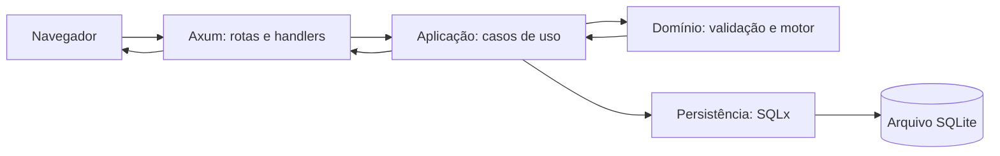
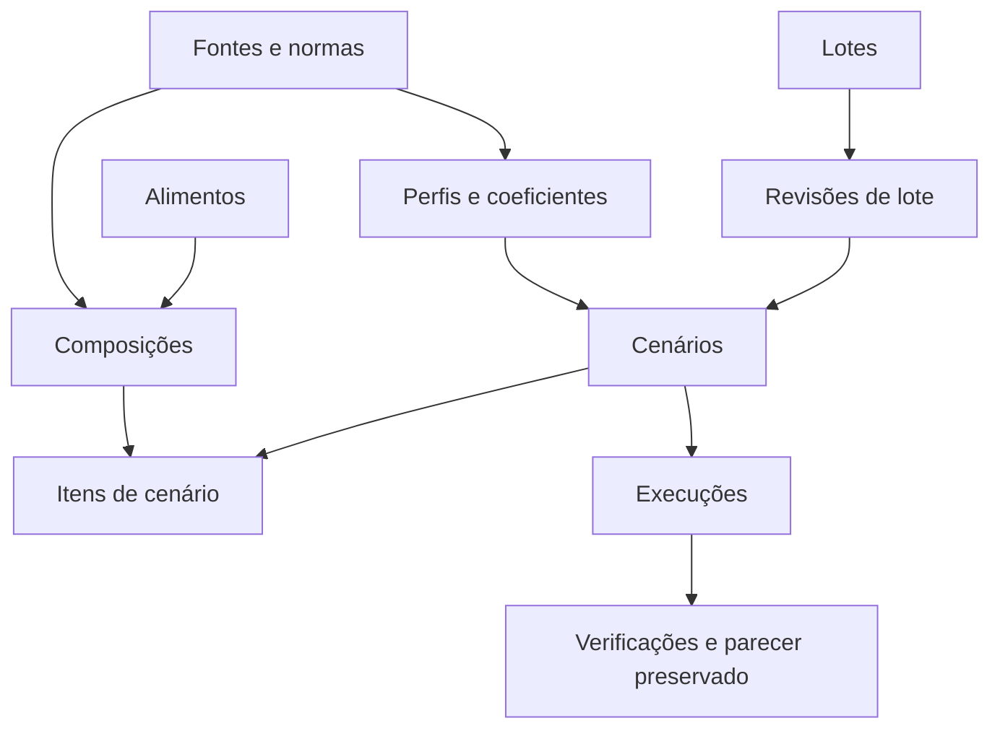

# Arquitetura, banco e tecnologias

O FeedYourCow é um monólito local. Axum recebe HTTP, Maud gera páginas no servidor e o navegador
usa htmx v4, hx-live e pequenos scripts locais para atualizar partes da tela. Casos de uso
coordenam domínio e persistência; o motor de inferência não depende de HTTP ou SQLite.

## Organização do repositório

| Caminho | Responsabilidade |
| --- | --- |
| `src/dominio/` | Tipos, unidades, regras, parecer e motor. |
| `src/dominio/motor/` | Verificação, formulação, segurança e cálculos. |
| `src/aplicacao/` | Cadastros, cenários, execuções, histórico e demonstração. |
| `src/persistencia/` | Banco, cargas, consultas, histórico e recuperação. |
| `src/web/<recurso>/` | Rotas, handlers, entradas e templates Maud por função. |
| `src/web/comum/` | Segurança, estado, layouts e componentes compartilhados. |
| `src/web/templates/` | Reexportações de módulos de templates. |
| `queries/` | Consultas SQL separadas usadas pelas macros SQLx. |
| `migrations/` | Evolução do esquema SQLite. |
| `dados_referencia/` | Perfil, normas, modelos e exemplos versionados. |
| `.sqlx/` | Metadados offline das consultas validadas em compilação. |
| `static/` | CSS único, JavaScript, SVG e bibliotecas vendorizadas. |
| `tests/` | Integração Rust e cenários Playwright em `javascript/e2e/`. |
| `scripts/` | Verificações, empacotamento e teste da distribuição. |
| `docs/` | Guias, especificação, referências e capturas ilustrativas. |

`src/web/rotas.rs` compõe os roteadores. Os handlers convertem entradas e chamam serviços; os
templates recebem dados já preparados. `src/aplicacao/execucoes/execucao.rs` decide se formulação
precisa de processo filho e impõe o prazo. A entrada `src/dominio/motor/mod.rs` seleciona
verificação ou formulação. O [motor](MOTOR.md) detalha a sequência e as restrições.

## Tecnologias e dependências diretas

As versões efetivas estão em `Cargo.lock` e `package-lock.json`; `Cargo.toml` e `package.json`
mostram as faixas declaradas. Os principais papéis são:

| Recurso | Uso no projeto |
| --- | --- |
| Rust 2024, Tokio | Servidor e tarefas assíncronas. |
| Axum 0.8, tower-http, tracing | Rotas, serviços HTTP, limites e logs. |
| Maud 0.27 | HTML renderizado no servidor com componentes Rust. |
| htmx 4.0, hx-live | Requisições incrementais e comportamento reativo local. |
| SQLite, SQLx 0.9 | Banco, migrações e consultas verificadas por macros. |
| microlp 0.6 | Cinco programas lineares da formulação contínua. |
| chrono, chrono-tz | Datas civis e fuso `America/Sao_Paulo`. |
| rust_decimal | Valores monetários em decimal. |
| serde, serde_json | Cenário e parecer serializados, inclusive no processo filho. |
| sha2, uuid | Integridade das cargas/backups e identificadores. |
| tower-livereload | Recarga opcional durante desenvolvimento. |
| Playwright 1.64.1 | Testes reais de navegador, instalado só para desenvolvimento. |

A opção `[lints.rust] unsafe_code = "forbid"` e `#![forbid(unsafe_code)]` vedam blocos `unsafe`
no código da aplicação. `microlp` é embutido: o pacote não depende de solver externo. Os
JavaScript necessários são distribuídos em `static/`, sem CDN em tempo de execução. O projeto
usa um CSS plano em `static/app.css`, com variáveis no começo do arquivo.

Referências oficiais de API e origem dos recursos ficam em [FONTES.md](FONTES.md).

## Modelo de dados e preservação

`migrations/0001_base.sql` cria fontes, perfis, coeficientes, normas, lotes, revisões,
alimentos, composições, produtos, cenários, itens, execuções e verificações. Migrações posteriores
adicionam preservação, contaminantes, modelos de preenchimento e o catálogo inicial. Revisar um
lote ou composição cria versão nova; uma execução já gravada mantém a fotografia de suas entradas
e do conhecimento. Comparar exige a mesma revisão do mesmo lote.

`preparar` aplica migrações SQLx e cargas versionadas. Cada carga possui versão e hash; reaplicar
o mesmo conteúdo é idempotente e uma colisão é recusada. As consultas ficam em arquivos `.sql` e
são chamadas por macros `query_file!`; `.sqlx/` permite build offline. O script
`scripts/verificar_sqlx.py` recria o esquema em banco limpo e compara os metadados do cache.

O banco ativo e os backups não entram no Git. Backup usa `VACUUM INTO`, inclui documentos de
referência necessários à auditoria e cria manifesto SHA-256. Restauração verifica hashes,
integridade e vínculos do SQLite antes de concluir. Consulte [operação](OPERACAO.md) para os
comandos.

## Limites de confiança e interface

O servidor recusa escuta fora de loopback. Escritas usam POST, token CSRF e verificação de origem;
requisições possuem limites. O produto não inclui usuários, autenticação ou acesso simultâneo
remoto. A interface funciona sem JavaScript nos fluxos essenciais; htmx atualiza fragmentos,
enquanto os scripts preservam rascunhos, foco e estado entre trocas. Dicas, expansíveis e impressão
não alteram regras de negócio: a validação final ocorre no servidor.
