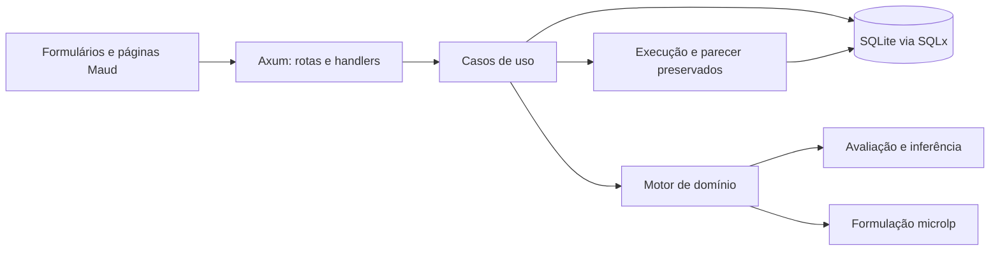

# Entrega, tecnologias e rastreabilidade

Este documento é um mapa para revisar a entrega. Os [requisitos](REQUISITOS.md) definem o
comportamento esperado; a conformidade de uma revisão depende da execução dos testes e do CI.
Consulte o [README](../README.md) para comandos de desenvolvimento e produção.

## Arquitetura e fluxo

O motor recebe fatos e versões definidos para uma execução. Na verificação, avalia as quantidades
informadas. Na formulação, resolve cinco subproblemas lineares, revalida candidatas e separa a
solução contínua da condição de pesagem. O processo filho limita o tempo de cálculo. O
[detalhamento do motor](motor-especialista.md) apresenta estados, regras e diagramas adicionais.

## Correspondência entre requisitos e evidências

Esta tabela aponta onde procurar evidências; não substitui o resultado de uma execução do CI.
IDs e critérios completos estão nas seções 4, 8 e 9 de [REQUISITOS.md](REQUISITOS.md).

| Grupo | Implementação principal | Testes representativos |
| --- | --- | --- |
| RF-01–05 | `src/persistencia/`, `src/web/cadastros/` | `inicio.rs`, `exemplos.rs` |
| RF-06–09 | `src/web/cenarios/`, `src/dominio/motor/` | `cenarios.rs`, `nucleo.rs` |
| RF-10–13 | `src/dominio/motor/formulacao/` | `otimizacao.rs`, `motor.rs` |
| RF-14–15 | `src/aplicacao/execucoes/` | `comparacao.rs`, `reutilizacao.rs` |
| RF-16–19 | `src/persistencia/`, `dados_referencia/` | `exemplos.rs`, `entrega.rs` |
| RNF-01–14 | `scripts/`, `.github/workflows/` | Rust, Python, Playwright |

Os nomes de testes da tabela são arquivos de `tests/`. Os testes Rust também cobrem regras,
contratos HTTP, entrada de dados, persistência
e apresentação. A [suíte de navegador](../tests/javascript/README.md) descreve seus cenários.
O CI executa build, testes Rust, Clippy, rustfmt, verificações de texto/estrutura/SQLx,
ensaio de desempenho e Playwright em Chromium, Firefox e WebKit. O
[teste do pacote de produção](../scripts/testar_producao.py) é um procedimento local adicional;
ele não aparece no workflow atual.

### Estado verificado nesta revisão documental

Em 22/10/2026, `cargo test --locked`, `scripts/qualidade.py`, os testes Python de `scripts/`
e o teste do pacote de produção passaram. O build de release terminou e os links locais dos
arquivos Markdown presentes no pacote foram conferidos. Esta revisão não executou a suíte
Playwright nem o workflow do GitHub Actions; para concluir os critérios CT-26 e CT-28 em uma
entrega específica, consulte o resultado do CI dessa revisão.

## Tecnologias e dependências

O manifesto [`Cargo.toml`](../Cargo.toml) e os lockfiles fixam a resolução efetiva. As funções
principais das dependências diretas são:

| Tecnologia | Papel |
| --- | --- |
| Rust 2024, Tokio | Aplicação nativa e execução assíncrona. |
| Axum, tower-http, tracing | HTTP local, arquivos estáticos, limites e observabilidade. |
| Maud | HTML renderizado no servidor com componentes Rust. |
| htmx v4, hx-live, JavaScript local | Atualização de trechos e comportamento progressivo. |
| SQLite, SQLx | Persistência, migrações e consultas verificadas em compilação. |
| microlp | Programação linear da formulação de menor custo. |
| chrono, chrono-tz | Datas civis e fuso de São Paulo. |
| rust_decimal, serde, sha2, uuid | Preços, serialização, integridade e identificadores. |
| tower-livereload | Recarga opcional durante desenvolvimento. |
| Playwright, Python | Testes de navegador e verificações auxiliares de qualidade. |

Os JavaScript distribuídos ficam em `static/`; as
[versões, origens e licenças](../static/vendor/README.md)
são registradas junto a eles. `microlp` roda no processo da aplicação; não há solver externo no
pacote. O script de release produz um pacote nativo para o alvo de compilação.

## Concepção, fontes e assistência por IA

O [relatório inicial](../hackathon/RELATORIO_TEMAS_E_ARQUITETURA.md) comparou três temas e
motivou a escolha do tema 2. A [pesquisa específica](tema_2_dietas_literatura_e_motor.md)
reuniu literatura, normas, tabelas e fórmulas; sua seção 12 registra referências e limites de
uso. As [fontes dos modelos](../fontes/MODELOS.md) distinguem valores consultados de hipóteses
sintéticas. A [sequência de implementação](../hackathon/SEQUENCIA_IMPLEMENTACAO.md) registra
as etapas do trabalho assistido por Codex, da análise inicial às iterações de testes e interface.

A assistência por IA apoiou pesquisa, especificação, implementação e revisão. Compilador, testes,
inspeção do navegador e revisão humana foram usados para verificar mudanças; a aplicação em
execução não consulta modelo de linguagem. Fontes externas e hipóteses dos exemplos permanecem
identificadas para que o operador não interprete dados sintéticos como medição da fazenda.
