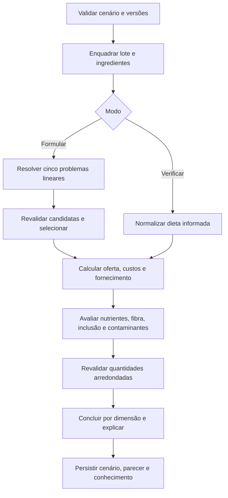

# Motor de inferência e formulação

O perfil ativo é `E2020_NRC1989_RUMEN_MVP_v1`. Sua base de coeficientes e regras fica em
`dados_referencia/001_conhecimento.sql`; a entrada pública do domínio é
`dominio::motor::avaliar`. O motor recebe cenário e conhecimento definidos para a execução,
sem consultar HTTP ou SQLite. O serviço da aplicação grava entradas, parecer e versões depois
do cálculo. [Requisitos](REQUISITOS.md) define o contrato; [fontes](FONTES.md) separa literatura,
hipóteses e limitações.

## Visão do fluxo



A agenda de verificação percorre etapas em ordem fixa e registra uma trilha de inferência.
Restrições independentes continuam sendo avaliadas quando outra dimensão viola um limite ou
possui dado desconhecido. O parecer não converte ausência de informação em zero.

## Unidades e cálculos

Seja `qᵢ` a quantidade digitada do ingrediente `i`, `sᵢ` sua fração de MS, `r` a fração de
sobras e `lᵢ` a perda anterior ao fornecimento. A quantidade consumida `xᵢ`, em kg MS por
animal/dia, depende da base escolhida:

```text
consumo em MS: xᵢ = qᵢ
consumo em MN: xᵢ = qᵢ × sᵢ
oferta em MN:  xᵢ = qᵢ × sᵢ × (1 − r)
```

Para um nutriente `j`, `aᵢⱼ` é sua fração na MS do ingrediente:

```text
D = somaᵢ xᵢ                         [kg MS/animal/dia]
Aⱼ = somaᵢ (xᵢ × aᵢⱼ)               [kg nutriente/animal/dia]
Cⱼ = 100 × Aⱼ / D                    [% da MS da dieta]
balançoⱼ = Aⱼ − Rⱼ                  [kg/animal/dia]
coberturaⱼ = 100 × Aⱼ / Rⱼ          [% do requisito]
```

A ausência de um teor em ingrediente efetivamente usado torna desconhecido o total desse
nutriente. Valores de garantia mínima/máxima não são tratados como composição pontual.

### Requisitos e consumo de referência

```text
LCG4 = leite × (0,4 + 0,15 × gordura)
Rⱼ = mantençaⱼ(PV) + leite × coeficiente_leiteⱼ(gordura)
CMS_ref = PV × percentual_tabela_B(PV, LCG4) / 100
```

`gordura` está em pontos percentuais: 4, e não 0,04. `leite` é a produção real em
kg/animal/dia; LCG4 seleciona a referência de consumo, não substitui a produção real nos
requisitos. Os coeficientes de NDT, PB, Ca e P são interpolados linearmente nas tabelas de
mantença e leite. Para consumo, o motor interpola primeiro PV em cada linha de LCG4 e depois
interpola LCG4. Fora dos nós cobertos, usa dois nós da borda para extrapolar e emite aviso.
O alvo informado ou a medição válida prevalece sobre a referência. Na verificação, a MS da dieta
é calculada das quantidades informadas; diferença acima de 10% da referência gera aviso
operacional, não um diagnóstico de capacidade fisiológica.

### Custo, oferta e estoque

Com preço `pᵢ` em R$/kg MN, `n` animais e horizonte `h` dias:

```text
oferta_MNᵢ = xᵢ / [sᵢ × (1 − r)]
necessidade_brutaᵢ = oferta_MNᵢ × n × h / (1 − lᵢ)
custoᵢ = xᵢ × pᵢ / [sᵢ × (1 − r) × (1 − lᵢ)]
```

Preço é armazenado em representação decimal. Custos são somados após normalizar preço por
embalagem/tonelada. O estoque informado é bruto; o motor testa a necessidade bruta do horizonte
contra ele. Valor ausente não é estoque ilimitado, salvo hipótese explícita do cenário.

## Barreira de fibra e políticas do perfil

A FDN de forragem é dividida pela MS total da dieta para selecionar a **maior linha cujo limiar
foi alcançado**. O limite mínimo absoluto é 15% da MS. Os números carregados são:

| FDN de forragem mínima | FDN total mínima da linha | Amido máximo da linha |
| ---: | ---: | ---: |
| 19% | 25% | 30% |
| 18% | 27% | 28% |
| 17% | 29% | 26% |
| 16% | 31% | 24% |
| 15% | 33% | 22% |

Sobre a linha selecionada, a política operacional do MVP impõe **FDN total ≥ 30%**, **amido ≤
25%** e **EE ≤ 6%**. O limite efetivo é o mais restritivo entre linha e política. Essas
barreiras são técnicas e não devem ser apresentadas como limites legais brasileiros. Fibra
fisicamente efetiva não é deduzida automaticamente de FDN química ou de peneiras incompletas.

## Elegibilidade e segurança

O motor distingue três situações: violação comprovada, falta de informação e regra não avaliada.
Lote fora do perfil produz `FORA_DO_PERFIL`; estado fisiológico indispensável desconhecido
produz `INCONCLUSIVO`. Origem animal, exceção, autorização, evidência e vigência de norma são
avaliadas por ingrediente. A política do MVP exclui NNP intencionalmente adicionado,
medicamentos e subprodutos animais da formulação automática mesmo que exista exceção legal.

Contaminantes só são comparados quando o analito, a matriz, o método, o documento e a unidade do
laudo são compatíveis. O motor normaliza µg/kg e mg/kg, base MN/MS e base de 12% de umidade.
`<LOQ` usa o limite superior; se esse valor não comprova atendimento, a conclusão fica pendente.
A referência de AFB1 da União Europeia só é aplicada quando o operador a ativa e a regra está
vigente. A ausência de laudo ou de limite brasileiro universal carregado não é uma aprovação.

## Formulação de menor custo

O motor resolve **cinco problemas de programação linear** com `microlp`, um para cada linha de
fibra. Cada variável `xᵢ` é o consumo do ingrediente em kg MS/animal/dia. Minimiza o custo de
oferta sujeito a:

- Soma de `xᵢ` igual ao consumo-alvo selecionado.
- NDT, PB, Ca e P ao menos iguais aos requisitos calculados.
- FDN total e de forragem acima dos mínimos; amido e EE abaixo dos tetos efetivos.
- Inclusão mínima/máxima, teto do suplemento, estoque, autorização e exclusões do MVP.
- Limites compatíveis de contaminantes quando a referência escolhida permite avaliá-los.

Ingredientes são ordenados por ID antes de montar os problemas. Candidatas são submetidas ao
mesmo verificador contínuo, inclusive à linha de fibra que resulta da própria solução. Só uma
candidata revalidada pode ser selecionada. O desempate considera custo, número de ingredientes
e ordem canônica. O processo filho recebe uma cópia serializada do cenário e do conhecimento; o
serviço o encerra ao atingir o prazo. Uma interrupção não é prova de inviabilidade.

| Estado da busca | Condição |
| --- | --- |
| `OTIMO_NO_MODELO` | Candidata válida; os cinco problemas têm conclusão comprovada. |
| `VIAVEL_SEM_OTIMO` | Candidata válida, mas falta prova global de custo mínimo. |
| `INVIAVEL_NO_MODELO` | Os cinco problemas têm inviabilidade comprovada. |
| `INCONCLUSIVA` | Sem candidata e sem prova completa; inclui prazo, erro ou dado pendente. |

A certificação se refere ao problema **contínuo** definido pelo perfil e pelo cenário, não a
uma dieta integral, a uma recomendação clínica ou ao problema discreto de pesagem.

## Revalidação prática

Para cada item com resolução positiva em kg MN, a oferta é arredondada ao múltiplo mais próximo.
O motor calcula novamente consumo, nutrientes, linha de fibra, custo, estoque e demais limites.
Uma recomendação de pesagem exige resolução positiva em todo ingrediente usado; itens zerados
não exigem resolução. Resolução zero mantém aproximação contínua identificada como tal. Quando
a dieta arredondada viola uma restrição, o parecer informa `FORNECIMENTO_INCOMPATIVEL`, conserva
o resultado contínuo e não certifica ótimo para as quantidades práticas.

## Explicação, estados e persistência

Cada verificação conserva ID da regra, dimensão, estado, valor, limite, unidade, fonte,
explicação e dependências. Os estados atômicos são `ATENDE`, `VIOLA`, `DESCONHECIDO` e
`NAO_APLICAVEL`. Por dimensão, qualquer violação produz `NAO_ATENDE`; na ausência de violação,
dado desconhecido produz `INCONCLUSIVO`; verificações favoráveis produzem `ATENDE`; dimensão
sem avaliação produz `NAO_AVALIADO`. Dimensões separadas incluem núcleo químico, barreiras,
ingredientes, inclusão/estoque, contaminantes e o que ficou fora do núcleo.

O histórico salva cenário, versões de lote e composição, conhecimento e parecer em transação.
Uma revisão posterior não altera o registro já gravado. Duplicar uma execução cria novo cálculo
com o conhecimento ativo. A consulta do registro antigo apenas mostra suas entradas e conclusões
preservadas; não oferece reexecução de versões originais.
