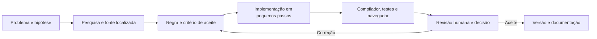

# Concepção e desenvolvimento assistido por IA

Esta página registra as decisões de produto que antecederam o código e o papel da assistência
por IA. É uma síntese das análises iniciais, suficiente para entender por que o produto atual
possui este escopo. O [contrato vigente](REQUISITOS.md) e o código determinam o comportamento
entregue.

## Comparação inicial de temas

Foram avaliados três caminhos para um sistema especialista no contexto da pecuária leiteira:

| Tema | Pergunta central | Principal dificuldade para um MVP confiável |
| --- | --- | --- |
| Triagem | Que sinais exigem atenção? | Evidência clínica e encaminhamento. |
| Dietas | Atende limites? Há menor custo? | Composição, segurança e otimização. |
| Economia | Como variam custos e receitas? | Custos, tempo e causalidade. |

A escolha recaiu em **verificação e formulação de dietas** porque o problema permite regras
explícitas, entradas auditáveis, exemplos numéricos e testes de regressão. A comparação econômica
foi mantida como função limitada ao custo alimentar de cenários comparáveis. Triagem clínica,
previsão de produção e contabilidade integral ficaram fora do produto.

## Da pesquisa ao perfil implementado

A pesquisa inicial separou quatro tipos de informação: tabelas de exigências, composição de
alimentos, barreiras técnicas de dieta e normas aplicáveis a ingredientes. Sistemas nutricionais
de épocas e escopos diferentes não foram tratados como coeficientes intercambiáveis. O produto
fixou um perfil fechado e versionado: exigências e consumo da publicação da Embrapa usada na
carga, barreiras de fibra/amido e políticas explícitas do MVP. O [motor](MOTOR.md) documenta as
fórmulas; [fontes](FONTES.md) identifica obras, cargas e hipóteses.

A pesquisa também revelou dimensões que não podiam receber uma conclusão completa com os dados
do MVP: fibra física, micronutrientes, água, segurança sem laudo e respostas clínicas. A decisão
foi preservar estados **inconclusivo** ou **não avaliado**, mantendo o cálculo químico disponível
quando independente. Extrapolações controladas recebem aviso em vez de parecer precisão plena.

Para tornar a primeira experiência reproduzível, foram criados seis lotes e quinze alimentos
sintéticos com procedência e condições assumidas. O usuário pode experimentar, copiar e revisar,
mas deve inserir dados reais e evidências antes de usar o resultado em uma operação. Receitas de
mistura foram armazenadas como composições próprias; não há editor de receita dinâmica.

## Decisões de arquitetura

1. Aplicação local em Rust com renderização HTML no servidor para manter o cálculo e a validação
   no mesmo processo lógico e permitir uso sem conexão externa.
2. SQLite e SQLx para versões de cadastros, migrações, consultas verificadas e histórico
   preservado. O conhecimento fica em cargas SQL com versão e hash.
3. Motor puro de domínio, com entrada única para verificar ou formular e parecer explicável.
4. Formulação por cinco problemas lineares, seguida de revalidação independente; arredondamento
   de pesagem recebe avaliação própria.
5. Execução da formulação em processo filho para que o prazo possa encerrá-la efetivamente.
6. Maud, htmx e hx-live locais, CSS único e melhoria progressiva sem deslocar decisões do servidor
   para JavaScript.
7. Testes Rust, Playwright e pacote de produção como evidências complementares.

A organização concreta dos módulos e do banco está em [ARQUITETURA.md](ARQUITETURA.md).

## Fluxo de trabalho com assistência por IA

A assistência por Codex apoiou a comparação de alternativas, a organização da pesquisa, a
formulação dos requisitos, a implementação, a documentação e a investigação de regressões. O
fluxo adotado foi:

Decisões relevantes de escopo e interpretação foram registradas antes de alterar regras.
Compilador, testes, comparação de resultados e inspeção visual foram usados para questionar as
saídas produzidas pela IA. Links e referências foram preservados para permitir auditoria;
hipóteses sintéticas foram rotuladas para não serem confundidas com dados observados.

O motor entregue é determinístico com as entradas e versões preservadas. Ele **não** consulta
modelos de linguagem na execução, nem transforma texto livre ou páginas externas em regras
novas. A assistência por IA descreve o processo de desenvolvimento, não uma dependência de
produção ou uma fonte de autoridade nutricional.

## Sequência resumida

1. Comparação dos três temas e escolha do problema de dietas.
2. Pesquisa nutricional, de normas, unidades e limites de aplicabilidade.
3. Perfil versionado, requisitos e casos de aceitação.
4. Núcleo Rust, dados locais, verificação e formulação.
5. Interface de trabalho, ajuda, exemplos e histórico.
6. Testes de domínio, HTTP, navegador, backup e desempenho.
7. Ajustes de segurança, estados da busca, pesagem, comparação e leitura do parecer.
8. Preparação do pacote de produção e revisão final da documentação.

Esta sequência explica a origem do desenho atual; não equivale a uma cronologia de cada commit.
Para verificar uma alteração específica, consulte o Git e a suíte indicada em
[QUALIDADE.md](QUALIDADE.md).
