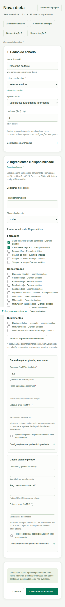

# Usar o FeedYourCow

O aplicativo é uma ferramenta local de trabalho. A primeira simulação usa dados sintéticos para
mostrar o fluxo; antes de avaliar um lote real, confira composição, condições fisiológicas,
preços, estoque e evidência de autorização de cada produto.

## Percurso rápido

_Captura de teste com banco já usado. Os contadores da instalação nova serão diferentes._

## Primeira simulação

1. Após `preparar` e `servir`, abra <http://127.0.0.1:3000>.
2. Na **Visão geral**, clique em **Abrir cenário de exemplo**.
3. Revise lote, ingredientes, quantidades, preços e hipóteses.
4. Clique em **Calcular e salvar cenário**.
5. Leia primeiro **Resultados por dimensão** e as advertências. Depois examine balanço,
   restrições, custo e fornecimento.

O atalho inicial verifica as quantidades preenchidas; não procura um custo mínimo. As opções
**Demonstração A** e **Demonstração B** em **Nova dieta** dependem dos cadastros das fixtures e
pedem confirmação antes de substituir o rascunho.

## Preparar dados próprios

**Lotes de animais:** cadastre ou revise identificação, número de animais, peso médio, produção,
gordura do leite, dias em lactação e condições de manejo. Estados como gestação, crescimento e
confinamento distinguem **sim**, **não** e **desconhecido**. Um campo desconhecido não deve ser
preenchido como “não”. Separe grupos heterogêneos em lotes diferentes.

**Alimentos:** consulte a procedência e crie uma composição ou nova revisão. MS é percentual da
matéria natural (MN); NDT, PB, Ca, P, FDN, amido e EE são percentuais da matéria seca (MS).
Registre fonte, natureza do valor, método, data, processamento, produto/lote e evidências. Uma
média tabelada ou um exemplo sintético não representa a análise do alimento disponível na
fazenda. Garantias unilaterais não são composição pontual. Preço e estoque pertencem ao cenário,
não à ficha da composição.

Modelos de preenchimento podem ajudar a iniciar o cadastro, mas exigem revisão e não confirmam
estados de segurança. **Criar cópia** faz um cadastro independente; **Salvar revisão** preserva a
versão anterior. Excluir um exemplo retira a opção ativa sem apagar execuções históricas.
**Restaurar exemplos** exige confirmação e pode criar cópia ou nova revisão do registro inicial.
Repetir `preparar` não desfaz alterações nem restaura exclusões.

## Construir um cenário

Em **Nova dieta**, dê um nome, selecione lote e tipo de cálculo, informe horizonte e datas de
avaliação e de aplicação das regras. Em **Selecionar ingredientes**, marque somente as composições
necessárias e atualize a seleção. O formulário exibe campos apenas dos itens marcados. É possível
cadastrar outro alimento em nova guia e usar **Atualizar cadastros** para incorporá-lo.

_Captura de teste de uma dieta ainda em edição; preços e estoques vazios precisam ser definidos._

### Quantidades e preços

Escolha uma das bases de entrada: **consumo em kg MS/animal/dia**, **consumo em kg MN/animal/dia**
ou **oferta em kg MN/animal/dia**. Na verificação, preencha a quantidade de cada ingrediente. Na
formulação, as quantidades digitadas não são usadas como ponto inicial: o motor calcula uma
distribuição. Preencha preço e origem da cotação para cada item. A interface aceita R$/kg MN,
preço por tonelada MN ou por embalagem com massa informada. Preço zero também precisa de origem.

Estoque vazio significa **desconhecido**. Informe estoque bruto em kg MN ou marque explicitamente
a hipótese de disponibilidade ilimitada. Nas configurações do ingrediente, ajuste MS apenas para
o cenário atual, perdas anteriores ao fornecimento, inclusão mínima/máxima, teto aplicável e
resolução de pesagem. Fornecimento depende de sobras, perdas, animais e horizonte.

### Premissas avançadas

O consumo-alvo em kg MS/animal/dia é opcional. Se vazio, o motor usa a referência do perfil. Uma
medição de consumo pode ser informada com MS ofertada e MS das sobras do mesmo lote/período.
Oferta não prova ingestão homogênea. Registre origem de sobras e perdas mesmo quando são zero.
Preço do leite é opcional para margem sobre alimentação. A referência adicional da União Europeia
para contaminantes é opcional e não se apresenta como limite legal brasileiro.

A verificação aceita até **20 ingredientes**; a formulação, até **10**. Se houver erro, os campos
inválidos são identificados e o rascunho válido permanece. O fluxo essencial funciona sem
JavaScript; atualizações por htmx tornam a interação mais rápida quando disponíveis.

## Interpretar o parecer

- **ATENDE** descreve somente a dimensão avaliada.
- **NÃO ATENDE** indica pelo menos uma restrição violada naquela dimensão.
- **INCONCLUSIVO** indica dado necessário desconhecido ou incompatível.
- **NÃO AVALIADO** indica dimensão fora do núcleo ou sem regra aplicável.
- **FORA DO PERFIL** e **BLOQUEADO** impedem recomendação compatível com o perfil.

Na formulação, confira o **estado da busca** antes do custo e das quantidades. Um resultado
contínuo pode ser ótimo no modelo e ainda não fornecer uma pesagem recomendável. Resolução zero
significa quantidade contínua aproximada; uma recomendação prática exige resolução positiva em
cada ingrediente usado e revalidação da dieta arredondada. A
[captura de recusa prática](imagens/fornecimento.png) mostra como o parecer conserva a solução
contínua enquanto recusa o fornecimento incompatível.

**Cálculos e regras aplicadas** mostram valores, limites, unidades, fontes e caminho de inferência.
**Entradas preservadas** e **Fontes e versões preservadas** identificam o que foi usado. Fibra
física, água, micronutrientes e outras dimensões sem perfil completo permanecem separadas; uma
conclusão química favorável não aprova a dieta integralmente.

## Reutilizar e comparar

**Duplicar e simular** cria um cenário editável vinculado à execução de origem sem substituir o
parecer antigo. Após uma formulação com candidata, **Refazer otimização** conserva as premissas,
**Ajustar e verificar solução contínua** copia a dieta calculada, e **Ajustar e verificar
quantidades práticas** copia a oferta arredondada quando ela existe. Copiar quantidades não
significa aprová-las; a nova execução precisa ser avaliada.

No **Histórico e análise**, consulte e filtre execuções, abra pareceres preservados e compare duas
execuções da **mesma revisão do mesmo lote**. O servidor recusa comparação de lotes ou revisões
diferentes. A tela mostra diferenças de premissas antes da economia. **Imprimir parecer** gera a
versão completa; **Imprimir ficha de fornecimento** oferece uma versão operacional curta com a
condição de uso. A impressão pode ser salva como PDF pelo navegador.

A **Ajuda** e os indicadores `?` explicam campos e estados. Os formulários de cadastro e atalhos
de nova dieta podem abrir em nova guia para preservar a tarefa em andamento.

### Datas e cancelamento de cadastros

A data da composição é opcional. Quando preenchida, deve ser uma data civil válida
(`AAAA-MM-DD`). Revisões antigas com datas inválidas mostram o valor original e exigem
correção ou confirmação explícita de remoção. Execuções históricas permanecem intactas.
Cancelar preserva o tipo: cadastrar novamente após cancelar lote abre outro lote.

### Comparar execuções de páginas diferentes

No histórico, escolha **Fixar como referência** na execução desejada. A referência acompanha
os filtros e a navegação entre páginas pela URL. Escolha a alternativa na página atual e
clique em **Comparar premissas e custos**. Alternativas de outro lote ou revisão ficam
identificadas como incompatíveis. **Remover referência** libera uma nova escolha.
Uma referência inexistente permite limpar a seleção. O fluxo funciona sem JavaScript.
