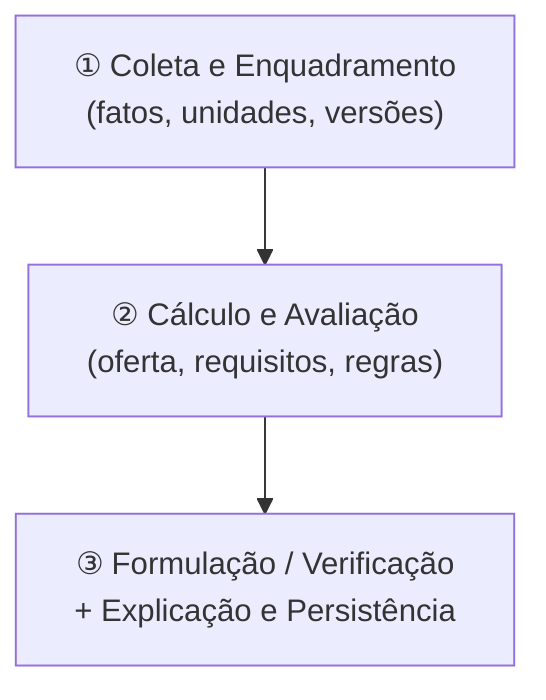
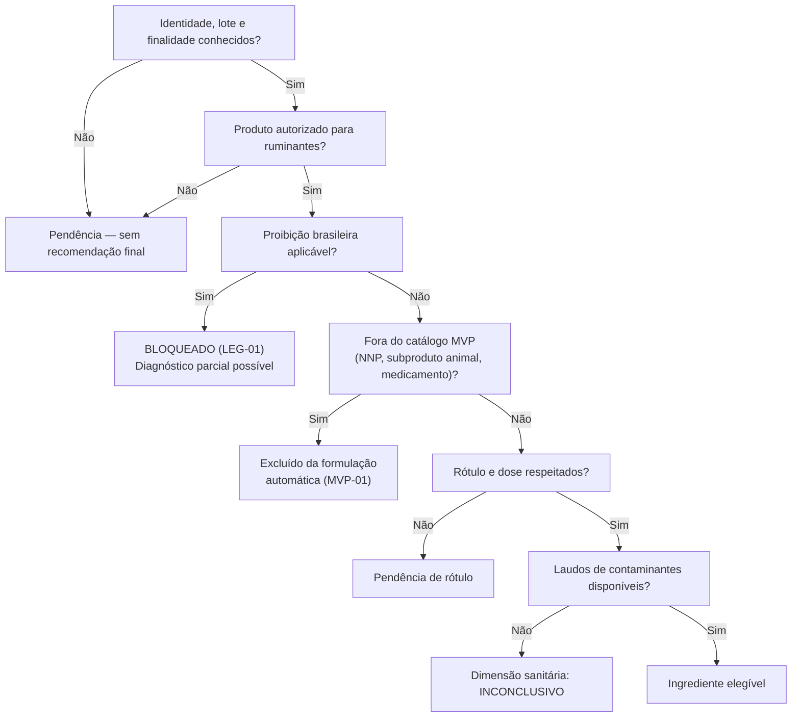
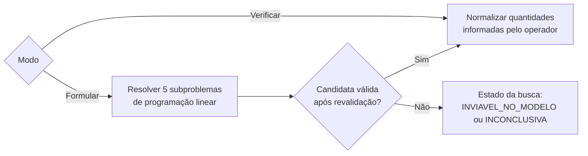
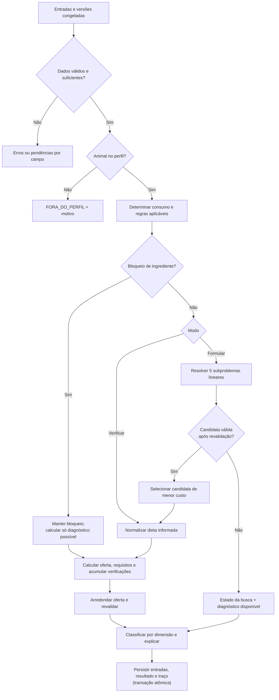

# Motor do Sistema Especialista — FeedYourCow

> [!NOTE]
> Perfil ativo: **E2020_NRC1989_RUMEN_MVP_v1** — Exigências NRC 1989 transcritas da Embrapa 2020,
> com barreiras ruminais adaptadas da NASEM 2021 e políticas operacionais do MVP.

---

## Visão geral da arquitetura de inferência

O motor é organizado em **três camadas sequenciais**, operando sobre um conjunto de fatos imutáveis
(congelados no início de cada execução):



As conclusões de cada etapa alimentam a próxima, mas **nunca retroagem** para remover um bloqueio
ou uma violação já determinada. O motor usa **encadeamento para frente** até não surgirem fatos
novos.

---

## Passo a passo detalhado

### Passo 1 — Inicialização e congelamento de versões

Ao iniciar uma execução, o motor fixa:

- Perfil nutricional ativo com seus coeficientes e versão
- Revisão do lote (peso, produção, gordura, dias em lactação)
- Composições dos ingredientes selecionados (MS, NDT, PB, Ca, P, FDN, amido, EE)
- Preços, estoques, perdas, sobras e limites de inclusão do cenário
- Data de avaliação e horizonte em dias

> [!IMPORTANT]
> Nenhuma dessas entradas pode ser alterada no meio de um cálculo. Atualizar catálogo ou preços
> após iniciar não afeta a execução em curso nem execuções históricas.

---

### Passo 2 — Validação de dados (DAT-01 / DAT-02)

Antes de qualquer cálculo, o motor verifica:

| Verificação                                                         | Resultado se falhar              |
| ------------------------------------------------------------------- | -------------------------------- |
| Campos obrigatórios presentes                                       | `INVALIDO` com campo listado     |
| Unidades compatíveis e coerentes                                    | `INVALIDO`                       |
| Valores numéricos válidos (sem NaN, ∞, negativos indevidos, MS = 0) | `INVALIDO`                       |
| Composições obrigatórias ausentes                                   | `INCONCLUSIVO` (não imputa zero) |
| Dados contraditórios (ex.: lote adulto + recria)                    | Erro de consistência             |

> [!CAUTION]
> Campo vazio ≠ zero. O motor distingue explicitamente: **desconhecido**, **não medido**,
> **não detectado**, **abaixo do LOQ** e **zero declarado como hipótese**. Isso propaga-se
> para o parecer e para o histórico.

---

### Passo 3 — Enquadramento no perfil (ESC-01 / ESC-02)

O motor verifica se o animal pertence à **população operacional** do perfil ativo:

1. Vaca adulta em lactação, sem crescimento nem gestação? → senão: `FORA_DO_PERFIL`
2. Dias em lactação entre 60 e 250? → senão: `FORA_DO_PERFIL`
3. PV entre 300–800 kg, G entre 3–5%, LCG4 entre 5–30 kg/dia? → senão: `FORA_DO_PERFIL`
4. Confinamento com dieta total quantificável? → senão: `FORA_DO_PERFIL`
5. Necessidade conhecida de correção ambiental/por atividade? → `FORA_DO_PERFIL`; se não avaliada,
   registrar **hipótese de ausência de correção**

---

### Passo 4 — Determinação do consumo (F04 / F07 / RN-07)

**Calcular LCG4** (leite corrigido para 4% de gordura):

$$\text{LCG4} = PL \times (0{,}4 + 0{,}15 \times G)$$

onde $G$ está em pontos percentuais (ex.: 4, não 0,04).

**Consumo de referência** — interpolação bilinear na Tabela B (PV × LCG4):

$$\text{CMS}_{\text{ref}} = PV \times \frac{f\%_{PV}}{100}$$

- Dentro de 400–600 kg: interpolação bilinear direta
- Fora de 400–600 kg (mas dentro de 300–800): extrapolação linear pelos 2 nós de borda + **aviso
  de menor precisão**

**Consumo-alvo final:**

- Se o operador informou um valor observado/medido → prevalece sobre a referência
- Senão → usa `CMS_ref`

Na **verificação**: calcula a MS real da dieta e compara com a referência. Diferença relativa
absoluta > 10% gera **aviso operacional** (não implica incapacidade fisiológica).

---

### Passo 5 — Segurança e elegibilidade dos ingredientes (LEG-01 / LEG-02 / MVP-01)

Para **cada ingrediente**, em ordem:



> [!WARNING]
> Um `BLOQUEADO` por proibição legal **não é removido** por um bom resultado nutricional.
> O motor pode calcular o diagnóstico químico parcialmente, mas nunca emite recomendação
> de formulação para ingrediente bloqueado.

---

### Passo 6 — Modo de operação: Verificar ou Formular



#### Modo Verificar

Recebe as quantidades em kg MN ou kg MS/animal/dia e converte tudo para a base canônica:

$$x_i = q_i \times s_i \quad \text{(kg MS do ingrediente } i \text{)}$$

#### Modo Formular — Os 5 subproblemas lineares

O motor resolve **um problema de PL para cada linha da Tabela C** (barreiras ruminais),
porque a linha efetiva depende da composição final (ainda desconhecida na otimização):

| Subproblema | Limiar FDN forragem, % MS | FDN total mínima | Amido máximo |
| ----------: | ------------------------: | ---------------: | -----------: |
|           1 |                     ≥ 19% |              25% |          30% |
|           2 |                     ≥ 18% |              27% |          28% |
|           3 |                     ≥ 17% |              29% |          26% |
|           4 |                     ≥ 16% |              31% |          24% |
|           5 |                     ≥ 15% |              33% |          22% |

Sobre cada linha, aplicam-se as políticas do MVP:

$$\text{FDN}_{\min} = \max(\text{FDN}_{\text{linha}},\; 30\%) \quad \text{(POLITICA\_MVP)}$$
$$\text{Amido}_{\max} = \min(\text{Amido}_{\text{linha}},\; 25\%) \quad \text{(POLITICA\_MVP)}$$
$$\text{EE}_{\max} = 6\% \text{ MS} \quad \text{(POLITICA\_MVP)}$$

**Função objetivo** (minimizar custo de oferta):

$$\min Z = \frac{\sum_i x_i \cdot \frac{p_i}{s_i \cdot (1-l_i)}}{1-r}$$

**Restrições nutricionais** (NDT, PB, Ca, P ≥ requisito; FDN ≥ mínimo; amido ≤ máximo; EE ≤ 6%),
mais limites de inclusão e disponibilidade de estoque.

Após resolver os 5 subproblemas → **recalcula a linha efetiva** de cada candidata → **revalida
todas as regras** → seleciona a **candidata válida de menor custo**.

**Desempate** (RN-18): menor custo → menor nº de ingredientes → ordem lexicográfica canônica.

**Estado da busca** (RN-19):

| Estado               | Significado                                                                         |
| -------------------- | ----------------------------------------------------------------------------------- |
| `OTIMO_NO_MODELO`    | Todos os 5 subproblemas com ótimo comprovado ou inviável; ao menos 1 solução válida |
| `VIAVEL_SEM_OTIMO`   | Candidata válida, sem prova de custo mínimo global                                  |
| `INVIAVEL_NO_MODELO` | Inviabilidade comprovada em todos os subproblemas                                   |
| `INCONCLUSIVA`       | Timeout, erro numérico ou falta de dados                                            |

---

### Passo 7 — Cálculo de requisitos e oferta nutricional (F06 / F08)

**Requisito por nutriente** (interpolação linear na Tabela A):

$$R_j = M_j(PV) + PL \times L_j(G)$$

onde $M_j$ é a mantença e $L_j$ o coeficiente por kg de leite (usa-se **PL real**, não LCG4).

**Oferta** e concentração na dieta:

$$A_j = \sum_i x_i \cdot a_{ij} \quad ; \quad C_j\% = 100 \cdot \frac{A_j}{D}$$

**Balanço, déficit, excesso e cobertura:**

$$\text{balanço}_j = A_j - R_j$$
$$\text{cobertura}_j = 100 \cdot \frac{A_j}{R_j}$$

---

### Passo 8 — Avaliação acumulativa das regras (sem atalhos)

O motor avalia **todos os grupos independentemente** — uma violação não impede o diagnóstico
dos demais. As verificações ocorrem em paralelo lógico:

| Dimensão                            | Regras                 | Estados possíveis                       |
| ----------------------------------- | ---------------------- | --------------------------------------- |
| Elegibilidade dos dados             | DAT-01, DAT-02         | `ATENDE` / `INVALIDO` / `INCONCLUSIVO`  |
| Enquadramento no perfil             | ESC-01, ESC-02         | `ATENDE` / `FORA_DO_PERFIL`             |
| Química (NDT, PB, Ca, P)            | NUT-01 a NUT-04        | `ATENDE` / `VIOLA` / `DESCONHECIDO`     |
| Barreiras ruminais (FDN, amido, EE) | RUM-01, RUM-02         | `ATENDE` / `VIOLA` / `DESCONHECIDO`     |
| Fibra física (peNDF)                | RUM-03                 | `ATENDE` / `NAO_AVALIADO`               |
| Segurança dos ingredientes          | LEG-01, LEG-02, MVP-01 | `ATENDE` / `BLOQUEADO` / `INCONCLUSIVO` |
| Contaminantes                       | CON-01, CON-02         | `ATENDE` / `VIOLA` / `INCONCLUSIVO`     |
| Micronutrientes / vitaminas / AA    | —                      | `NAO_AVALIADO` (fora do núcleo)         |
| Formulação / busca                  | FOR-01, FOR-02         | ver RN-19                               |

**Lógica de síntese por dimensão** (RN-02):

- Se houver **qualquer violação** → `NAO_ATENDE` (acumula todas)
- Sem violação + informação obrigatória desconhecida → `INCONCLUSIVO`
- Todas atendidas/não aplicáveis → `ATENDE`

---

### Passo 9 — Arredondamento e revalidação das quantidades práticas (RN-20)

1. Aplica-se a resolução de fornecimento configurada por ingrediente
2. Recalcular: consumo, nutrientes, linha de fibra, oferta, custo e estoque
3. Se houver **qualquer violação** → `FORNECIMENTO_INCOMPATIVEL`; a recomendação prática é bloqueada
4. O parecer contínuo e o prático são preservados **separadamente**

> [!NOTE]
> A prova de ótimo global não se transfere automaticamente para o problema arredondado.

---

### Passo 10 — Cálculo econômico (F13 / F14 / RN-21)

Com sobra planejada `r` e perda de estoque `l_i`:

$$\text{oferta}_{MN,i} = \frac{x_i}{s_i \cdot (1-r)} \quad \text{(kg MN/animal/dia)}$$

$$\text{custo\_oferta} = \frac{\sum_i x_i \cdot \frac{p_i}{s_i \cdot (1-l_i)}}{1-r}$$

$$\text{necessidade\_bruta}_{MN,i} = h \cdot n \cdot \frac{x_i}{s_i \cdot (1-r) \cdot (1-l_i)}$$

- Custo por kg de leite: somente se `PL > 0`
- Margem sobre alimentação: somente se preço do leite informado e compatível
- Comparação entre cenários: mostra as diferenças de premissas antes de apresentar a economia

---

### Passo 11 — Explicação e traço de inferência (EXP-01 / RN-22)

Cada conclusão deve conter:

| Campo da conclusão     | Descrição                                            |
| ---------------------- | ---------------------------------------------------- |
| **Entrada**            | Valor e unidade original e normalizado               |
| **Cálculo/comparação** | Expressão aplicada e resultado intermediário         |
| **Limite**             | Valor, base e unidade do limite aplicado             |
| **Regra**              | Identificador (ex.: RUM-02, NUT-01)                  |
| **Fonte**              | Referência técnica ou normativa com versão           |
| **Resultado**          | `ATENDE` / `VIOLA` / `DESCONHECIDO` / `NAO_AVALIADO` |

O motor produz o **traço completo** dos nós percorridos, permitindo responder:

- _Por que esta informação foi solicitada?_
- _Como esta conclusão foi obtida?_
- _Quais dependências ela tem?_

---

### Passo 12 — Persistência em transação atômica (RN-23)

Tudo é salvo em **uma única transação SQLite**:

```
entradas congeladas + verificações + traço de inferência → commit atômico
```

- Falha → nenhum parecer parcial é marcado como concluído
- Execução salva → imutável; atualizações do catálogo não a alteram
- Histórico permite **reproduzir** o resultado com as versões originais

---

## Diagrama completo do fluxo lógico



---

## Resumo das propriedades-chave do motor

| Propriedade                      | Descrição                                                                         |
| -------------------------------- | --------------------------------------------------------------------------------- |
| **Encadeamento para frente**     | Fatos derivados alimentam novas regras; sem retroação                             |
| **Avaliação acumulativa**        | Todas as violações são detectadas; nenhuma elimina as outras                      |
| **Verificações independentes**   | peNDF ausente não bloqueia o cálculo químico                                      |
| **Imutabilidade histórica**      | Execução salva nunca é sobrescrita                                                |
| **Explicabilidade total**        | Todo resultado carrega entrada, cálculo, regra, fonte e versão                    |
| **Sem relaxamento automático**   | Nenhuma regra nutricional/legal é flexibilizada para produzir solução             |
| **Sem alegação de dieta segura** | O núcleo declara apenas atendimento ao perfil especificado                        |
| **Determinismo**                 | Mesmas entradas + artefatos → mesmos resultados (dentro das tolerâncias de RN-24) |
