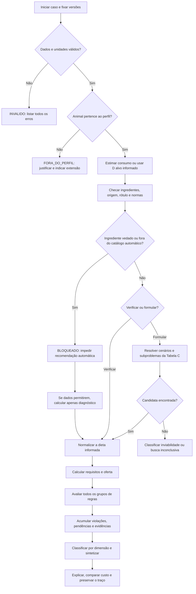

# Tema 2: literatura, normas e especificação do motor de dietas

**Hackathon UFJF 2026 · Pesquisa e proposta documental · 20/10/2026**

Este documento propõe a base de conhecimento, a árvore de decisões e os cálculos de um MVP para
formular e verificar dietas de bovinos leiteiros. Não implementa o sistema e não depende de uma
consulta prévia a especialistas para que a equipe desenvolva a prova de conceito.

O texto complementa o [relatório geral](../hackathon/RELATORIO_TEMAS_E_ARQUITETURA.md). Os identificadores entre
colchetes apontam para as fontes organizadas no final. Fórmulas, condições de aplicação, escolhas de
projeto e obrigações legais são identificadas separadamente.

## 1. Decisão de projeto e alcance da proposta

Recomenda-se um motor com três camadas:

1. **Árvore de elegibilidade e coleta:** caracteriza lote, dados, ingredientes e modelo aplicável.
2. **Cálculo e avaliação de restrições:** calcula a oferta nutricional e acumula todas as violações.
3. **Formulação e explicação:** procura combinações compatíveis, compara custos e explica o
  resultado.

Uma árvore que termina na primeira deficiência perderia outros problemas da mesma dieta. Por isso,
depois da seleção inicial, o processamento se abre em verificações independentes e volta a se reunir
na classificação final. Trata-se de uma árvore de condução associada a uma rede de regras.

### 1.1. Perfil fechado para o primeiro MVP

**Identificador proposto: `E2020_NRC1989_RUMEN_MVP_v1`.**

- Exigências de NDT, PB, Ca e P: Tabela 3 do manual Embrapa de 2020, que referencia NRC de 1989.
- Referência de consumo de MS: Tabela 4 do mesmo manual, para fase intermediária de lactação.
- Cálculo por matéria seca, interpolação e otimização: especificados integralmente nas seções 6–9.
- Barreiras de fibra/amido: tabela técnica apresentada no MSD, adaptada da NASEM de 2021.
- Restrições adicionais conservadoras de amido e extrato etéreo: escolhas explícitas do projeto.
- Segurança de ingredientes: regras brasileiras aplicáveis e perfis estrangeiros identificados.

Esse perfil permite fechar entradas, coeficientes e resultados esperados sem reproduzir centenas de
equações de um sistema nutricional moderno. Sua saída é **“atende ao perfil especificado”**. Não
deve ser rotulada como adequação completa segundo NASEM 2021, BR-LEITE 2024 ou atendimento de
aminoácidos. As diferenças entre os modelos são parte da especificação, não apenas texto a
acrescentar ao rodapé. [C01], [C02], [C03], [C09], [C13].

Não se escolheu a referência histórica por ser a mais atual. Ela foi escolhida por oferecer um
núcleo tabular reproduzível para o prazo do MVP. NASEM e BR-LEITE fundamentam a comparação, as
barreiras adicionais e a evolução proposta, com suas versões mantidas separadas.

### 1.2. População operacional do perfil

O primeiro fluxo automático deve admitir vacas adultas, em lactação, sem exigência adicional de
crescimento, sem gestação, com peso corporal estável, em confinamento e com dieta total
quantificável. Limites:

- Peso vivo: de **300 a 800 kg**, inclusive. A tabela de exigências cobre 400–700 kg; entre
  300–400 e 700–800 kg, o sistema adota extrapolação linear pelos dois nós extremos e registra
  aviso de menor precisão.
- Gordura do leite: de **3 a 5%**, inclusive, por cobertura da tabela de produção.
- Leite corrigido para 4% de gordura: de **5 a 30 kg/dia**, por cobertura da tabela de consumo.
- Dias em lactação: de **60 a 250**, como recorte operacional proposto para a fase intermediária.
- Destinação: produção de leite; objetivo econômico inicial de menor custo para produção informada.
- Sem aplicação automática a transição, vacas secas, bezerros, recria, engorda ou gestação.
- Sem correção automática para estresse térmico, pastejo não quantificado ou ganho/perda de
  reservas.

A faixa de dias é uma decisão de escopo, não um limite biológico demonstrado pela tabela. Raça,
idade, ordem de parto, condição corporal e manejo devem ser registrados. O núcleo histórico não
contém um multiplicador racial; não inventar um. Uma raça cadastrada não torna o modelo validado
especificamente para ela. A seção 10 apresenta alternativas de consumo e energia mais específicas.

Uma entrada fora desse recorte produz **FORA_DO_PERFIL**, acompanhada da razão e do modelo de
evolução pertinente. Isso não significa que o animal não possa receber uma dieta formulada.

## 2. Método da busca e hierarquia de evidências

Foram pesquisados, em português e inglês, os seguintes eixos:

- Exigências nutricionais: NRC 1989/2001, NASEM 2021 e BR-LEITE 2024.
- Consumo de MS: modelos de confinamento, condições tropicais e diferenças entre populações.
- Composição de alimentos: Embrapa, CQBAL, Feedipedia e tabelas INRAE–CIRAD–AFZ.
- Fibra física e química, processamento do amido, gordura e nitrogênio não proteico.
- Formulação de menor custo, segurança, rastreabilidade e ingredientes autorizados.
- Normas brasileiras consolidadas, atos complementares e referências UE, FDA e Codex.

Para artigos, utilizaram-se buscas semânticas em índice científico, expansão por
referências/citações e consulta a metadados, resumos e textos disponíveis. Para normas,
priorizaram-se Planalto, MAPA, Anvisa, Diário Oficial, EUR-Lex e FDA. O acesso e a profundidade
estão registrados na bibliografia.

Consultas incluíram combinações de `dairy cattle nutrient requirements`, `dry matter intake tropical
crossbred`, `physically effective fiber starch acidosis`, `urea dairy network meta-analysis`,
`BR-LEITE`, `alimentação animal legislação`, `ruminantes proteína animal` e `aflatoxins animal
feed`.

Esta é uma busca ampla estruturada por problemas do motor, não uma revisão sistemática com
protocolo, dupla seleção e nova metanálise. A cobertura inclui literatura fundamental e atualizações
normativas encontradas até a data acima; não se afirma ter identificado toda publicação existente.

Hierarquia adotada:

1. Texto oficial vigente, para obrigações legais e suas exceções.
2. Sistemas de exigências e manuais institucionais, para definição de modelos e unidades.
3. Estudos primários, revisões e metanálises, para mecanismos, contexto e incerteza.
4. Políticas operacionais do MVP, quando for preciso fixar uma escolha não imposta pelas fontes.

Cada regra deve informar sua natureza: **BR_LEGAL**, **REFERENCIA_ESTRANGEIRA**, **TECNICA** ou
**POLITICA_MVP**. Uma publicação nutricional não é uma lei; uma norma europeia não é lei brasileira.

## 3. Síntese crítica da literatura

### 3.1. Sistemas de exigências não são intercambiáveis

O manual Embrapa de 2020 é útil para fundamentos e demonstração de balanceamento. Sua Tabela 3
utiliza exigências antigas; data de publicação do manual e data de origem dos coeficientes são
informações diferentes. O núcleo proposto conserva essa origem no identificador do perfil. [C01].

O NRC de 2001 trabalha com sistemas de energia líquida e proteína metabolizável. A NASEM de 2021
atualiza consumo, oferta de nutrientes, aminoácidos, minerais e respostas. Por exemplo, aumenta o
coeficiente de energia de mantença de 0,08 para 0,10 Mcal por kg de peso metabólico. Não é correto
trocar apenas esse coeficiente e chamar todo o restante de NASEM 2021. [C02], [C03], [C05], [C06].

Na NASEM, algumas avaliações energéticas dependem da dieta completa e do consumo. Somar valores
fixos de energia por ingrediente não reproduz automaticamente esse modelo. A proteína bruta também
não substitui proteína metabolizável nem o atendimento de aminoácidos. As tabelas de exigências
modernas descrevem situações específicas; não são uma régua universal por litro de leite.
[C05]–[C08].

O BR-LEITE de 2024 agrega dados brasileiros e discute diferenças entre taurinos, zebuínos e
cruzados. Seus capítulos de consumo e energia são especialmente relevantes para evolução do
protótipo. A comparação NRC/INRA também reforça que oferta e exigência precisam compartilhar um
sistema de avaliação consistente. [C09], [C10], [C13], [L07].

### 3.2. Consumo é uma estimativa, não uma garantia

A quantidade oferecida não equivale necessariamente à ingerida. Sobras, seleção de partículas,
qualidade da forragem, estágio fisiológico, ambiente e manejo modificam o consumo. O valor previsto
é uma referência de cenário; o consumo medido deve ser identificado como observação distinta. [C04],
[C09], [C10].

Para um lote heterogêneo, calcular primeiro os requisitos por subgrupo é preferível a tratar toda a
população como uma vaca média. Idade e número de partos ajudam a detectar animais ainda em
crescimento, cuja exigência adicional não está contemplada no perfil inicial.

### 3.3. Fibra exige química, forma física e contexto

Mertens fundamenta a distinção entre FDN e fibra fisicamente efetiva. Zebeli e colaboradores mostram
que resultados dependem do método de peneira. Os valores discutidos para partículas maiores que 1,18
mm e maiores que 8 mm não podem ser trocados entre si. [L01], [L02].

Khorrami e colaboradores relacionam peNDF, amido e consumo ao risco de acidose. Ferraretto e
colaboradores mostram a importância do tipo e processamento do grão. Assim, milho seco moído e milho
úmido não devem receber automaticamente a mesma descrição de fermentabilidade. [L03], [L04].

O motor deve guardar separadamente FDN total, FDN oriunda de forragem, amido, método de peNDF e
processamento. A razão volumoso/concentrado é informação útil, mas não substitui essas medidas.

### 3.4. Gordura e NNP não podem ser avaliados apenas pelo teor de PB ou energia

Weld e Armentano mostram respostas diferentes conforme a fonte lipídica. Extrato etéreo, ácidos
graxos totais e gordura insaturada livre não são a mesma variável. [L05].

Simoni e colaboradores comparam ureia comum e de liberação lenta em dietas isonitrogenadas. A dose
média experimental não é recomendação de uso; não há justificativa para atribuir aumento automático
de leite à ureia protegida. Equivalente proteico de ureia não é proteína verdadeira nem oferta
direta de aminoácidos. [L06].

**Decisão para o MVP:** excluir ureia, outras fontes adicionadas de NNP e aditivos medicamentosos da
formulação automática. O documento ainda especifica como verificar a presença de ureia e aplicar um
perfil contextual. Sem essa separação, um otimizador baseado apenas em PB poderia preferir NNP
indevidamente.

### 3.5. Fontes de composição e recursos existentes

Prioridade para o catálogo: análise do lote de alimento, tabela brasileira identificada e, depois,
base internacional compatível. Conservar alimento, derivado, processamento, região, método, data,
número de observações quando disponível e unidade. CQBAL e Feedipedia são fontes úteis, não laudos
do alimento específico da propriedade. [C11], [C12].

As tabelas INRAE apresentam variáveis de sistemas diferentes; UFL, PDI, NDT e Mcal não devem ser
unificados apenas por terem relação com energia ou proteína. [C13], [C14].

A FAO já disponibiliza ferramenta de formulação de menor custo para vacas leiteiras com recursos
locais. Serve como referência de fluxo e comparação; sua distribuição em Excel não exige introduzir
esse runtime na aplicação Rust. Não se pressupõe licença para copiar sua implementação. [C15].

## 4. Normas oficiais e efeitos sobre o motor

### 4.1. Base brasileira vigente

A Lei 6.198/1974 e o Decreto **12.031/2024**, consolidado com alterações posteriores, são
referências centrais. O novo decreto revogou o regulamento/anexo do Decreto 6.296/2007. Não usar o
texto antigo como regulamento atual. O art. 151 preserva normas complementares compatíveis. [N01],
[N02].

No Decreto 12.031/2024, observar principalmente:

- Arts. 37–38: boas práticas, conservação e inocuidade.
- Arts. 40–41: autocontroles, registros e rastreabilidade; dados informatizados auditáveis.
- Art. 43: responsabilidade técnica nos estabelecimentos abrangidos.
- Arts. 45–46: padrões, garantias e substâncias aprovadas.

Esses dispositivos justificam procedência dos ingredientes e histórico de decisões. As exigências de
estabelecimentos fabricantes não devem ser atribuídas indiscriminadamente ao software ou usadas como
pré-condição para desenvolver esta prova de conceito.

### 4.2. Matérias-primas, aditivos e boas práticas

O catálogo MAPA consultado estava atualizado em 02/10/2026. A página de registro/cadastro,
atualizada em 19/10/2026, fornece as listas de ingredientes e produtos. A lista positiva
referenciada pela IN 110/2020 e Portaria 359/2021 precisa ser consultada com suas condições de uso.
[N03], [N04].

**Regra:** a presença na lista não autoriza qualquer dose, espécie ou finalidade. Exigir identidade
canônica, produto/fornecedor, origem, lote, espécie/categoria, condições e instruções do rótulo.
Informação incompleta produz pendência; não marcar automaticamente como autorizado.

A IN 4/2007 continua indicada no catálogo, com alterações. Seus registros, armazenamento e POPs são
relevantes para fornecedores, contaminação cruzada, equipamentos, água, resíduos e rastreio. O
software pode registrar evidências, mas não comprova sozinho a execução das boas práticas. [N05].

### 4.3. Ingredientes de origem animal e ruminantes

A IN 8/2004 proíbe produtos para ruminantes com proteínas e gorduras de origem animal e inclui cama
de aviário e resíduos da criação de suínos. Há exceções no art. 3º, incluindo lácteos, ossos
calcinados sem proteína/gordura e gelatina/colágeno de couros/peles. A IN 1/2015 acrescenta ovo em
pó. Logo, **“qualquer origem animal é ilegal” seria uma regra incorreta**. [N06].

Para simplificar o catálogo inicial, propõe-se excluir subprodutos animais por política do MVP. Essa
exclusão deve aparecer como escopo do produto, separada das proibições legais e suas exceções.

O catálogo registra o adiamento da Portaria de EEB 1.180/2024 para **01/03/2027**, pela Portaria
1.566/2026. A árvore deve consultar a versão temporal da norma; não aplicar antecipadamente uma
substituição regulatória apenas porque o ato já foi publicado. [N03].

### 4.4. Antimicrobianos e transições

A Portaria SDA/MAPA 1.617/2026, publicada em 27/04/2026, trata de antimicrobianos listados usados
como melhoradores de desempenho, com transição de 180 dias para certos produtos anteriores. Em
20/10/2026, essa transição ainda importa. Não generalizar o ato para qualquer finalidade terapêutica
ou para todos os ionóforos. O MVP não propõe doses medicamentosas. [N07].

### 4.5. Micotoxinas: matriz, analito e vigência

A Portaria 7/1988, frequentemente citada com **50 µg/kg de aflatoxinas totais**, foi revogada
expressamente pelo art. 10 da IN 30/2009. Esse valor não deve entrar como limite legal brasileiro
atual. Também não transpor limites de produtos para cães/gatos para bovinos. Não foi identificado
nesta busca um limite brasileiro universal atual para micotoxinas em ração bovina que permita uma
declaração geral de conformidade. Isso não significa ausência de dever de inocuidade. [N03], [N08].

Para leite fluido, outra matriz, a IN Anvisa **463/2026** altera a IN 160/2022 e explicita AFM1 de
**0,5 µg/L**. Foi publicada em 06/08/2026, com vigência na publicação e prazo de adequação de 180
dias. Registrar a transição e a unidade; não tratar automaticamente µg/L como µg/kg. [N09].

O limite de AFM1 do leite não pode ser convertido diretamente em limite de AFB1 da dieta usando uma
transferência fixa presumida. O motor não substitui a análise laboratorial do leite.

### 4.6. Referências estrangeiras que podem originar perfis técnicos

**União Europeia, Regulamento 2023/1708:** ureia para ruminantes com rúmen funcional, máximo de
**8.800 mg de aditivo/kg de alimento completo com 12% de umidade**, equivalente a **1% da MS**.
Exige adaptação gradual, dieta rica em carboidratos facilmente digestíveis e baixa em nitrogênio
solúvel nas condições de dose máxima, além de **30% como máximo do N total diário oriundo de N da
ureia**. Revoga 839/2012. Não é limite legal brasileiro. [N10].

**União Europeia, Diretiva 2002/32/CE, texto consolidado consultado:** [N11].

| Analito | Matriz | Limite na base com 12% de umidade |
| --- | --- | ---: |
| AFB1 | Matérias-primas | 20 µg/kg |
| AFB1 | Alimento composto para gado leiteiro/bezerros | 5 µg/kg |
| Gossipol livre | Alimento completo para bovinos, exceto bezerros | 500 mg/kg |
| HCN | Alimento completo | 50 mg/kg |

Os limites são específicos da matriz e do analito. Gossipol total não é gossipol livre. O perfil de
ingrediente deve ser verificado além da mistura final; diluir ingrediente irregular não equivale a
autorizar seu uso. Demais limites da diretiva não estão integralmente transcritos nesta tabela.

**FDA:** a orientação consultada apresenta action level de **20 ppb de aflatoxinas** para alimentos
e ingredientes destinados a animais leiteiros. Isso difere do limite europeu de AFB1 e não deve ser
aplicado à mesma variável sem distinguir soma de aflatoxinas, matriz e jurisdição. É política
regulatória dos EUA, não autorização de uso no Brasil. [N12].

**Codex, CXC 54-2004, com emendas de 2008 e 2024:** fundamenta boas práticas na alimentação animal,
incluindo origem, fabricação, armazenamento e rastreabilidade. É referência internacional; sua
citação não incorpora automaticamente toda disposição ao direito brasileiro. [N13].

### 4.7. Contrato de uma restrição normativa

Guardar, para cada regra: identificador; jurisdição; natureza; ato/dispositivo; versão; publicação;
vigência; transição; espécie/categoria; ingrediente ou matriz; analito; unidade; base de umidade;
condições; exceções; evidência exigida e ação. Data da pesquisa não substitui data de vigência.

O contexto regulatório padrão será **Brasil**. O perfil UE ou FDA deve ser ativado explicitamente
como referência adicional, sem alterar sua identificação para BR_LEGAL.

## 5. Contrato de dados e unidades

### 5.1. Lote e objetivo

Campos: identificação, quantidade de animais, raça/grupo genético, idade, ordem de parto, peso vivo
médio, dispersão, dias em lactação, gestação, variação de peso, condição corporal, produção de
leite, gordura, proteína/lactose quando utilizadas, manejo e objetivo econômico.

Entradas obrigatórias do núcleo: número de animais positivo; PV; produção em kg/animal/dia; gordura
em %; dias em lactação; classe adulta; ausência de crescimento/gestação no recorte; alimentação
total quantificável; perfil e versão.

Se houver somente litros de leite, exigir densidade informada ou conversão documentada. Não usar
silenciosamente 1 L = 1 kg. Peso médio por lote não dispensa avaliar heterogeneidade dos animais.

### 5.2. Alimentos

Cada ingrediente deve conter:

- Identidade, origem, processamento e classificação como forragem/concentrado/suplemento.
- Teor de MS; NDT, PB, Ca, P, FDN, amido e EE na base MS, conforme verificações ativadas.
- Método de FDN e correções aplicadas; distinguir amostra de tabela e análise do lote.
- Quantidade, unidade, preço, base comercial, disponibilidade e data do preço.
- Limites de inclusão do produto, rótulo, rastreio e condições para ruminantes.
- NNP e origem animal; não inferir ausência quando o cadastro estiver incompleto.
- Contaminantes e respectivos laudos quando o perfil os exigir.
- Método/valor de fibra física, se disponível; ausente não recebe fator inventado.

O sinalizador de NNP refere-se a fontes intencionalmente adicionadas, como ureia e amireia. Não
exige ausência de todo N não proteico naturalmente existente nos alimentos vegetais; esse N continua
incluído na PB/N total do laudo. O sinalizador precisa estar explícito no cadastro.

`Ausente`, `não detectado`, `abaixo do limite de quantificação` e `zero` são estados diferentes. Não
substituir limite de quantificação por zero. Uma garantia mínima de PB ou máxima de umidade não é
necessariamente composição exata nem oferece simultaneamente limites para todos os cálculos.

### 5.3. Convenções matemáticas

Todas as quantidades abaixo são por animal e por dia, salvo indicação. Usar:

```text
q_i : kg de matéria natural do ingrediente i
s_i : kg de MS/kg de matéria natural; 0 < s_i <= 1
x_i : kg de MS do ingrediente i
a_ij: kg do nutriente j/kg de MS do ingrediente i
p_i : R$/kg de matéria natural
D   : soma de x_i; kg de MS/dia
PV  : peso vivo, kg
PL  : produção de leite, kg/dia
G   : gordura do leite em pontos percentuais; por exemplo, 4 e não 0.04
```

Percentual de alimento deve ser convertido em fração antes da multiplicação. Para o núcleo sem NNP,
frações de PB/FDN/amido/EE/Ca/P estão entre zero e um. Equivalente proteico de ureia é uma exceção
conceitual; não tentar validá-lo como proteína verdadeira de um ingrediente comum.

## 6. Fórmulas completas do núcleo

### 6.1. F01 — Matéria natural, matéria seca e custo

```text
x_i = q_i * s_i
q_i = x_i / s_i
D = soma_i(x_i)
custo_kg_MS_i = p_i / s_i
custo_dia = soma_i(x_i * p_i / s_i)
```

Se o preço for por tonelada de matéria natural, dividir por 1.000. Para embalagem de massa `b`, usar
preço da embalagem dividido por `b`, mantendo a mesma base de matéria natural.

Se houver perda econômica anterior ao fornecimento, com fração `l_i` entre zero e um:

```text
custo_kg_MS_util_i = p_i / (s_i * (1 - l_i))
custo_consumo_planejado = soma_i(x_i * custo_kg_MS_util_i)
```

Essa perda deve reduzir a disponibilidade útil de forma compatível; não cobrá-la novamente no mesmo
custo. Não confundir perda de estoque com sobras de cocho.

### 6.2. F02 — Oferta diária e concentração de nutrientes

```text
A_j = soma_i(x_i * a_ij)
C_j_percentual_MS = 100 * A_j / D
oferta_g_dia_j = 1000 * A_j
participacao_MS_i = x_i / D
```

`D = 0` impede concentrações e comparação de dieta; produzir erro, não infinito ou zero aparente.
NDT é somado como kg de NDT; PB como kg de PB. O motor compara cada grandeza com seu próprio
requisito, sem transformar PB em PM nem NDT em Mcal sem um modelo separado.

### 6.3. F03 — Oferta, consumo e sobras

Para um lote de `n` animais, com pesagens e teores de MS das sobras:

```text
CMS_observado = (MS_ofertada_lote - MS_sobras_lote) / n
MS_ofertada_lote = soma_i(q_ofertado_i * s_i)
MS_sobras_lote = q_sobras * s_sobras
```

Para ingestão de um nutriente, subtrair também sua massa nas sobras, quando analisada. Se houver
seleção de partículas, uma taxa uniforme de sobras não determina a composição ingerida.

Na formulação, `D_alvo` é o cenário de consumo escolhido. Para calcular oferta com sobra planejada
`r`, medida em fração da MS ofertada, e sob hipótese explícita de mistura homogênea:

```text
MS_ofertar = D_alvo / (1 - r)
q_ofertar_i = (x_i / s_i) / (1 - r)
custo_oferta_planejada = custo_consumo_planejado / (1 - r)
```

Exigir `0 <= r < 1`. Identificar o resultado como oferta planejada; não afirmar ingestão confirmada.
Quando não houver perdas de estoque, `custo_consumo_planejado = custo_dia` de F01. Quando `r > 0`, o
custo da oferta é maior que o custo das quantidades de consumo; usar a oferta na comparação
econômica. Se as sobras tiverem aproveitamento econômico, registrá-lo em cenário separado.

### 6.4. F04 — Leite corrigido para 4% de gordura

```text
gordura_leite_kg_dia = PL * G / 100
LCG4 = 0.4 * PL + 15 * gordura_leite_kg_dia
LCG4 = PL * (0.4 + 0.15 * G)
```

Essas expressões são equivalentes. Usar produção real e gordura real para exigências de produção da
Tabela A; usar `LCG4` apenas onde o modelo de consumo pede leite corrigido. Não corrigir duas vezes.
A identidade é apresentada nos exemplos e referências de [C01] e [C10].

### 6.5. F05 — Interpolação e extrapolação linear controlada

Para uma variável entre dois nós tabelados:

```text
t = (z - z0) / (z1 - z0)
valor(z) = (1 - t) * valor(z0) + t * valor(z1)
```

Se `z` coincide com um nó, usar o valor desse nó sem divisão desnecessária. Entre nós, aceitar
`0 <= t <= 1`. Para PV dentro de 300–800 kg, quando estiver fora da cobertura tabulada, usar os
dois nós mais próximos da extremidade; o mesmo cálculo admite `t < 0` ou `t > 1`. Registrar que
o resultado é extrapolado e pode ter menor precisão. Fora do intervalo operacional, produzir
FORA_DO_PERFIL. Esta aproximação de engenharia não é uma equação fisiológica nova validada na
literatura.

### 6.6. Tabela A — Requisitos de mantença e por kg de leite

Transcrição numérica da Tabela 3 de [C01], com unidades explícitas. O MVP compara NDT, PB, Ca e P;
não precisa usar a coluna de EM. Os coeficientes abaixo são **requisitos dietéticos desse perfil**,
não massas de minerais absorvidos de um sistema moderno.

| PV, kg | NDT, kg/dia | PB, kg/dia | Ca, kg/dia | P, kg/dia |
| ---: | ---: | ---: | ---: | ---: |
| 400 | 3.13 | 0.318 | 0.0160 | 0.0110 |
| 450 | 3.42 | 0.341 | 0.0180 | 0.0130 |
| 500 | 3.70 | 0.364 | 0.0200 | 0.0140 |
| 550 | 3.97 | 0.386 | 0.0220 | 0.0160 |
| 600 | 4.24 | 0.406 | 0.0240 | 0.0170 |
| 650 | 4.51 | 0.428 | 0.0260 | 0.0190 |
| 700 | 4.76 | 0.449 | 0.0280 | 0.0200 |

Requisito adicional **por kg de leite produzido**, de acordo com gordura:

| G, % | NDT, kg/kg leite | PB, kg/kg leite | Ca, kg/kg leite | P, kg/kg leite |
| ---: | ---: | ---: | ---: | ---: |
| 3.0 | 0.280 | 0.078 | 0.00273 | 0.0017 |
| 3.5 | 0.301 | 0.084 | 0.00297 | 0.0018 |
| 4.0 | 0.322 | 0.090 | 0.00321 | 0.0020 |
| 4.5 | 0.343 | 0.096 | 0.00345 | 0.0021 |
| 5.0 | 0.364 | 0.101 | 0.00369 | 0.0023 |

### 6.7. F06 — Requisito diário por nutriente

Interpolar `M_j(PV)` na tabela de mantença e `L_j(G)` na tabela por kg de leite:

```text
R_j = M_j(PV) + PL * L_j(G)
```

`j` percorre NDT, PB, Ca e P. Crescimento, gestação e mudança de reservas não recebem valor zero por
conveniência: foram excluídos pela árvore de elegibilidade. Se estiverem presentes, não usar esta
expressão como requisito total do animal.

### 6.8. Tabela B e F07 — Referência de consumo de MS

Tabela 4 de [C01], em **% do PV**, para vacas na fase intermediária de lactação:

| LCG4, kg/dia | PV 400 kg | PV 500 kg | PV 600 kg |
| ---: | ---: | ---: | ---: |
| 5 | 2.0 | 1.9 | 1.8 |
| 10 | 2.7 | 2.5 | 2.2 |
| 15 | 3.2 | 2.9 | 2.5 |
| 20 | 3.6 | 3.3 | 2.7 |
| 25 | 4.0 | 3.5 | 3.0 |
| 30 | 4.3 | 4.0 | 3.2 |

**Cobertura tabulada:** a referência de consumo é fornecida para **400–600 kg**. No intervalo
operacional de 300–800 kg, fora dessa faixa, o sistema extrapola linearmente por PV usando os
dois nós de borda e registra aviso de menor precisão. `D_alvo` informado é opcional e prevalece
sobre essa referência.

Interpolação bilinear, primeiro por peso e depois por LCG4:

```text
u = (PV - PV0) / (PV1 - PV0)
v = (LCG4 - L0) / (L1 - L0)
f0 = (1 - u) * T(L0, PV0) + u * T(L0, PV1)
f1 = (1 - u) * T(L1, PV0) + u * T(L1, PV1)
f_percentual_PV = (1 - v) * f0 + v * f1
CMS_referencia = PV * f_percentual_PV / 100
```

Em nós ou bordas exatas, reduzir a interpolação à dimensão necessária. Não substituir `% do PV` por
fração sem dividir por 100.

Na formulação inicial, adotar `D_alvo = CMS_referencia`, salvo valor observado/informado escolhido
explicitamente no cenário. Na verificação, calcular `D` da dieta e comparar com a referência, sem
transformar discrepância em certeza de incapacidade de consumo. Uma diferença superior a 10% gera
aviso operacional do MVP; esse percentual é configurável e não é um limite da literatura.

### 6.9. F08 — Balanço, déficit, excesso e cobertura

```text
balanco_j = A_j - R_j
deficit_j = max(0, R_j - A_j)
excesso_j = max(0, A_j - R_j)
cobertura_j_percentual = 100 * A_j / R_j
```

Requisitos positivos são necessários para a razão. Excesso em relação ao requisito mínimo não
equivale a intoxicação. Limites máximos de nutrientes/produtos precisam de regra específica; a
tabela de mínimos não estabelece tolerância toxicológica.

### 6.10. F09 — FDN, FDN de forragem, amido e EE

```text
FDN_total_percentual_MS = 100 * soma_i(x_i * fdn_i) / D
FDN_forragem_percentual_MS = 100 * soma_i(x_i * fdn_i * forragem_i) / D
FDN_forragem_percentual_FDN = 100 * soma_i(x_i * fdn_i * forragem_i)
                            / soma_i(x_i * fdn_i)
amido_percentual_MS = 100 * soma_i(x_i * amido_i) / D
EE_percentual_MS = 100 * soma_i(x_i * ee_i) / D
volumoso_percentual_MS = 100 * soma_i(x_i * forragem_i) / D
```

`forragem_i` vale zero ou um e exige classificação conhecida. Se a FDN total for zero, não calcular
sua razão; o ramo de fibra já estará violado. Não calcular amido como `100 - FDN - PB`.

### 6.11. Tabela C — Barreiras ruminais e políticas adicionais

A tabela técnica adaptada de NASEM no MSD fornece estas combinações de referência: [C16].

| FDN de forragem, % MS | FDN total mínima, % MS | Amido máximo, % MS |
| ---: | ---: | ---: |
| 19 | 25 | 30 |
| 18 | 27 | 28 |
| 17 | 29 | 26 |
| 16 | 31 | 24 |
| 15 | 33 | 22 |

**Seleção determinística proposta:** usar a maior linha de FDN de forragem que não ultrapasse o
valor observado. Assim, 18,7% seleciona a linha 18; valores a partir de 19 selecionam a linha 19.
Abaixo de 15%, rejeitar a compatibilidade com esse perfil. A seleção em degraus é uma decisão de
implementação conservadora entre linhas; não representa um limiar biológico abrupto.

Políticas adicionais para a versão inicial:

```text
FDN_minima_MVP = max(FDN_minima_linha, 30)
amido_maximo_MVP = min(amido_maximo_linha, 25)
EE_maximo_MVP = 6
```

Os números **30, 25 e 6%** são escolhas operacionais explícitas, não leis nem cortes universais
demonstrados pelas metanálises. A tabela e os trabalhos sobre fibra/gordura oferecem contexto; a
política pode ser alterada em outra versão. Gordura protegida ou processamento diferente não anulam
automaticamente os limites da versão ativa. [C16], [L02]–[L05].

### 6.12. F10 — Fibra fisicamente efetiva

Para método de peneira `m` e fator físico documentado entre zero e um:

```text
peNDF_m_percentual_MS = 100 * soma_i(x_i * fdn_i * pef_i_m) / D
```

Uma aproximação baseada na amostra da dieta total pode ser expressa como:

```text
peNDF_TMR_m_percentual_MS = FDN_TMR_percentual_MS * fracao_MS_retida_m
```

As duas formas não são automaticamente equivalentes. Registrar amostra, preparo, método e se a
medida é observada ou estimada. Dados de peneiras >1,18 mm e >8 mm não compartilham o mesmo limite.
FDN física ajustada, `paNDF`, da NASEM também não é sinônimo de qualquer peNDF. [L01], [L02], [C16].

Para um ramo técnico opcional com peNDF >8 mm, a faixa contextual de [L03] sugere aproximadamente
15–18% quando amido está em 20–25% da MS. Adotar **18%** como alvo de triagem é política do perfil
opcional, sob esse contexto. Fora dele, não extrapolar automaticamente a regra.

Se peNDF estiver ausente, a checagem física retorna NÃO_AVALIADO. A dieta ainda pode ter resultado
químico calculado; sua avaliação física permanece pendente.

### 6.13. F11 — Ureia e nitrogênio não proteico

O ramo automático usa `x_ureia = 0`. Na avaliação contextual, seja `u` a massa diária do produto e
`n_u` seu teor declarado de N, em kg/kg de produto:

```text
N_ureia = soma(u * n_u)
PB_equivalente_ureia = 6.25 * N_ureia
N_total_dieta = PB_total_dieta / 6.25
fracao_N_ureia = N_ureia / N_total_dieta
ureia_produto_percentual_MS = 100 * soma(u) / D
```

A expressão de N total exige que a PB informada inclua todo o N e que não haja dupla contagem do
NNP. Caso contrário, usar a análise de N total ou reconstruir as contribuições documentadas. Para
produto diluído, distinguir massa do produto, massa de ureia e teor de N.

No perfil UE de [N10], o limite de 8.800 mg/kg a 12% de umidade equivale a 10.000 mg/kg MS. Além de
`fracao_N_ureia <= 0.30`, conferir rúmen funcional, adaptação, dieta, mistura e produto. Cumprir só
a conta de PB não encerra esse ramo.

### 6.14. F12 — Contaminantes, unidades e umidade

Se `C_MN_i` estiver em µg/kg de matéria natural, converter para base MS:

```text
C_MS_i = C_MN_i / s_i
C_MS_dieta = soma_i(x_i * C_MS_i) / D
C_base_12_umidade = 0.88 * C_MS_dieta
```

Para cada ingrediente, aplicar também sua restrição própria na base correta. Conversões:

```text
1 mg/kg = 1000 microgramas/kg
1 ppm = 1 mg/kg
1 ppb = 1 micrograma/kg
```

Essas equivalências são para razões de massa. Concentração por litro exige tratar volume/densidade
separadamente. AFB1, soma de aflatoxinas e AFM1 não são analitos intercambiáveis. [N09]–[N12].

Sem resultado de um ingrediente, não completar a média com zero. Com laudo `<LOQ`, uma avaliação
conservadora pode usar LOQ como limite superior, preservando o qualificador e o método. Isso é
política de avaliação, não alteração do resultado laboratorial.

### 6.15. F13 — Escala de lote, fornecimento e estoque

Para `n` animais e horizonte de `h` dias:

```text
MS_lote_dia_i = n * x_i
MN_lote_dia_i = n * x_i / s_i
MN_horizonte_i = h * n * x_i / s_i
custo_lote_dia_sem_sobras = n * custo_consumo_planejado
```

Se o resultado for quantidade efetivamente consumida, calcular separadamente a oferta com a taxa de
sobras especificada em F03. O custo efetivo do lote será `n * custo_oferta_planejada`.
Disponibilidade de estoque deve usar a mesma base dessa oferta. Com estoque bruto sujeito à perda
`l_i`, a necessidade é `h*n*x_i / (s_i*(1-r)*(1-l_i))` em matéria natural bruta.

### 6.16. F14 — Economia condicionada ao cenário

```text
custo_alimentar_por_kg_leite = custo_oferta_planejada / PL
receita_leite_dia = PL * preco_por_kg_leite
margem_sobre_alimentacao = receita_leite_dia - custo_oferta_planejada
economia_dia = custo_oferta_atual - custo_oferta_candidata
```

Exigir `PL > 0` para custo unitário. A margem exclui os demais custos da fazenda. Se o preço for por
litro, manter a conversão documentada. Essas contas usam a produção informada; não preveem resposta
produtiva, fertilidade ou aumento de litros devido à substituição de um ingrediente.

### 6.17. F15 — Incerteza e variação de composição

Se forem conhecidos intervalos compatíveis para cada fração nutricional:

```text
A_j_min = soma_i(x_i * a_ij_min)
A_j_max = soma_i(x_i * a_ij_max)
```

Para uma garantia de atendimento mínimo, comparar o limite inferior; para um teto, comparar o
superior. Correlações entre variáveis e distribuições não são inferidas desses intervalos.

Ao variar MS, declarar o que fica fixo: se matéria natural estiver fixa, a MS/nutrientes mudam; se
MS estiver fixa, matéria natural necessária e custo mudam. Não alterar ambas silenciosamente.
Intervalos provenientes de garantias de rótulo não devem ser apresentados como probabilidades.

## 7. Formulação completa como problema de otimização

### 7.1. Variáveis e objetivo

Usar `x_i >= 0`, em kg MS/animal/dia. Para `D_alvo` fixo e coeficientes do cenário congelados:

```text
minimizar Z = soma_i(x_i * custo_kg_MS_util_i) / (1 - r)
```

`r` fica fixo no cenário. Esse fator constante não muda a solução de menor custo dentro do mesmo
cenário, mas é necessário para comparar cenários com taxas de sobra diferentes. Restrições:

```text
soma_i(x_i) = D_alvo
soma_i(x_i * ndt_i) >= R_NDT
soma_i(x_i * pb_i) >= R_PB
soma_i(x_i * ca_i) >= R_Ca
soma_i(x_i * p_i_nutriente) >= R_P
soma_i(x_i * fdn_i) >= D_alvo * FDN_minima_MVP / 100
soma_i(x_i * amido_i) <= D_alvo * amido_maximo_MVP / 100
soma_i(x_i * ee_i) <= D_alvo * 0.06
```

Aqui, `p_i_nutriente` é a fração de fósforo; não é o preço `p_i` de F01. Na futura implementação,
usar nomes distintos para eliminar essa ambiguidade.

### 7.2. Como manter linear a seleção da Tabela C

A linha da Tabela C depende da composição final, ainda desconhecida. Portanto, não escolher uma
linha arbitrariamente antes da otimização. Resolver um subproblema para cada uma das cinco linhas:

```text
soma_i(x_i * fdn_i * forragem_i) >= D_alvo * limiar_linha / 100
```

Cada subproblema aplica a FDN mínima e o amido máximo de sua linha, mais as políticas do MVP. Unir
as soluções viáveis, recalcular a linha efetivamente selecionada pela dieta e revalidar todas as
regras. Escolher a solução válida de menor custo.

A união desses cinco conjuntos cobre o perfil em degraus: qualquer dieta admissível satisfaz o
subproblema correspondente à sua linha. Uma solução que exceda o limiar de outra linha pode ser mais
restritiva do que o necessário, mas não deve ser considerada inválida só por esse motivo.

### 7.3. Inclusão, estoque, rótulo e segurança

Para limites de participação na MS e disponibilidade em matéria natural:

```text
inclusao_min_i * D_alvo <= x_i <= inclusao_max_i * D_alvo
h * n * x_i / (s_i * (1 - r)) <= estoque_bruto_MN_i * (1 - l_i)
x_ingrediente_proibido = 0
x_ureia_e_outros_NNP = 0
x_subproduto_animal_fora_catalogo_MVP = 0
x_aditivo_medicamentoso = 0
```

Não há percentual universal seguro para todo ingrediente. Para alimentos comuns, sem restrição
específica, o limite matemático pode ser de zero a `D_alvo`. Para suplementos concentrados, exigir
dose/rótulo e converter corretamente sua base; não preencher limite ausente com 100%.

Se houver teto de contaminante na dieta em base MS, também é linear:

```text
soma_i(x_i * C_MS_i) <= D_alvo * limite_C_MS
```

Somente usar essa restrição se todas as concentrações necessárias estiverem disponíveis e forem
comparáveis. Ela não suspende proibições e limites próprios de ingredientes.

### 7.4. Algoritmo proposto e semântica dos resultados

Programação linear é apropriada para esse núcleo porque `D_alvo`, composição e coeficientes são
fixos. Não se está demonstrando que toda a nutrição animal seja linear. Modelos que ajustem oferta,
digestibilidade ou consumo conforme a dieta exigem outra formulação ou iteração explícita.

Uma alternativa inicial é busca em grade, com massas em passos definidos e poucos ingredientes.
Nesse caso, declarar **melhor candidata na grade**. Ausência de candidata na grade não prova
inviabilidade do problema contínuo.

Para um método contínuo, distinguir:

- **Ótimo encontrado:** apenas se o método forneceu essa garantia para os subproblemas definidos.
- **Solução viável:** respeita as restrições, sem garantia de custo mínimo.
- **Inviável no modelo:** conflito comprovado entre as restrições daquele cenário.
- **Busca inconclusiva:** interrupção, limite numérico, limite de tempo ou dados insuficientes.

Não relaxar automaticamente uma regra legal ou sanitária para obter solução. Para explicar
inviabilidade, mostrar grupos de restrições conflitantes ou um diagnóstico de folgas separado, sem
apresentar a solução relaxada como dieta aprovada.

Após arredondar para a precisão de fornecimento, repetir todas as contas e restrições. Uma solução
contínua válida pode deixar de ser viável quando transformada em quantidades de cocho.

Desempate proposto: menor custo, depois menor número de ingredientes e depois ordem canônica. Esse
desempate é política do MVP; não confere superioridade nutricional à dieta.

## 8. Árvore de decisões proposta

### 8.1. Fluxo principal



Origem ou autorização desconhecida gera pendência de ingrediente. O diagrama separa a proibição
confirmada; a execução completa também trata o desconhecido antes de produzir recomendação. O
marcador BLOQUEADO permanece no ramo diagnóstico: cálculos adicionais não liberam a formulação
automática nem anulam a proibição. Sua finalidade é mostrar outras violações do caso.

### 8.2. Subárvore de enquadramento

Ordem sugerida:

1. Categoria = vaca adulta em lactação? Caso contrário, FORA_DO_PERFIL.
2. Existe crescimento, gestação ou ganho/perda corporal a modelar? Se sim, FORA_DO_PERFIL.
3. Dias em lactação dentro do recorte operacional? Se não, FORA_DO_PERFIL.
4. PV entre 300–800 kg, G entre 3–5% e LCG4 entre 5–30 kg/dia? Se não, FORA_DO_PERFIL.
5. Há confinamento e dieta total quantificável? Se não, FORA_DO_PERFIL; não tratar suplemento
   como dieta completa nem ignorar a energia adicional do pastejo.
6. PV entre 400–600 kg? Usar a Tabela B. Fora da faixa, estimar por extrapolação linear e
   registrar aviso de menor precisão, salvo se houver D_alvo informado.
7. Há necessidade conhecida de correção por ambiente ou atividade? Se sim, FORA_DO_PERFIL.
   Se essa necessidade não foi avaliada, registrar a hipótese de ausência de correção.
8. Há dados contraditórios, como lote marcado adulto e composto por recria? Gerar erro de
   consistência antes de calcular; não escolher silenciosamente uma das respostas.

Idade e raça são usadas para caracterização e escolha de extensões. Não inferir estado fisiológico
apenas a partir da idade, nem gestação a partir dos dias em lactação.

### 8.3. Subárvore de segurança dos ingredientes

Para **cada ingrediente**, antes da análise econômica:

1. Identidade, lote, base e finalidade conhecidos? Se não, pendência.
2. É próprio para alimentação animal e possui condição de uso verificável? Se não, pendência ou
  bloqueio conforme a evidência.
3. Proibição brasileira aplicável? Conferir espécie, finalidade, data e exceções; se confirmada,
  bloquear, mesmo que a composição seja nutricionalmente atraente.
4. Está fora do catálogo automático por política do MVP? Retirar da formulação automática, sem
  descrevê-lo automaticamente como ilegal.
5. Condições e dose do rótulo são respeitadas? Aplicar o limite na unidade e base corretas.
6. NNP presente? Formulação automática bloqueada; avaliação contextual segue F11 e [N10].
7. Laudos de contaminantes exigidos pelo perfil estão disponíveis? Caso contrário, a dimensão
  sanitária fica inconclusiva. Ativar limites estrangeiros somente com identificação explícita.

### 8.4. Subárvore nutricional, com avaliação acumulativa

```text
NDT disponível >= requisito? -> atende / déficit / não calculável
PB disponível >= requisito?  -> atende / déficit / não calculável
Ca disponível >= requisito?  -> atende / déficit / não calculável
P disponível >= requisito?   -> atende / déficit / não calculável
FDN de forragem >= 15% MS?   -> selecionar linha / viola perfil / desconhecido
FDN total >= mínimo ativo?   -> atende / viola / desconhecido
Amido <= máximo ativo?      -> atende / viola / desconhecido
EE <= 6% MS?                -> atende / viola política / desconhecido
peNDF e método disponíveis? -> avaliar ramo contextual / não avaliado
Outros minerais, vitaminas e AA? -> avaliar perfil específico / não avaliados
```

Não usar `senão` para tornar esses grupos mutuamente exclusivos. Uma dieta pode ter déficit de
proteína, excesso de amido e um ingrediente vedado ao mesmo tempo.

### 8.5. Estados e agregação

Cada verificação retorna **ATENDE**, **VIOLA**, **DESCONHECIDO** ou **NAO_APLICAVEL**. Negação de
desconhecido permanece desconhecido. Ausência de gestação deve ser uma informação explícita, não
resultado de um campo vazio.

No resumo de cada dimensão:

- Alguma violação: NÃO_ATENDE, com a lista completa, mesmo se também houver pendências.
- Nenhuma violação e alguma informação obrigatória desconhecida: INCONCLUSIVO.
- Todas as verificações obrigatórias atendidas ou justificadamente não aplicáveis: ATENDE.

Mostrar separadamente: elegibilidade; compatibilidade química; checagem ruminal; segurança dos
ingredientes; cobertura de micronutrientes; resultado da busca; custo. A conclusão do núcleo não
apaga “não avaliado” nas outras dimensões. Não emitir uma classificação global “dieta segura”.

### 8.6. Regras mínimas com identificadores

- **DAT-01:** unidade ausente/incompatível ou número inválido → INVALIDO, com o campo afetado.
- **DAT-02:** composição obrigatória ausente → INCONCLUSIVO; não imputar zero.
- **ESC-01:** animal, estágio ou variável fora da cobertura → FORA_DO_PERFIL.
- **ESC-02:** consumo de referência fora de PV 400–600 kg → extrapolar linearmente e registrar
  aviso de menor precisão; D_alvo informado prevalece.
- **LEG-01:** ingrediente proibido, após exceções e vigência → BLOQUEADO.
- **LEG-02:** autorização/origem desconhecida → pendência de segurança e sem recomendação final.
- **MVP-01:** NNP, subproduto animal ou medicamento fora do catálogo inicial → exclusão automática.
- **NUT-01 a NUT-04:** comparar NDT, PB, Ca e P com F06; registrar cada balanço.
- **RUM-01:** selecionar a linha de FDN de forragem e aplicar a Tabela C.
- **RUM-02:** aplicar mínimo de FDN e máximos de amido/EE adicionais da versão do MVP.
- **RUM-03:** método de fibra física ausente/incompatível → NÃO_AVALIADO, sem conversão fictícia.
- **NNP-01:** ureia presente em avaliação contextual → exigir produto, N, adaptação e condições.
- **CON-01:** comparar cada contaminante por analito, matriz, umidade, jurisdição e data.
- **CON-02:** falta de laudo/LOQ incompatível → pendência; não completar a mistura com zero.
- **FOR-01:** solução obtida → revalidar todas as regras, inclusive após arredondamento.
- **FOR-02:** sem solução → distinguir inviabilidade comprovada, grade sem candidata e interrupção.
- **ECO-01:** comparar custos somente dentro de critérios e cenários compatíveis.
- **EXP-01:** toda conclusão deve carregar entrada, cálculo, limite, regra, fonte e versão.

## 9. Exemplos numéricos e casos de aceitação

### 9.1. Caso completo do núcleo

Animal sintético: adulto, sem crescimento/gestação, PV 400 kg, PL 10 kg/dia, G 4%, 150 dias em
lactação, em confinamento com dieta total quantificável. Logo, LCG4 = 10 kg/dia e CMS de referência
= 400 × 2,7/100 = **10,8 kg MS/dia**.

Requisitos, pela Tabela A:

```text
NDT = 3.13 + 10 * 0.322 = 6.350 kg/dia
PB  = 0.318 + 10 * 0.090 = 1.218 kg/dia
Ca  = 0.0160 + 10 * 0.00321 = 0.04810 kg/dia = 48.10 g/dia
P   = 0.0110 + 10 * 0.0020 = 0.03100 kg/dia = 31.00 g/dia
```

Composições **sintéticas**, apenas para conferir a aritmética; não constituem catálogo de alimentos:

| Ingrediente | MS, % MN | NDT, % MS | PB, % MS | FDN, % MS | Amido, % MS | EE, % MS |
| --- | ---: | ---: | ---: | ---: | ---: | ---: |
| Silagem | 35 | 62 | 8 | 50 | 22 | 3 |
| Milho | 88 | 86 | 9 | 10 | 70 | 4 |
| Farelo de soja | 90 | 80 | 46 | 14 | 3 | 2 |
| Mistura mineral | 95 | 0 | 0 | 0 | 0 | 0 |

| Ingrediente | Ca, % MS | P, % MS | Preço sintético, R$/kg MN |
| --- | ---: | ---: | ---: |
| Silagem | 0.30 | 0.22 | 0.25 |
| Milho | 0.03 | 0.30 | 1.30 |
| Farelo de soja | 0.30 | 0.65 | 2.20 |
| Mistura mineral | 20.00 | 8.00 | 4.00 |

Dieta A, em kg MS/dia: silagem 7,2; milho 1,8; soja 1,6; mineral 0,2. Total = 10,8. Seu amido é
`(7,2 × 0,22 + 1,8 × 0,70 + 1,6 × 0,03)/10,8 × 100` = **26,7778% MS**. Ela viola o teto
**operacional de 25%**, mesmo que pudesse atender à linha técnica de 30%. O parecer deve identificar
a origem do teto, não atribuí-lo à legislação.

Dieta B: silagem 8,2; milho 0,8; soja 1,6; mineral 0,2 kg MS/dia. Assumir neste caso de teste que os
limites de rótulo e a disponibilidade permitem essas quantidades.

```text
D = 10.8 kg MS/dia
NDT = 7.052 kg/dia
PB = 1.464 kg/dia
Ca = 0.06964 kg/dia = 69.64 g/dia
P = 0.04684 kg/dia = 46.84 g/dia
FDN total = 40.7778% MS
FDN de forragem = 37.9630% MS
amido = 22.3333% MS
EE = 2.8704% MS
```

A dieta B atende aos mínimos e barreiras químicas definidos. Sobras, peNDF, outros minerais,
vitaminas, aminoácidos e laudos não foram fornecidos: manter suas dimensões sem avaliação. Este
exemplo não demonstra ótimo de custo nem adequação fisiológica completa.

Quantidades naturais e custo da dieta B, com preço por kg de matéria natural e sem perdas:

```text
silagem = 8.2 / 0.35 = 23.428571 kg MN/dia
milho   = 0.8 / 0.88 = 0.909091 kg MN/dia
soja    = 1.6 / 0.90 = 1.777778 kg MN/dia
mineral = 0.2 / 0.95 = 0.210526 kg MN/dia
custo = 11.792177 R$/animal/dia
```

O custo da dieta A é R$ 12,555164/dia. A diferença calculada é aproximadamente R$ 0,762987/dia,
mantidas as premissas. Não existe cotação atual de mercado nem resposta produtiva embutida. Com
sobra planejada de 10% da MS ofertada, o custo de oferta da dieta B seria `11,792177413 / 0,90 = R$
13,102419/dia`, sem outros aproveitamentos ou perdas.

### 9.2. Interpolação e bordas

Para PV = 425 kg e G = 3,75%, os coeficientes interpolados são:

```text
M_NDT = (3.13 + 3.42) / 2 = 3.275 kg/dia
L_NDT = (0.301 + 0.322) / 2 = 0.3115 kg/kg leite
```

Para PV = 450 kg e LCG4 = 12,5 kg/dia, interpolar a Tabela B entre 400/500 kg e 10/15 kg de leite
corrigido. Obter **2,825% PV**, ou **12,7125 kg MS/dia**.

PV = 650 kg sem D_alvo informado usará consumo de referência extrapolado, com aviso de menor
precisão. PV = 300 e PV = 800 kg pertencem à extensão operacional e recebem o aviso apropriado;
PV abaixo de 300 ou acima de 800 kg não pertence ao perfil.

### 9.3. Unidade e segurança

- Silagem com 35% MS e AFB1 = 10 µg/kg MN: C_MS = 28,5714; C na base 12% de umidade = **25,1429
  µg/kg**. Não comparar diretamente o valor 10 com um teto de outra umidade.
- Produto de ureia hipotético com 46% N, 0,1 kg/dia: N = **0,046 kg/dia** e equivalente de PB =
  **0,2875 kg/dia**. Não somá-lo novamente se o N já estiver no laudo de PB.
- N total de dieta = 0,4 kg/dia nesse cenário: fração de N da ureia = **11,5%**. Isso, sozinho, não
  prova atendimento das condições do perfil UE nem autoriza inclusão automática no MVP.
- Um ingrediente vedado continua bloqueado mesmo que todas as metas nutricionais sejam atendidas.

### 9.4. Conjunto mínimo de testes futuros

1. Reproduzir todos os valores dos exemplos acima com tolerâncias numéricas declaradas.
2. Converter %/fração, kg/g, tonelada/kg, matéria natural/MS e base de umidade.
3. Exercitar nós, bordas, interpolação bidimensional e extrapolação linear controlada em PV.
4. Testar todos os ramos de categoria, gestação, crescimento, consumo e dados desconhecidos.
5. Acumular déficit de PB e excesso de amido no mesmo caso.
6. Distinguir proibição legal de exclusão por política; cobrir as exceções de origem animal.
7. Exigir matriz/analito/unidade corretos para contaminantes; não preencher laudo ausente com zero.
8. Rejeitar confusão entre peNDF >1,18 e >8 mm e registrar física não avaliada.
9. Testar mudança de MS com matéria natural fixa e, separadamente, MS fixa.
10. Comparar otimização com enumeração completa de um caso pequeno e conhecido.
11. Distinguir inviabilidade, grade sem resultado e interrupção; não relaxar limites
  silenciosamente.
12. Revalidar quantidades arredondadas, estoque, sobras e limites de rótulo.
13. Corrigir uma resposta e reconstruir todas as conclusões derivadas.
14. Reexecutar caso com a base antiga e obter o mesmo resultado e caminho decisório.

Esses testes ainda não foram implementados. As verificações realizadas nesta tarefa são documentais
e aritméticas; não constituem validação de um sistema já existente.

## 10. Fórmulas e modelos de evolução, fora da aprovação do núcleo

### 10.1. Consumo BR-LEITE 2024

O capítulo 3 adota uma equação para vacas em lactação em confinamento: [C10].

```text
CMS_BR = (0.3261 * LCG4 + 0.1114 * PV^0.75)
         * (1 - exp(-0.0134 * (DEL + 92.4786)))
```

PV em kg, LCG4 em kg/dia, DEL em dias; resultado em kg MS/dia. O exemplo do capítulo com PV 550, PL
25, G 3,6% e DEL 90 resulta em aproximadamente **18,55 kg MS/dia**.

O capítulo reconhece limitações de predição, especialmente em estratos de menor consumo. Essa
alternativa deve ser um estimador identificado, não correção silenciosa da Tabela B.

### 10.2. Consumo NASEM 2021, fatores do animal

Equação 2-1, com `P=0` para primíparas e `P=1` para multíparas; ECC de 1 a 5: [C04].

```text
CMS_NASEM = [3.7 + 5.7*P + 0.305*MilkE + 0.022*PV + (-0.689 - 1.87*P)*ECC]
            * [1 - (0.212 + 0.136*P)*exp(-0.053*DEL)]
```

`MilkE` é energia diária secretada no leite em Mcal/dia, com origem documentada; não é produção em
kg nem concentração em Mcal/kg. Para um lote misto, o ajuste de paridade precisa ser tratado
conforme a população do modelo, preferindo subgrupos quando os dados permitirem.

O modelo foi desenvolvido sobretudo com Holandesas confinadas. O capítulo apresenta outra equação
com efeitos da dieta e restrições próprias. Não aplicar o modelo de preenchimento ruminal a qualquer
fase ou raça apenas porque seus campos estão disponíveis.

### 10.3. Energia do leite e balanço energético

Expressão utilizada no capítulo de lactação do BR-LEITE, referenciada ao NRC 2001: [C09].

```text
E_leite_Mcal_kg = 0.0929*G + 0.0547*PB_leite_percentual + 0.0395*lactose_percentual
E_leite_Mcal_dia = PL * E_leite_Mcal_kg
```

Ela usa PB do leite. Se o dado for proteína verdadeira, a expressão correspondente do NRC de 2001
usa outro coeficiente; não substituir o tipo de proteína sem documentação. Não usar uma composição
padrão de leite não informada como se fosse análise observada.

Para vaca adulta com os demais termos devidamente modelados:

```text
EL_mantenca_NRC2001 = 0.08 * PV^0.75
EL_mantenca_NASEM2021 = 0.10 * PV^0.75
balanco_EL = oferta_EL - (EL_mantenca + E_leite + outros_requisitos_EL)
```

São alternativas de sistema. A oferta energética deve ser calculada no mesmo modelo e nível de
consumo; não reaproveitar automaticamente valores fixos NDT/EL de outro sistema. [C02], [C05].

### 10.4. Proteína, minerais e outras categorias

Para evolução, adotar um sistema completo de oferta de PM, proteína microbiana, PDR/PNDR e
aminoácidos. Não criar a aproximação `PM = PB` nem adicionar uma eficiência genérica sem fonte. O
capítulo de proteína da NASEM inclui perdas, secreções e eficiências específicas. [C06].

Como exemplo de mudança conceitual, a NASEM usa perda de Ca de mantença baseada no consumo:

```text
Ca_mantenca_absorvido_g_dia = 0.90 * CMS_kg_dia
```

Esse é requisito **absorvido**, não diretamente o Ca dietético da Tabela A. Oferta absorvida exige
coeficientes adequados às fontes e ao modelo. Acrescentar esse termo à tabela antiga geraria dupla
contagem e mistura de sistemas. [C07].

Para gestação, transição e recria, selecionar módulos próprios da NASEM/BR-LEITE, incluindo os
termos de produção/crescimento e a população pertinente. O capítulo 10 do BR-LEITE foi consultado
para esse enquadramento; não se propõe substituir vaca gestante por vaca em mantença. [C03], [C09].

### 10.5. Modelos de risco de acidose

Equações publicadas no resumo de Khorrami e colaboradores, com `S=amido%MS`, `P=peNDF>8mm%MS` e
`D=CMS kg/dia`: [L03].

```text
pH_medio = 5.960 - 0.00781*S + 0.03743*P - 0.00061*P^2
tempo_supressao_min_dia = 124.7 + 1.7007*D + 20.9270*S + 0.2959*P
                        - 0.0437*D*S*P
```

O tempo corresponde aos limiares de pH ruminal/reticular definidos pelo estudo. São equações
estatísticas de risco, não diagnóstico. O domínio completo de calibração não foi conferido no texto
integral; portanto, ficam **desativadas como classificadores numéricos** no MVP proposto. Não
truncar uma previsão absurda e apresentá-la como válida.

### 10.6. Outros indicadores calculáveis

Se os teores elementares forem conhecidos em g/kg MS, o balanço cátion-aniônico pode ser expresso:

```text
DCAD_mEq_kgMS = 1000 * (Na/22.99 + K/39.10 - Cl/35.45 - 2*S/32.06)
```

A expressão é um balanço de equivalentes; não determina sozinha uma recomendação de dieta pré-parto.
Metas clínicas e modelos de absorção exigem outro perfil, fora do núcleo inicial. [C07].

O mesmo vale para água, vitaminas e microminerais: registrar acesso à água e composição disponível,
mas manter avaliação quantitativa como não realizada até adotar equações e fontes compatíveis.

## 11. Rastreabilidade, explicação e decisões técnicas futuras

O registro de uma execução deve preservar:

- Entradas originais, unidades, normalizações, estado conhecido/desconhecido e origem.
- Perfil, versões dos dados de alimentos e regras normativas, data de avaliação e aplicação.
- Nós percorridos; regras disparadas, satisfeitas, violadas ou pendentes.
- Valores calculados, limites, unidade/base, fonte e fundamento de cada comparação.
- Cenário de consumo, premissas de sobras/perdas, estoque e política de arredondamento.
- Método de busca, estado de término, candidatos comparados e alcance da alegação de ótimo.

Exemplo de explicação: “RUM-02: amido calculado 26,7778% da MS; teto operacional do perfil v1 25%;
diferença 1,7778 ponto percentual. A tabela técnica admite outro teto, mas a política ativa é mais
restritiva.” Essa explicação informa o motivo efetivo, sem atribuir à fonte uma regra nova.

O motor deverá validar referências, unidades, identificadores e dependências antes de carregar a
base. Uma alteração de entrada exige reconstruir os fatos derivados. Dados contraditórios precisam
de resolução explícita; prioridade de uma regra não muda a verdade de uma medição.

Proposta numérica: cálculos físicos com precisão suficiente e comparação documentada, por exemplo
tolerância relativa de `1e-8` e absoluta de `1e-8 kg` nos cálculos internos. Converter a unidade
antes de aplicar a tolerância. Isso não autoriza exceder limites sanitários nem substituir a
incerteza/decisão metrológica de laudos. Arredondar para apresentação e fornecimento separadamente.

Para a futura aplicação Rust, representar condições/ações por tipos e manter tabelas versionadas.
Não executar expressões arbitrárias vindas de arquivos e não usar LLM para decidir a
compatibilidade. O agente de IA apoia pesquisa, modelagem, implementação e testes; o resultado vem
da base e do motor.

O MVP pode ser desenvolvido e testado com as sugestões deste documento. Etapas posteriores podem
revisar os perfis, ampliar populações e incorporar experiência profissional, sem bloquear agora a
produção da prova de conceito documentalmente definida.

## 12. Fontes, acesso e bibliografia

Consulta em **20/10/2026**. DOI identifica a obra; links institucionais identificam as versões
efetivamente consultadas. Onde o texto integral não abriu, isso é indicado. Não se atribuem às
fontes as decisões de escopo, interpolação, cortes adicionais ou tolerâncias propostas neste texto.

### C01

Salman e colaboradores. **Manual prático de formulação de ração para vacas leiteiras**, 2ª edição,
Embrapa Rondônia, Documentos 167, 2020. Texto consultado: conceitos, Tabelas 3–4 e métodos.

[Registro e PDF](https://www.infoteca.cnptia.embrapa.br/infoteca/handle/doc/1123902).

### C02

National Research Council. **Nutrient Requirements of Dairy Cattle**, 7ª edição revisada, 2001.
Referência de modelo; as expressões específicas utilizadas foram também cotejadas com os materiais
institucionais citados. Não foi reproduzido integralmente seu software/modelo.

[DOI da obra](https://doi.org/10.17226/9825).

### C03

National Academies of Sciences, Engineering, and Medicine. **Nutrient Requirements of Dairy
Cattle**, 8ª edição revisada, 2021. Referência moderna de comparação e evolução.

[DOI](https://doi.org/10.17226/25806).

### C04

NASEM 2021, **capítulo 2: Dry Matter Intake**. Equação 2-1 e contexto de aplicação consultados via
conteúdo indexado; houve bloqueio de acesso automatizado ao leitor integral. Para a tabela ruminal,
consultou-se também o texto integral do MSD indicado em C16.

[Capítulo](https://www.ncbi.nlm.nih.gov/books/NBK600610/).

### C05

NASEM 2021, **capítulo 3: Energy**. Revisão do coeficiente de mantença e tratamento energético da
dieta completa, consultados em trechos indexados; leitor direto com bloqueio de acesso.

[Capítulo](https://www.ncbi.nlm.nih.gov/books/NBK600598/).

### C06

NASEM 2021, **capítulo 6: Protein**. Estrutura de proteína metabolizável e perdas não produtivas,
consultada em conteúdo indexado. Não se extraiu aqui um modelo completo de PM/aminoácidos.

[Capítulo](https://www.ncbi.nlm.nih.gov/books/NBK600611/).

### C07

NASEM 2021, **capítulo 7: Minerals**. Distinção entre oferta dietética e absorvida; Equação 7-1.
Conteúdo indexado consultado; leitor direto com bloqueio.

[Capítulo](https://www.ncbi.nlm.nih.gov/books/NBK600600/).

### C08

NASEM 2021, **capítulo 21: Nutrient Requirement Tables**. Notas sobre cenários, composição e consumo
que condicionam as concentrações tabeladas; conteúdo indexado consultado.

[Capítulo](https://www.ncbi.nlm.nih.gov/books/NBK600587/).

### C09

Borges e colaboradores, editores. **BR-LEITE: Exigências Nutricionais de Zebuínos Leiteiros e
Cruzados**, 1ª edição, 2024. Livro institucional e capítulos 10–11 consultados; o capítulo 11
discute energia e população Gir/F1, sem oferecer um substituto completo de PM para este MVP.

[DOI](https://doi.org/10.26626/9786556682075.2024.B001). [Capítulo
10](https://vet.ufmg.br/wp-content/uploads/2024/11/cap10.pdf). [Capítulo
11](https://vet.ufmg.br/wp-content/uploads/2024/11/cap11.pdf).

### C10

Oliveira e colaboradores. **Predição de consumo de matéria seca em sistemas confinados de bovinos de
leite**, BR-LEITE, 2024, p. 24–43. Texto integral do capítulo e exemplo numérico consultados. Foi
encontrada inconsistência de coeficiente na descrição de LCG de um trecho; a Tabela 2 e o exemplo
usam a identidade correta `0.4*PL + 0.15*PL*G`, conservada neste documento.

[Registro Embrapa](https://www.alice.cnptia.embrapa.br/alice/handle/doc/1169399).
[Capítulo](https://vet.ufmg.br/wp-content/uploads/2024/11/cap03.pdf).

### C11

**CQBAL 4.0: Tabelas Brasileiras de Composição de Alimentos para Ruminantes**. Consulta da base e
identificação do recurso; não se criou um catálogo operacional validado a partir de suas médias.

[Base](https://www.cqbal.com.br/).

### C12

INRAE, CIRAD, AFZ e FAO. **Feedipedia**. Página institucional/metodologia consultada; recurso de
composição, processamento e limitações de alimentos, especialmente tropicais/subtropicais.

[Metodologia](https://www.feedipedia.org/content/about-feedipedia).

### C13

Daniel, J. B.; van Laar, H.; Dijkstra, J.; Sauvant, D. **Evaluation of predicted ration nutritional
values by NRC (2001) and INRA (2018) feed evaluation systems, and implications for the prediction of
milk response**, Journal of Dairy Science, publicação eletrônica 2020. Metadados e resumo
consultados; a ferramenta de leitura não forneceu passagens integrais.

[DOI](https://doi.org/10.3168/jds.2020-18286).

### C14

**INRAE–CIRAD–AFZ Feed Tables**. Estrutura de variáveis e distinção entre sistemas consultadas.

[Base](https://www.feedtables.com/).

### C15

FAO. **Ration Formulation Tool for dairy cows**. Página oficial de distribuição no Feedipedia, com
descrição da finalidade e dependência de Excel; os arquivos da ferramenta não foram executados.

[Recurso](https://www.feedipedia.org/content/fao-ration-formulation-tool-dairy-cows).

### C16

MSD Veterinary Manual. **Nutritional Requirements of Dairy Cattle**. Texto consultado, especialmente
relação FDN de forragem/FDN total/amido e notas das tabelas adaptadas de NASEM 2021.

<a href="https://www.msdvetmanual.com/management-and-nutrition/nutrition-dairy-cattle/
nutritional-requirements-of-dairy-cattle">Texto e tabelas</a>.

### L01

Mertens, D. R., 1997. **Creating a system for meeting the fiber requirements of dairy cows**.
Fundamento conceitual de peNDF. Metadados e resumo consultados; texto integral não recuperado.

[DOI](https://doi.org/10.3168/jds.S0022-0302(97)76075-2).

### L02

Zebeli, Q. e colaboradores, 2012. **Invited review: Role of physically effective fiber and
estimation of dietary fiber adequacy in high-producing dairy cattle**. Revisão; métodos de peNDF e
contexto de fermentabilidade. Metadados/resumo consultados; texto integral não recuperado.

[DOI](https://doi.org/10.3168/jds.2011-4421).

### L03

Khorrami, B.; Khiaosa-Ard, R.; Zebeli, Q., 2021. **Models to predict the risk of subacute ruminal
acidosis in dairy cows based on dietary and cow factors: A meta-analysis**. Resumo oficial com
equações consultado; domínio integral de calibração não verificado.

[DOI](https://doi.org/10.3168/jds.2020-19890). [Resumo](https://pubmed.ncbi.nlm.nih.gov/33838889/).

### L04

Ferraretto, L. F.; Crump, P. M.; Shaver, R. D., 2013. **Effect of cereal grain type and corn grain
harvesting and processing methods on intake, digestion, and milk production by dairy cows through a
meta-analysis**. Resumo oficial consultado; não extrapolar médias para resposta individual.

[DOI](https://doi.org/10.3168/jds.2012-5932).

### L05

Weld, K. A.; Armentano, L. E., 2017. **The effects of adding fat to diets of lactating dairy cows on
total-tract neutral detergent fiber digestibility: A meta-analysis**. Resumo oficial consultado;
fonte lipídica e consumo condicionam os resultados.

[DOI](https://doi.org/10.3168/jds.2016-11500).

### L06

Simoni, M. e colaboradores, 2023. **A network meta-analysis of the impact of feed-grade and
slow-release ureas on lactating dairy cattle**. Texto integral consultado na editora. População:
vacas leiteiras de produção superior a 25 kg/dia; comparação isonitrogenada. Não generalizar a
outras categorias nem interpretar dose média experimental como prescrição.

[DOI](https://doi.org/10.3168/jds.2022-22786).

### L07

Souza, M. C. e colaboradores, 2014. **Short communication: Prediction of intake in dairy cows under
tropical conditions**. Metadados/resumo e discussão no BR-LEITE consultados; leitura do índice
científico sem passagens integrais. Não se adotaram coeficientes não recuperados do artigo.

[DOI](https://doi.org/10.3168/jds.2013-7652).

### N01

Brasil. **Lei 6.198/1974**, com alterações. Base legal da fiscalização de alimentação animal,
referenciada pelo regulamento consolidado consultado.

[Planalto](https://www.planalto.gov.br/ccivil_03/leis/1970-1979/l6198.htm).

### N02

Brasil. **Decreto 12.031/2024**, texto consolidado. Consultados os dispositivos citados e alterações
por Decretos 12.126/2024 e 12.502/2025; atenção aos arts. 151, 153 e 154.

[Planalto](https://www.planalto.gov.br/ccivil_03/_ato2023-2026/2024/decreto/D12031.htm).

### N03

MAPA. **Catálogo de legislação de alimentação animal**, atualizado em 02/10/2026. Referência para
vigência, alterações e adiamentos de normas complementares, inclusive Portarias 1.180/2024 e
1.566/2026. Os textos integrais desses dois atos não foram reconstruídos neste documento.

<a href="https://www.gov.br/agricultura/pt-br/assuntos/insumos-agropecuarios/
insumos-pecuarios/alimentacao-animal/legislacao-alimentacao-animal">Catálogo oficial</a>.

### N04

MAPA. **Registro/cadastro e listas de ingredientes**, página atualizada em 19/10/2026. Lista
positiva identificada por edição de 04/08/2026; IN 110/2020 e Portaria 359/2021.

<a href="https://www.gov.br/agricultura/pt-br/assuntos/insumos-agropecuarios/
insumos-pecuarios/alimentacao-animal/registro-cadastro">Listas oficiais</a>.

### N05

MAPA. **IN 4/2007**, boas práticas de fabricação; texto consultado, especialmente registros e POPs.
Conferir também alterações indicadas no catálogo vigente para a aplicação pretendida.

<a href="https://www.gov.br/agricultura/pt-br/assuntos/insumos-agropecuarios/
insumos-pecuarios/alimentacao-animal/arquivos-alimentacao-animal/
INM000000045.pdf">Texto oficial</a>.

### N06

MAPA. **IN 8/2004** e **IN 1/2015**: proteínas/gorduras animais para ruminantes e exceções. Textos
oficiais consultados.

<a href="https://www.gov.br/agricultura/pt-br/assuntos/insumos-agropecuarios/
insumos-pecuarios/alimentacao-animal/arquivos-alimentacao-animal/legislacao/
instrucao-normativa-no-8-de-25-de-marco-de-2004.pdf">IN 8/2004</a>.

<a href="https://www.gov.br/agricultura/pt-br/assuntos/insumos-agropecuarios/
insumos-pecuarios/alimentacao-animal/arquivos-alimentacao-animal/legislacao/
instrucao-normativa-no-1-de-20-de-fevereiro-de-2015.pdf">IN 1/2015</a>.

### N07

MAPA. **Portaria SDA 1.617/2026**, publicação de 27/04/2026. Texto oficial consultado; observar
finalidade, substâncias listadas e art. 2º, § 1º, quanto à transição.

<a href="https://www.in.gov.br/en/web/dou/-/portaria-sda/mapa-n-1.617-de-24-de-abril-de-
2026-701457881">Diário Oficial</a>.

### N08

MAPA. **IN 30/2009**, texto oficial. Art. 10 revoga a Portaria 7/1988; a revogação foi conferida na
íntegra, não inferida apenas de uma apresentação técnica.

<a href="https://www.gov.br/agricultura/pt-br/assuntos/insumos-agropecuarios/
insumos-pecuarios/alimentacao-animal/arquivos-alimentacao-animal/legislacao/
instrucao-normativa-no-30-de-5-de-agosto-de-2009.pdf">Texto oficial</a>.

### N09

Anvisa. **IN 463/2026**, alteração da IN 160/2022, publicada em 06/08/2026. Consultados anexo, art.
3º e vigência. Matriz de leite fluido e nota de unidade µg/L; adequação em 180 dias.

<a href="https://anvisalegis.datalegis.net/action/ActionDatalegis.php?acao=detalharAto&amp;
cod_menu=1696&amp;cod_modulo=134&amp;nomeTitulo=codigos&amp;numeroAto=00000463&amp;
orgao=DC%2FANVISA%2FMS&amp;seqAto=000&amp;tipo=INM&amp;valorAno=2026">AnvisaLegis</a>.

### N10

Comissão Europeia. **Regulamento de Execução UE 2023/1708**, ureia, anexo integral consultado.
Vigente desde 28/09/2023, autorização até 28/09/2033; revoga 839/2012.

[EUR-Lex](https://eur-lex.europa.eu/legal-content/EN/ALL/?uri=CELEX%3A32023R1708).

### N11

União Europeia. **Diretiva 2002/32/CE**, consolidação de 28/11/2019 apresentada como vigente no
EUR-Lex consultado. Anexo I: analitos, matrizes, limites e base de 12% de umidade.

[EUR-Lex](https://eur-lex.europa.eu/legal-content/EN/ALL/?uri=CELEX%3A02002L0032-20191128).

### N12

FDA. **Guidance for Industry: Action Levels for Poisonous or Deleterious Substances in Human Food
and Animal Feed**. Página/tabela consultada, de caráter orientativo e com referência histórica de
2000; antes de adotar um perfil operacional EUA, conferir a CPG específica e suas atualizações.

<a href="https://www.fda.gov/regulatory-information/search-fda-guidance-documents/
guidance-industry-action-levels-poisonous-or-deleterious-substances-human-food-and-animal-feed">
Orientação FDA</a>.

### N13

Codex Alimentarius, FAO/OMS. **Code of Practice on Good Animal Feeding**, CXC 54-2004, com emendas
de 2008 e 2024 indicadas no catálogo oficial. O PDF histórico CAC/RCP foi lido; a edição com emendas
foi confirmada por catálogo/conteúdo indexado, mas o leitor direto redirecionou para autenticação ou
página inicial. As recomendações gerais citadas foram conferidas no texto acessível; não se afirma
ter cotejado integralmente todas as emendas.

[Texto histórico acessível](https://www.fao.org/input/download/standards/10080/CXP_054e.pdf).

<a href="https://www.fao.org/fao-who-codexalimentarius/thematic-areas/animal-feed/en/">
Catálogo oficial: referência à atualização de 2024</a>.

## 13. Como atualizar esta base documental

Repetir as buscas por modelo/assunto; conferir erratas e novas edições; revisar o catálogo MAPA, as
listas de ingredientes e atos consolidados; verificar transições por data; registrar o nível de
acesso a cada publicação; reexecutar os exemplos com a versão antiga e a nova.

Uma mudança de fonte não deve sobrescrever silenciosamente um perfil. Criar nova versão com
diferenças de parâmetros, população coberta, regras e casos de aceitação. Manter os documentos
originais como referências e preservar a autoria ao reutilizar dados; acesso público não significa
que toda implementação ou publicação esteja licenciada para redistribuição irrestrita.

[C01]: #c01
[C02]: #c02
[C03]: #c03
[C04]: #c04
[C05]: #c05
[C06]: #c06
[C07]: #c07
[C08]: #c08
[C09]: #c09
[C10]: #c10
[C11]: #c11
[C12]: #c12
[C13]: #c13
[C14]: #c14
[C15]: #c15
[C16]: #c16
[L01]: #l01
[L02]: #l02
[L03]: #l03
[L04]: #l04
[L05]: #l05
[L06]: #l06
[L07]: #l07
[N01]: #n01
[N02]: #n02
[N03]: #n03
[N04]: #n04
[N05]: #n05
[N06]: #n06
[N07]: #n07
[N08]: #n08
[N09]: #n09
[N10]: #n10
[N11]: #n11
[N12]: #n12
[N13]: #n13
