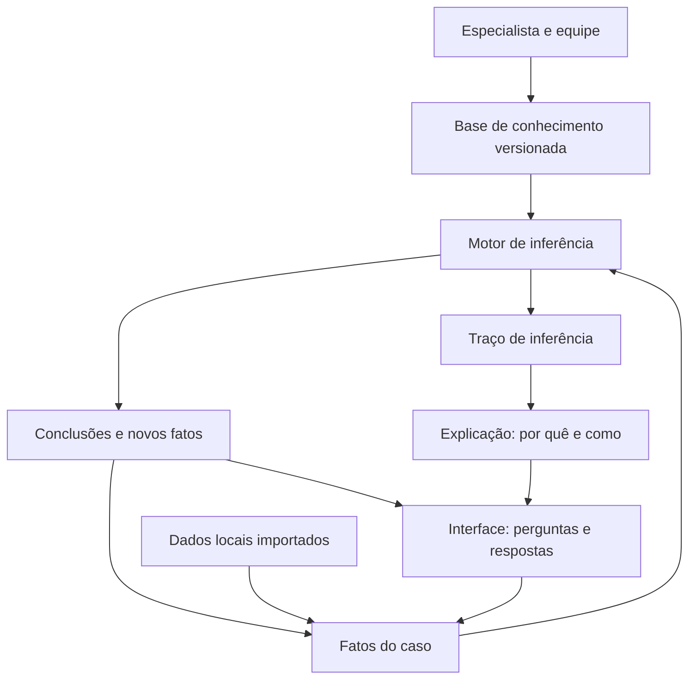

# Análise dos temas e proposta de arquitetura

**Hackathon UFJF 2026 · RERUM · Pesquisa realizada em 20/10/2026**

Este relatório reúne a leitura dos dois PDFs desta pasta, pesquisa em fontes institucionais e
documentação oficial do stack. Seu objetivo é apoiar a escolha de **um** tema e a definição de uma
prova de conceito demonstrável. As propostas de escopo, regras e testes são sugestões de engenharia;
não constituem uma base de conhecimento já homologada por especialistas.

## 1. Síntese e recomendação

Os três temas permitem a mesma arquitetura: coleta estruturada, fatos normalizados, regras
versionadas, motor de inferência e parecer acompanhado das evidências que o produziram.

| Tema | Recorte sugerido | Principal dificuldade |
| --- | --- | --- |
| T1 · Anamnese | Triagem de vacas em lactação | Validação clínica e sinais inespecíficos |
| T2 · Dietas | Formular e verificar dietas de poucos ingredientes | Unidades e modelo nutricional |
| T3 · Economia | Diagnóstico de custos e cenários | Qualidade dos registros e rateios |

**Sugestão inicial: T3**, se a prioridade for concluir um sistema consistente dentro do prazo.
Permite resultados esperados calculáveis e regras de interpretação fáceis de demonstrar. Isso não
significa maior pontuação garantida: uma calculadora financeira sem inferência não atende ao
desafio.

T1 é uma boa escolha com acesso a um veterinário que revise casos e regras. T2 é atraente com apoio
nutricional e dados de composição dos alimentos; tentar reproduzir um modelo nutricional completo
durante o evento aumenta bastante o risco de uma entrega incompleta. Essa comparação é uma avaliação
de viabilidade deste relatório, não uma classificação fornecida pela organização.

### 1.1. O que os PDFs efetivamente exigem

Fontes locais:

- [Apresentação Hackathon2026.pdf](<Apresentação Hackathon2026.pdf>), 16 páginas. As páginas 7–10
  definem o projeto; 12–14 descrevem o processo e o modelo conceitual; 15 trata da entrega.
- [Hackathon2026.pdf](Hackathon2026.pdf), 3 páginas. As páginas 2–3 consolidam objetivos, temas,
  diretrizes e documentação obrigatória.

Requisitos que devem orientar qualquer escolha:

1. Aplicação para usuário final, baseada em conhecimento explícito e motor de inferência.
2. Agente de IA utilizado na análise e no desenvolvimento. A decisão operacional deve sair das
  regras e do motor determinístico e auditável; a LLM não pode ocupar o papel de especialista.
3. Código e ferramentas abertos, com a solução final funcionando integralmente em localhost.
4. Demonstração funcional, documentação do processo, arquitetura e regras de produção, além de
  apresentação organizada do trabalho.
5. Equipes de um a três participantes. A apresentação informa inscrição e presença como condições.
6. Avaliação pelo potencial de resolver o problema; complexidade e assertividade são critérios
  adicionais. O material também valoriza a organização do grupo e o aprendizado.

O cronograma informado é: início em **20/10 às 9h**, entrega até **22/10 às 20h** e demonstração em
**23/10 às 9h**. O relatório compara os três temas para seleção; o regulamento pede escolher um.

## 2. Como interpretar a estrutura recomendada

Um sistema especialista representa conhecimento de um domínio e aplica esse conhecimento a fatos de
um caso. Uma regra pode ser lida como: **se determinadas condições forem satisfeitas, então produza
uma conclusão, uma pendência ou uma orientação**. O motor organiza a avaliação dessas regras e
permite que uma conclusão intermediária sirva de entrada para outra regra.

Isso distingue inferência de uma lista fixa de mensagens: o parecer depende das evidências do caso,
das regras aplicáveis, de sua combinação e do conhecimento que ainda falta obter.

O modelo da página 14 da apresentação pode ser implementado assim:



Três separações são essenciais:

- **Conhecimento:** regras, variáveis, unidades, referências, limites e condições de aplicação.
- **Memória de trabalho:** respostas, medidas e conclusões de um caso específico.
- **Inferência e explicação:** avaliação das condições e registro do caminho até o resultado.

A aquisição de conhecimento deve combinar pesquisa, extração com apoio da IA e revisão humana.
Fontes externas, sensores e APIs são possibilidades do modelo conceitual, não obrigações do MVP.
Para a demonstração, dados digitados e arquivos locais evitam dependência de serviços externos.

## 3. T1 · Anamnese e triagem explicável

### 3.1. Problema e proposta de solução

**Pergunta principal:** quais sinais e antecedentes exigem atenção prioritária, quais hipóteses
merecem investigação e quais informações faltam para encaminhar o caso?

Propor um assistente de anamnese para vacas em lactação, com perguntas progressivas, classificação
de prioridade e resumo para o veterinário. Começar por alterações de leite/úbere e alterações
metabólicas no início da lactação. O resultado deve expressar suspeitas e encaminhamentos, sem
emitir prescrição.

O comunicado da Embrapa sobre mastite clínica orienta observar úbere, aspecto do leite e
comportamento do animal. Já o manual veterinário mostra que sinais de cetose podem ser inespecíficos
e que exames de corpos cetônicos têm papel relevante. Portanto, queda de produção isolada não
sustenta diagnóstico fechado. [Embrapa: mastite clínica][A1]; [MSD: hipercetonemia][A2].

### 3.2. Dados necessários

- Animal: identificação, raça, idade, número de partos, peso estimado e origem dessa estimativa.
- Contexto produtivo: data do parto, dias em lactação, produção habitual e recente, unidade e
  período.
- Evolução: início dos sinais, duração, agravamento e ocorrência em outros animais do lote.
- Estado geral: apetite, ingestão de água, comportamento e capacidade de ficar em pé.
- Sinais observáveis: alterações respiratórias, fezes, ruminação e sinais de desidratação.
- Úbere e leite: quarto afetado, dor, calor, inchaço, grumos, sangue e alteração de aspecto.
- Histórico: episódios anteriores, mudança de alimentação e intervenções já realizadas.
- Medidas e exames: temperatura, CMT, CCS e corpos cetônicos, quando disponíveis, com método,
  unidade, data e responsável pelo registro. Diferenciar relato de medição efetiva.

Cada resposta deve admitir **sim**, **não** e **não informado/não observado**. A ausência de um
exame não equivale a resultado negativo. O formulário deve explicar a finalidade das perguntas
relevantes.

### 3.3. O que analisar e pesquisar antes de codificar

1. **Prioridade antes da hipótese.** Definir com veterinário quais sinais interrompem o questionário
  e demandam atendimento imediato. Incapacidade de permanecer em pé é um exemplo importante de
  apresentação clínica no material sobre paresia puerperal; não identifica sozinha sua causa. [MSD:
  seção sobre paresia puerperal][A3], artigo *Parturient Paresis in Cows*.
2. **Diagnósticos diferenciais.** Mapear causas alternativas para anorexia e redução de leite,
  evitando transformar sinais compartilhados em uma única doença.
3. **Forma clínica e subclínica.** A Embrapa distingue a forma subclínica, sem alterações visíveis,
  cuja identificação depende de exames do leite. Ausência de alteração visível não permite declarar
  o animal livre de mastite. [Embrapa][A4].
4. **Faixas e critérios.** Qualquer corte de temperatura ou exame precisa de fonte, unidade, método,
  população de aplicação e revisão especializada. Não adotar números encontrados fora de contexto.
5. **Coexistência de problemas.** Permitir mais de uma suspeita e mais de um alerta por atendimento.
6. **Confiabilidade da informação.** Perguntar o que o usuário consegue observar; oferecer opções
  claras quando ele não souber avaliar um sinal.

### 3.4. Exemplos de regras de produção

Os exemplos abaixo são candidatos para discussão com o especialista, não protocolos homologados.

- **ANA-01:** se o animal não consegue ficar em pé, então sinalizar atendimento veterinário
  prioritário e interromper perguntas secundárias. A prioridade não depende de fechar diagnóstico.
- **ANA-02:** se há grumos ou alteração relevante no aspecto do leite, então registrar alteração
  mamária a investigar e solicitar informações do úbere e do estado geral. Referência: [A1].
- **ANA-03:** se há alteração mamária e sinais gerais de comprometimento, então elevar a prioridade
  segundo o protocolo revisado e mostrar quais sinais motivaram o encaminhamento. Referência: [A1].
- **ANA-04:** se há redução de apetite e de produção no início da lactação, então incluir alteração
  metabólica entre as hipóteses e registrar necessidade de avaliação/exames. Referência: [A2].
- **ANA-05:** se falta uma informação decisiva, então solicitar a próxima pergunta ou emitir parecer
  inconclusivo; não converter a pendência em ausência de doença.

Encadeamento demonstrável: alteração do leite → investigação mamária → combinação com sinais gerais
→ prioridade e explicação. Mostrar também quais hipóteses permaneceram sem evidência suficiente.

### 3.5. MVP, testes e demonstração

**Telas:** identificação e histórico; sinais; perguntas condicionais; parecer; consulta ao
histórico. O parecer deve conter prioridade, evidências, suspeitas, pendências, fontes e versão da
base.

Casos mínimos de teste, com resultados esperados revisados:

1. Alteração apenas no leite: investigar problema mamário, sem concluir agente causador.
2. Alteração mamária com comprometimento geral: aplicar a prioridade prevista no protocolo.
3. Animal incapaz de levantar: priorizar atendimento mesmo com histórico incompleto.
4. Queda de produção isolada: solicitar contexto, sem diagnóstico automático.
5. CMT não realizado: manter estado desconhecido, sem classificá-lo como negativo.
6. Duas suspeitas compatíveis: conservar ambas e suas evidências.
7. Correção de resposta: recalcular e remover conclusões que perderam sustentação.

Avaliar concordância de prioridade com casos revisados, omissão de sinais críticos, frequência de
parecer inconclusivo e quantidade de perguntas necessárias. Casos sintéticos verificam a lógica; não
demonstram acurácia clínica em campo.

## 4. T2 · Formulação e verificação de dietas

### 4.1. Problema e proposta de solução

**Pergunta principal:** uma dieta atende ao perfil do lote e, entre combinações permitidas, qual tem
menor custo dentro das restrições nutricionais consideradas?

Implementar dois modos: verificar uma dieta informada e gerar uma formulação candidata. Restringir o
MVP a vacas em lactação e poucos ingredientes. Registrar todos os atributos exigidos pelo enunciado:
raça, peso médio do lote, idade, estado produtivo, destinação econômica e produção.

O manual da Embrapa apresenta conceitos, composição de alimentos e métodos de formulação, incluindo
o cuidado de usar a mesma base de referência para ingredientes e exigências. A referência NASEM de
2021 amplia a modelagem de exigências e utilização de nutrientes; sua página institucional confirma
o escopo, mas não substitui o estudo das equações do livro. [Manual Embrapa][N1]; [NASEM][N2].

### 4.2. Dados necessários

- Lote: tamanho, raça, peso médio, dispersão dos pesos, idade e estágio de lactação/gestação.
- Produção: leite por animal/dia e, quando exigido pelo modelo, composição e unidade de medida.
- Destinação econômica: objetivo produtivo e critério de custo, sem substituir limites nutricionais.
- Manejo: sistema de alimentação, consumo observado ou estimado, sobras e disponibilidade de água.
- Ingrediente: quantidade na matéria natural, teor de matéria seca e composição na base seca.
- Nutrientes: proteína bruta, fibra em detergente neutro, medida energética escolhida e minerais
  abrangidos pelo modelo. Identificar claramente nutrientes que o MVP não consegue verificar.
- Restrições: disponibilidade, mínimos/máximos por ingrediente e combinações não permitidas.
- Custo: preço, unidade comercial, frete/perdas quando incluídos e data da informação.
- Procedência: análise laboratorial ou tabela, data, edição e contexto de aplicação.

Não misturar percentual e fração, kg de leite e litros, kg por lote e kg por animal, nem matéria
natural e matéria seca. Valores médios de tabelas não equivalem à análise do alimento da
propriedade.

### 4.3. Cálculos e decisões que precisam ser explícitos

Adotando quantidades por animal/dia, com percentuais convertidos em frações:

```text
MS_i = quantidade_natural_i × fracao_MS_i
nutriente_i = MS_i × fracao_nutriente_na_MS_i
MS_total = soma(MS_i)
concentracao_nutriente = soma(nutriente_i) / MS_total
custo_diario = soma(quantidade_natural_i × preco_por_kg_natural_i)
```

Exemplo aritmético sintético: 20 kg de um alimento com 35% de MS fornecem 7 kg de MS. Se ele contém
8% de PB na MS, fornece 0,56 kg de PB. Isso ilustra conversões, não uma dieta recomendada.

Antes da implementação, selecionar um único sistema de exigências e documentar suas limitações. Não
tratar NDT como se fosse energia líquida, nem PB como substituto completo de proteína metabolizável.
A comparação só é válida quando oferta e exigência usam definições compatíveis.

**Formulação sugerida para o MVP:** buscar combinações de três ou quatro ingredientes em faixas e
passos declarados. Para cada candidata, calcular nutrientes, verificar restrições e comparar o custo
das alternativas viáveis. Exibir o passo usado, o número de candidatas e o critério de desempate.

Essa busca pode ser escrita em Rust sem solver externo. O resultado é a melhor opção **na grade
avaliada**, não prova de ótimo global. Se nenhuma combinação passar, dizer que nenhuma foi
encontrada nessa busca; isso não prova inviabilidade de todas as dietas possíveis.

Uma evolução seria programação linear com variáveis de quantidade, objetivo de custo e limites de
nutrientes. A linearidade precisa ser demonstrada: respostas animais e digestibilidade dependentes
da dieta podem exigir outro tratamento. O quadrado de Pearson do manual é útil didaticamente para
misturas simples, mas não resolve sozinho todas as restrições de uma dieta completa. [N1].

### 4.4. Exemplos de regras de produção

Limites devem vir de perfil nutricional versionado e revisado por profissional do domínio.

- **DIE-01:** se falta teor de MS, unidade ou composição exigida, então bloquear a classificação
  completa e identificar o dado faltante.
- **DIE-02:** se a oferta calculada de um nutriente fica abaixo da exigência do perfil, então
  apontar déficit com valor calculado, unidade e diferença para o limite.
- **DIE-03:** se a proporção de fibra ou a inclusão de um ingrediente viola o perfil, então rejeitar
  a candidata e registrar a restrição responsável.
- **DIE-04:** se todas as restrições modeladas são atendidas, então classificar como compatível
  **com o modelo implementado**, explicitando verificações nutricionais que ficaram fora dele.
- **DIE-05:** se duas candidatas são compatíveis, então preferir a de menor custo e aplicar um
  desempate determinístico previamente documentado.

O motor interpreta e explica a avaliação; o módulo de cálculo determina quantidades e concentrações.
Nenhuma regra deve prometer aumento de produção apenas por reduzir custo ou aumentar concentrado.

### 4.5. MVP, testes e demonstração

**Telas:** perfil do lote; catálogo local de alimentos; composição da dieta; formulação; comparação
de alternativas; parecer com restrições atendidas, violadas e não avaliadas.

Casos mínimos de teste:

1. Conversão conhecida de matéria natural para MS e nutrientes, usando o exemplo acima.
2. Dieta com déficit conhecido: identificar o nutriente e a diferença correta.
3. Valor exatamente no limite: respeitar a inclusão/exclusão definida no perfil.
4. Unidade incompatível ou MS ausente: impedir aprovação silenciosa.
5. Duas dietas viáveis: escolher o menor custo, respeitando o desempate.
6. Grade sem candidata viável: emitir resultado limitado à busca efetuada.
7. Variação do teor de MS de uma silagem: recalcular oferta e custo por kg de MS.
8. Quantidade zero, negativa ou lote heterogêneo: validar ou sinalizar a limitação aplicável.

Na demonstração, alterar um preço e depois um teor de MS, mostrando por que as decisões mudam.
Comparar o cálculo com um caso manual revisado, sem alegar equivalência a um modelo nutricional
completo nem validação de desempenho animal.

## 5. T3 · Economia da atividade leiteira

### 5.1. Problema e proposta de solução

**Pergunta principal:** a atividade cobre os desembolsos, repõe recursos produtivos e remunera o
capital, e quais premissas mais afetam esse resultado?

Criar um diagnóstico mensal com indicadores, regras de interpretação e comparação de cenários.
Conectar dados zootécnicos a custos: volume produzido/vendido, descarte e animais em lactação. O
diferencial é explicar a combinação de indicadores e apontar o que precisa ser investigado.

Um trabalho de Embrapa/UFJF descreve COE, COT, CT e margens para a atividade leiteira. É uma
referência **histórica de metodologia**, publicada em 2007 com dados de 2002–2006; seus preços e
resultados por escala não devem virar parâmetros atuais nem regras universais de viabilidade.
[Metodologia][E1].

### 5.2. Dados necessários e cuidados de escopo

- Período, propriedade, sistema produtivo e critérios de apropriação dos custos.
- Animais totais, animais em lactação, dias do período e produção por animal.
- Leite produzido, vendido, descartado, consumido internamente e eventuais diferenças de estoque.
- Receita do leite: volume e preço efetivos, bonificações, descontos, competência e recebimento.
- Outras receitas da atividade, registradas separadamente da venda de leite.
- Alimentação, mão de obra contratada, sanidade, reprodução, energia, manutenção e outros gastos.
- Trabalho familiar: quantidade, critério e valor de remuneração imputada.
- Bens: valor depreciável, valor residual, vida útil e fração atribuída à atividade.
- Capital: base, taxa e período de remuneração, sem dupla contagem de juros ou arrendamentos.
- Caixa: saldos, datas de pagamentos, recebimentos, investimentos, financiamentos e amortizações.

O MVP pode usar custo por litro vendido como indicador gerencial de cobertura, desde que identifique
esse denominador. Custo de produção por litro produzido é outro indicador. Não comparar os dois sem
reconciliação. Rateios e receitas com animais também precisam de política explícita.

Separar competência e caixa: compra de equipamento não vira despesa operacional integral do mês;
depreciação não é pagamento mensal. Empréstimo é financiamento, não receita operacional. O relatório
histórico [E1] contém classificações que não devem ser copiadas automaticamente para essas
políticas.

### 5.3. Indicadores e fórmulas

Convenção proposta, inspirada na decomposição de [E1], com todos os termos no mesmo período:

```text
receita_leite = soma(volume_vendido × preco_efetivo)
receita_atividade = receita_leite + outras_receitas_operacionais
COE = custos operacionais efetivos apropriados ao periodo
COT = COE + depreciacao + remuneracao_imputada_do_trabalho_familiar
CT = COT + remuneracao_do_capital_nao_computada_anteriormente
margem_bruta = receita_atividade - COE
margem_liquida = receita_atividade - COT
resultado_economico = receita_atividade - CT
custo_por_litro = custo_atribuido_ao_leite / volume_do_denominador_declarado
preco_de_cobertura_CT = (CT - outras_receitas_operacionais) / volume_vendido
saldo_final_caixa = saldo_inicial + entradas_de_caixa - saidas_de_caixa
```

O preço de cobertura só faz sentido com volume vendido positivo e custos/receitas de escopo
compatível. Para custos compartilhados, documentar o rateio antes de apresentar o indicador.

Como extensão, o ponto de equilíbrio em volume pode usar `CF / (preco - CV_por_litro)`, apenas com
custos fixos/variáveis classificados, margem de contribuição positiva e hipóteses de escala
estáveis. Se o denominador não for positivo, o modelo não fornece um volume de equilíbrio finito.

O Cepea oferece referência de mercado, não o preço contratual da fazenda. Sua metodologia distingue
preço líquido, sem frete e impostos, usa ponderação por volume e identifica o mês de captação.
Comparações precisam alinhar região, período e composição do preço. [Metodologia Cepea][E2].

### 5.4. Exemplos de regras de produção

- **ECO-01:** se a receita é menor que o COE, então apontar que a operação não cobre o custo
  operacional efetivo apropriado; mostrar as categorias com maior participação.
- **ECO-02:** se a margem bruta é positiva e a líquida é negativa, então explicar que o excedente
  não cobre depreciação e trabalho familiar segundo as premissas informadas.
- **ECO-03:** se a margem líquida é positiva e o resultado econômico é negativo, então explicar
  insuficiência para a remuneração de capital escolhida.
- **ECO-04:** se há resultado positivo, mas saldo de caixa projetado negativo, então apontar
  necessidade de revisar o calendário financeiro, exibindo recebimentos e pagamentos envolvidos.
- **ECO-05:** se o denominador é zero ou faltam custos essenciais, então não calcular o indicador
  como se estivesse completo; emitir pendência e explicitar os itens ausentes.
- **ECO-06:** se um cenário piora o resultado, então ordenar seus fatores pela contribuição
  calculada à variação. Atribuir efeitos simultâneos segundo uma decomposição documentada.

A regra deve sugerir investigação: conferir desperdício, preço de compra ou produtividade do lote,
por exemplo. Uma participação elevada de alimentação, isoladamente, não justifica cortar a dieta.
Comparações com benchmarks exigem sistemas produtivos e critérios contábeis compatíveis.

### 5.5. Exemplo completo para demonstração

Caso sintético mensal, sem outras receitas, com todos os custos atribuídos à atividade leiteira:

| Entrada ou resultado | Valor |
| --- | ---: |
| Leite vendido | 30.000 L |
| Preço recebido | R$ 2,50/L |
| Receita | R$ 75.000 |
| COE | R$ 60.000 |
| COT | R$ 70.000 |
| CT | R$ 76.000 |
| Margem bruta | R$ 15.000 |
| Margem líquida | R$ 5.000 |
| Resultado econômico | −R$ 1.000 |

O parecer deve acionar **ECO-03**: existe margem líquida, mas a remuneração de capital não é coberta
integralmente. O preço de cobertura de CT é aproximadamente R$ 2,5333/L, com essas premissas.

Se o preço cair 10%, para R$ 2,25/L, mantendo volume e custos, a receita passa a R$ 67.500, a margem
líquida a −R$ 2.500 e o resultado econômico a −R$ 8.500. Nesse cenário, aplica-se **ECO-02**. É
análise de sensibilidade, sem previsão de preço ou de resposta produtiva do rebanho.

### 5.6. MVP, testes e demonstração

**Telas:** cadastro do período; produção e receitas; custos e premissas; diagnóstico; comparação de
cenários; explicação. Adotar um período e poucas categorias antes de construir séries históricas.

Casos mínimos de teste:

1. Exemplo acima: reproduzir todos os resultados e as regras esperadas.
2. Receita entre COE e COT: interpretar a margem bruta positiva com margem líquida negativa.
3. Receita igual ao CT: resultado zero, com tratamento de limites documentado.
4. Volume zero: não dividir e não apresentar custo unitário enganoso.
5. Resultado positivo com recebimento posterior: permitir caixa negativo sem contradição.
6. Compra de bem financiado: separar investimento, financiamento, amortização e depreciação.
7. Custo familiar ausente: sinalizar incompletude da margem líquida.
8. Alteração de volume: exigir revisão de custos variáveis, sem manter tudo fixo silenciosamente.

Conferir fórmulas contra cálculos manuais, reconciliação dos volumes, arredondamento monetário e
ausência de dupla contagem. O valor da demonstração está em explicar por que cada cenário muda.

## 6. Arquitetura técnica recomendada para este repositório

### 6.1. Estado atual e escolhas de implementação

Na leitura de 20/10, o projeto contém `Cargo.toml` sem dependências, `src/main.rs` com o programa
inicial e `REQUIREMENTS.md` vazio. A arquitetura abaixo é **proposta**, não descrição de recursos
implementados. `AGENTS.md` define Rust, Axum, Maud, htmx v4, hx-live, SQLite e SQLx.

Recomenda-se um **monólito modular**, com um processo local e um banco SQLite. Para o escopo do
evento, microserviços, filas, frontend separado e um interpretador genérico de regras aumentariam o
trabalho sem benefício demonstrado.

- **Axum:** rotas, extração de formulários e estado compartilhado; tracing para o fluxo de execução.
  Reaproveitar recursos do framework em vez de construir roteamento próprio. [Documentação][T1].
- **Maud:** componentes com structs que implementem `maud::Render` e retornem `maud::Markup`,
  conforme o padrão do repositório. Separar formulário, resultado e explicação. [Documentação][T2].
- **htmx v4:** receber fragmentos HTML nas ações do formulário. Usar **hx-live** para comportamentos
  locais de interface, mantendo cálculos decisórios e validação no servidor. [htmx][T3];
  [hx-live][T4].
- **Arquivos locais:** JS minificado, CSS e demais recursos sem CDN. Fixar versão e origem dos
  arquivos; conferir a sintaxe v4 em vez de copiar exemplos de outras versões.
- **Desenvolvimento:** prever autoreload com tower-livereload e bacon, como orienta `AGENTS.md`.
  Esses recursos devem ser configurados para desenvolvimento, separados da execução de entrega.
- **SQLite/SQLx:** persistência, transações, migrações próprias e consultas em `.sql` com macros.
  `query_file!` já oferece a separação exigida, com verificação em compilação. [SQLx][T5].
- **Motor em Rust:** condições e ações representadas por tipos/enums e avaliadas explicitamente.
  Para poucas dezenas de regras, uma iteração ordenada é suficiente como ponto de partida.
- **Base de conhecimento:** arquivos JSON versionados e desserializados em tipos Rust, com regras e
  parâmetros separados da interface. Adicionar dependências somente quando houver uso concreto.

O SQLite já faz parte do stack obrigatório. Evitar acrescentar runtimes Python/Node ou serviços de
IA ao caminho de execução da aplicação; as ferramentas de desenvolvimento podem continuar externas.

### 6.2. Organização sugerida

Criar apenas o módulo do tema escolhido; os três diretórios temáticos abaixo representam
alternativas.

```text
src/
  main.rs                    # inicialização e composição
  app.rs                     # rotas e estado da aplicação
  dominio/
    fatos.rs                 # valores, unidades e estados desconhecidos
    regras.rs                # condições e ações tipadas
    inferencia.rs             # agenda e encadeamento
    explicacao.rs            # resultado e evidências
    anamnese/                # alternativa T1
    dietas/                  # alternativa T2
    economia/                # alternativa T3
  aplicacao/                 # casos de uso e coordenação das transações
  persistencia/              # repositórios SQLx
  web/
    rotas/                   # handlers HTTP pequenos
    componentes/             # componentes Maud compartilhados
    paginas/                 # formulários e resultados por funcionalidade
conhecimento/
  tema_escolhido/             # regras, perfis e referências revisadas
queries/                     # consultas .sql usadas pelas macros
migrations/                  # migrações SQLx
.sqlx/                       # metadados para compilação sem banco conectado
static/
  css/app.css                # variáveis no início; CSS plano
  js/                        # htmx v4 e hx-live locais, minificados
tests/
  casos/                     # entradas e resultados esperados
  integracao/                # cenários com banco e aplicação
docs/                        # execução, arquitetura, regras e processo com IA
scripts/                     # limite de linha e avisos de tamanho
.github/workflows/           # build, testes, clippy e formatação
```

Separar módulos quando houver responsabilidades diferentes. Como parâmetro inicial da equipe, emitir
aviso para arquivos de código acima de 300 linhas; esse valor é uma proposta, não exigência numérica
do regulamento. O limite de **100 caracteres por linha** vem de `AGENTS.md`.

### 6.3. Contrato mínimo de uma regra

Cada regra deve registrar identificador estável, versão, tema, prioridade, condições, ações,
explicação, referência com seção/página, população aplicável, parâmetros, estado de revisão e casos
de teste. Estados sugeridos: rascunho, revisada e desativada.

Exemplo conceitual: `ECO-03`, prioridade 50, exige margem líquida positiva e resultado econômico
negativo, produz conclusão sobre remuneração do capital e referencia a metodologia adotada. Seu
traço deve guardar valores de entrada, comparações, regras precedentes e texto final.

O conteúdo da base deve ser validado na carga: IDs únicos, variáveis existentes, unidades
compatíveis, fontes presentes e ações conhecidas. Não executar código arbitrário contido nos
arquivos de regras. Uma base inválida deve ser rejeitada com indicação do problema, sem uso parcial
silencioso.

### 6.4. Motor de inferência e tratamento da incerteza

Fluxo sugerido:

1. Receber e validar a entrada; normalizar unidades e identificar a versão da base.
2. Separar fatos informados de fatos calculados e registrar sua procedência.
3. Avaliar regras em ordem estável de prioridade e identificador.
4. Disparar regras satisfeitas, registrar evidências e acrescentar fatos derivados.
5. Repetir enquanto surgirem fatos novos; impedir disparos redundantes e ciclos sem progresso.
6. Produzir conclusões, alertas, perguntas pendentes e traço explicativo.
7. Persistir o resultado junto com entradas e versão exata da base utilizada.

Adotar encadeamento para frente como estratégia inicial. Para perguntas, procurar condições ainda
desconhecidas nas regras relevantes e selecionar a próxima por prioridade. Não é necessário começar
com um motor de encadeamento para trás completo.

Usar lógica de três estados: verdadeiro, falso e desconhecido. Uma conjunção com condição falsa é
falsa; sem condições falsas, mas com uma desconhecida, permanece desconhecida. A disjunção é
verdadeira se houver condição verdadeira; sem verdadeiras, mas com desconhecidas, fica desconhecida.
Uma regra só dispara quando sua condição final é verdadeira. Negar desconhecido mantém desconhecido.

Urgência e qualidade de evidência são dimensões distintas. Não apresentar percentuais de certeza sem
método validado. A apresentação menciona pesos/CF no modelo conceitual, mas não determina fórmula de
combinação. Para o MVP, estados de evidência e pendências são uma alternativa mais simples. Se CF
for adotado, documentar escala, combinação, conflito e limites de interpretação.

Alertas podem coexistir. Conclusões incompatíveis devem ficar explícitas; prioridade sozinha não
transforma uma hipótese em verdade. Após editar uma resposta, reconstruir os fatos derivados a
partir das entradas, evitando conclusões antigas. Se um limite de iterações for atingido, registrar
falha/incompletude e não emitir parecer completo.

### 6.5. Persistência e rastreabilidade

Entidades comuns sugeridas:

- `casos`: tema, situação e datas; referência ao animal, lote ou período conforme o tema.
- `respostas`: variável, valor tipado, unidade, origem, momento e estado de conhecimento.
- `versoes_base`: versão, conteúdo imutável, hash e referências utilizadas.
- `execucoes`: caso, versão da base, versão da aplicação, entradas e resultado.
- `disparos`: execução, regra, ordem, evidências e fatos derivados.

Adicionar tabelas específicas apenas para o tema escolhido: animais/observações em T1;
lotes/ingredientes/composições/dietas em T2; períodos/lançamentos/bens/cenários em T3. Não usar um
único campo de texto livre para todos os dados sem validação de tipos e unidades.

Salvar execução e traço em transação; manter resultados anteriores quando a base mudar. Guardar
apenas o hash não permite reconstruir a base: preservar também seu conteúdo ou artefato imutável.

Para dinheiro, usar centavos inteiros nos totais e representação decimal/escala explícita para
preços unitários e taxas. Quantidades físicas precisam de unidade, precisão e tolerância declaradas.
Arredondar para exibição sem destruir a precisão dos cálculos intermediários.

### 6.6. Recursos do stack que já resolvem requisitos

- `query_file!` e `query_file_as!` permitem consultas externas validadas em compilação. Usar
  caminhos relativos à raiz do pacote e evitar substituir essas macros por consultas dinâmicas.
  [T5].
- `sqlx::migrate!` permite incorporar migrações ao executável. A documentação alerta para acompanhar
  mudanças da pasta com `build.rs`, evitando deixar novas migrações fora da recompilação. [T6].
- O modo offline das macros usa metadados em `.sqlx`, preparados com `cargo sqlx prepare` contra um
  banco com migrações aplicadas. Versionar os metadados e verificar com `cargo sqlx prepare
  --check`. Compilação offline não elimina o banco usado em execução. [T7].
- Verificar integridade referencial em cada conexão SQLite. O SQLite recomenda não presumir o estado
  padrão de `foreign_keys`; conferir também a configuração aplicada pelo driver. [T8].
- WAL pode favorecer leitura e escrita concorrentes em banco local, mas não elimina contenção entre
  escritores. Usá-lo somente com necessidade identificada e arquivo no mesmo host. [T9].

## 7. Plano de entrega e critérios de aceite

### 7.1. Sequência compatível com o cronograma

1. **20/10:** escolher tema e recorte, definir entradas/saídas e preparar casos com resultado
  esperado. Revisar as primeiras regras antes de construir muitas telas.
2. **21/10:** concluir um fluxo vertical: formulário → banco → inferência → explicação. Cobrir o
  motor, as regras e os cálculos com testes; depois ampliar apenas o necessário.
3. **22/10:** exercitar casos incompletos e conflitos, conferir documentação e ensaiar a execução
  sem internet. Preparar código, documentação e apresentação antes do limite de 20h.
4. **23/10:** demonstrar caso normal, caso de atenção e caso incompleto, incluindo alteração de
  entrada e inspeção do traço de regras, a partir da aplicação em localhost.

### 7.2. Critérios comuns de aceite

- O resultado identifica a base e as regras utilizadas e explica cada conclusão com evidências.
- Uma informação ausente não é tratada como falsa nem como valor zero.
- Mesmas entradas e mesma base produzem conclusões e ordem de disparo equivalentes.
- Edição de entrada invalida conclusões antigas; resultados anteriores continuam consultáveis.
- Regras e cálculos do tema escolhido têm testes individuais e casos integrados conhecidos.
- Integração usa SQLite temporário com migrações reais e confere persistência do traço.
- Requisições HTTP relevantes testam validação, erros e fragmentos HTML esperados.
- Os fluxos da interface têm inspeção visual e testes Playwright em Chromium, WebKit e Firefox,
  conforme a orientação atualizada de `AGENTS.md`; essas ferramentas pertencem ao desenvolvimento.
- A interface funciona com arquivos locais e nenhum serviço externo é necessário à demonstração.
- CI executa build, testes, clippy, `cargo fmt --check`, limite de linha e avisos de tamanho.
- Documentação cobre execução, estrutura, banco, fluxo, testes, regras, fontes e processo com IA.
- Commits são contínuos, curtos e descritivos, em português, conforme `AGENTS.md`.

O histórico do uso da IA deve mostrar decisões, revisão de regras e correções verificadas, sem
confundir código gerado com conhecimento validado. Dados de demonstração devem ser identificados
como sintéticos. Priorizar um caminho completo e explicável antes de adicionar funcionalidades.

## 8. Perguntas a resolver com especialistas

Antes de transformar as sugestões em regras operacionais:

- **T1:** quais prioridades usar; quais sinais são decisivos; quais diferenciais e exames incluir;
  quais casos conhecidos representam erro de triagem relevante?
- **T2:** qual modelo de exigências adotar; quais ingredientes e análises estão disponíveis; quais
  limites de inclusão e perfis podem ser revisados; o lote é suficientemente homogêneo?
- **T3:** a análise é do leite ou da atividade inteira; como ratear custos; como tratar animais e
  trabalho familiar; quais dados são de competência e quais são de caixa?
- **Todos:** quem revisará a base; qual é o recorte real da prova de conceito; que evidências
  sustentam cada conclusão e que pendências impedem classificar um caso?

## 9. Fontes e limites da pesquisa

Todas as páginas abaixo foram consultadas em **20/10/2026**. Foram priorizados materiais de Embrapa,
MSD Veterinary Manual, National Academies, Cepea e documentação oficial das tecnologias. As
referências antigas são identificadas por edição/data; não se presume que seus parâmetros
representem automaticamente condições atuais ou todos os sistemas de produção brasileiros.

### 9.1. Sanidade e anamnese

- **[A1] Embrapa, 2012.** *Diagnóstico de casos clínicos de mastite*, Comunicado Técnico 67.
  Consultados o registro e o comunicado: sinais do úbere, leite e estado geral. [Registro e acesso
  ao PDF][A1].
- **[A2] MSD Veterinary Manual.** *Hyperketonemia in Cattle*: sinais inespecíficos, contexto de
  lactação, diagnóstico e papel dos testes. [Artigo consultado][A2].
- **[A3] MSD Veterinary Manual.** Seção *Parturient Paresis in Ruminants*, com acesso a *Parturient
  Paresis in Cows*, artigo também consultado: sinais e diagnósticos diferenciais. [Seção e acesso ao
  artigo][A3].
- **[A4] Embrapa, 2010.** *Conhecendo melhor a mastite clínica*: distinção entre manifestações
  clínicas e subclínicas, observação e severidade. Consultado como apoio conceitual, sem adotar seus
  números de prevalência ou protocolos terapêuticos na proposta. [Registro e acesso à
  publicação][A4].

### 9.2. Nutrição

- **[N1] Embrapa Rondônia, 2020.** *Manual prático de formulação de ração para vacas leiteiras*, 2ª
  edição, Documentos 167. Consultadas seções de nutrientes, tabelas, bases de cálculo e métodos de
  formulação. [Registro e acesso ao manual][N1].
- **[N2] National Academies, 2021.** *Nutrient Requirements of Dairy Cattle: Eighth Revised
  Edition*. Consultada a página institucional do projeto e sua descrição de escopo. As equações do
  modelo não foram implementadas nem validadas neste trabalho. [Projeto e publicação][N2].

### 9.3. Economia

- **[E1] Verneque e colaboradores, Embrapa/UFJF, 2007.** *Custos e resultados econômicos da
  atividade leiteira no estado de Minas Gerais, Brasil*. Consultados registro e texto, especialmente
  Material e Métodos. Referência histórica para COE/COT/CT e margens; observar as ressalvas da seção
  5. [Registro e acesso ao trabalho][E1].
- **[E2] Cepea/Esalq-USP.** Metodologia do indicador de leite: unidade, preço líquido, ponderação e
  mês de captação. Não foram adotadas cotações como premissas dos exemplos. [Metodologia][E2].

### 9.4. Arquitetura e implementação

- **[T1] Axum:** documentação da biblioteca para roteamento, extração e estado. [Referência][T1].
- **[T2] Maud:** integração de templates HTML com Rust e verificação em compilação.
  [Referência][T2].
- **[T3] htmx v4:** requisições e substituição de HTML. [Referência][T3].
- **[T4] hx-live:** estado do DOM, expressões e comportamentos locais. [Referência][T4].
- **[T5] SQLx, `query_file!`:** consultas SQL em arquivos separados. [Referência][T5].
- **[T6] SQLx, `migrate!`:** migrações incorporadas e recompilação. [Referência][T6].
- **[T7] SQLx, `query!`:** requisitos de compilação e modo offline. [Referência][T7].
- **[T8] SQLite, Foreign Key Support:** ativação e conferência da integridade. [Referência][T8].
- **[T9] SQLite, Write-Ahead Logging:** concorrência e restrição ao mesmo host. [Referência][T9].

Os links `latest` refletem a documentação consultada, não uma versão já adotada pelo projeto. Ao
implementar, fixar versões compatíveis, preservar `Cargo.lock` e revisar a documentação dessas
versões. A pesquisa oferece base para decisões e aquisição de conhecimento; ainda faltam revisão
especializada, dados locais e validação em casos reais para uso operacional.

### 9.5. Como atualizar este levantamento

Repetir a leitura dos PDFs se houver nova edição; pesquisar os recortes de sanidade, formulação e
COE/COT/CT nas instituições citadas; conferir a documentação das versões escolhidas; registrar data,
seção consultada e mudanças nas conclusões. Saída esperada: este relatório Markdown e, após a
escolha do tema, uma base revisada com casos de teste. O cache de pesquisa `.firecrawl/` é local e
ignorado pelo Git; as referências necessárias para rastrear o relatório estão nesta seção.

[A1]: https://www.infoteca.cnptia.embrapa.br/infoteca/handle/doc/930366
[A2]:
https://www.msdvetmanual.com/metabolic-disorders/hyperketonemia-in-cattle/hyperketonemia-in-cattle
[A3]: https://www.msdvetmanual.com/metabolic-disorders/parturient-paresis-in-ruminants
[A4]: https://www.infoteca.cnptia.embrapa.br/infoteca/handle/doc/886649
[N1]: https://www.infoteca.cnptia.embrapa.br/infoteca/handle/doc/1123902
[N2]: https://www.nationalacademies.org/projects/DELS-BANR-13-02
[E1]: https://www.alice.cnptia.embrapa.br/alice/handle/doc/595321
[E2]: https://www.cepea.org.br/br/metodologia/leite.aspx
[T1]: https://docs.rs/axum/latest/axum/
[T2]: https://maud.lambda.xyz/
[T3]: https://four.htmx.org/
[T4]: https://four.htmx.org/extensions/hx-live
[T5]: https://docs.rs/sqlx/latest/sqlx/macro.query_file.html
[T6]: https://docs.rs/sqlx/latest/sqlx/macro.migrate.html
[T7]: https://docs.rs/sqlx/latest/sqlx/macro.query.html
[T8]: https://www.sqlite.org/foreignkeys.html
[T9]: https://www.sqlite.org/wal.html
