# 1. Apresentação e alcance

O FeedYourCow! é um sistema especialista local para apoiar a verificação de dietas e a
formulação de alternativas de menor custo para vacas adultas em lactação. A aplicação reúne
conhecimento versionado, um motor determinístico e uma interface web em português. Cada parecer
conserva as entradas, as regras e as evidências usadas no cálculo.

O perfil é `E2020_NRC1989_RUMEN_MVP_v1`. Os exemplos iniciais são sintéticos. O processo
de desenvolvimento e a pesquisa do Tema 2 estão em PDFs separados nesta entrega.

## 1.1. Problema e objetivos

O programa responde a duas perguntas complementares: a dieta informada atende ao perfil
implementado? Qual dieta de menor custo pode ser encontrada para os ingredientes, preços,
estoques e restrições do cenário? Verificar conserva as quantidades informadas; formular busca
uma candidata e a submete à mesma avaliação. A comparação econômica usa execuções compatíveis,
sem prever produção futura de leite.

## 1.2. Perfil de aplicação e limites

O perfil atende **vacas adultas em lactação**, confinadas, com dieta total quantificável, peso
estável, sem gestação, crescimento, mobilização de reservas nem correção necessária por ambiente
ou atividade. Aceita peso vivo de **300–800 kg**, gordura do leite de **3–5%**, leite corrigido a
4% de **5–30 kg/animal/dia** e **60–250 dias em lactação**. As tabelas originais cobrem peso
400–700 kg para exigências e 400–600 kg para consumo; fora dessas faixas tabeladas, mas dentro do
perfil, o cálculo extrapola linearmente e precisa avisar da menor precisão.

O núcleo avalia NDT, PB, Ca, P, FDN total e de forragem, amido, EE, inclusão, estoque, segurança
de ingredientes e contaminantes quando houver dados e referência aplicável. Não implementa
integralmente NASEM 2021 ou BR-LEITE 2024. Fibra física, vitaminas, aminoácidos, água e outros
micronutrientes não recebem aprovação por inferência. Não há previsão de produção de leite,
diagnóstico clínico, prescrição, integração obrigatória com rede ou cálculo para outras categorias
animais. O sistema não apresenta uma dieta como segura ou adequada em todas as dimensões.

## 1.3. Vocabulário de leitura

| Sigla ou termo | Significado |
| --- | --- |
| MN / MS | Matéria natural / matéria seca. |
| PV / LCG4 | Peso vivo / leite corrigido para 4% de gordura. |
| NDT / PB | Nutrientes digestíveis totais / proteína bruta. |
| Ca / P | Cálcio / fósforo. |
| FDN / EE | Fibra em detergente neutro / extrato etéreo. |
| Verificação | Avaliação de quantidades informadas, sem modificá-las. |
| Formulação | Busca contínua de menor custo sob as restrições do modelo. |
| Fornecimento prático | Oferta arredondada à resolução de pesagem e revalidada. |
| Revisão / execução | Versão de um cadastro / avaliação imutável de um cenário. |

# 2. Dados e requisitos

O contrato separa a identidade dos cadastros, suas revisões e os dados comerciais de cada
cenário. Os identificadores RF, RN e RNF permitem relacionar requisitos, implementação e testes.

## 2.1. Dados de lote

Registrar identidade, revisão, número positivo de animais, raça, idade quando conhecida, peso,
produção de leite em kg/animal/dia, gordura em pontos percentuais, dias em lactação, estado
produtivo, destinação e condições de manejo. Gestação, crescimento, classe adulta, peso estável,
confinamento, água e correções por ambiente/atividade usam **sim**, **não** ou **desconhecido**.
Desconhecido não confirma ausência de uma condição. Ordem de parto, dispersão de peso e condição
corporal são complementares. Lotes heterogêneos devem ser separados antes da análise.

## 2.2. Dados de alimento e produto

Separar identidade do alimento, revisão de composição e produto/lote físico. A composição traz
MS em kg MS/kg MN; NDT, PB, Ca, P, FDN, amido e EE em kg nutriente/kg MS. Preservar valor e
unidade originais, fonte, edição, localizador, natureza, método, data e processamento. Valores
ausentes continuam ausentes. Médias, análises, garantias mínimas/máximas e hipóteses sintéticas
têm significados diferentes; garantia unilateral não alimenta cálculo como ponto exato.

Registrar origem animal, NNP adicionado, medicamento, autorização, evidência de uso, fornecedor,
lote e limites de rótulo quando aplicáveis. Laudos de contaminantes precisam de analito, matriz,
unidade, umidade, método, documento e qualificador. Ausência de laudo não comprova ausência de
contaminação. Não inventar fabricantes, laudos ou autorizações para completar exemplos.

## 2.3. Dados de cenário

Registrar nome, revisão do lote, perfil, datas de avaliação e aplicação de regras, horizonte
positivo em dias, modo verificar/formular, base das quantidades, ingredientes selecionados,
preço e origem da cotação, estoque bruto ou hipótese explícita de disponibilidade sem limite,
perdas, sobras, limites de inclusão e resolução de oferta. Preço pode ser informado por kg MN,
tonelada MN ou embalagem com massa. Consumo-alvo ou medição de oferta e sobras é opcional;
quando ausente, usar a referência do perfil. Preço do leite e referência adicional UE para
contaminantes também são opcionais.

As bases internas são kg, dia, animal, kg MS/kg MN, kg nutriente/kg MS e R$/kg MN. Oferta,
consumo, massa por animal e massa por lote não são intercambiáveis. O cenário admite de **1 a 20
ingredientes na verificação** e de **1 a 10 na formulação**. O limite total de busca é positivo
e não excede 10 segundos. Entradas não finitas, unidades incoerentes, percentuais fora da faixa,
estoque negativo ou preço sem origem devem ser rejeitados com indicação de campo.

## 2.4. Requisitos funcionais

| ID    | Comportamento e critério observável                                              |
| ----- | -------------------------------------------------------------------------------- |
| RF-01 | `preparar` aplica migrações, perfil e exemplos sem duplicar ou desfazer edições. |
| RF-02 | Cadastrar, revisar, copiar e desativar lotes sem alterar execuções antigas.      |
| RF-03 | Cadastrar e revisar alimentos, composições, fontes e condições de produto.       |
| RF-04 | Informar custos, unidade comercial, perdas, estoque e inclusão por cenário.      |
| RF-05 | Consultar perfil, coeficientes, normas, fontes e versões usados.                 |
| RF-06 | Construir cenários editáveis e escolher verificar ou formular.                   |
| RF-07 | Validar dados e enquadrar lote, ingredientes e perfil antes da conclusão.        |
| RF-08 | Obter consumo-alvo informado/medido ou referência calculada, com origem visível. |
| RF-09 | Verificar dieta informada sem alterar suas quantidades.                          |
| RF-10 | Formular candidata de menor custo e indicar o estado de cada subproblema.        |
| RF-11 | Mostrar oferta e consumo por animal/lote e revalidar resolução de pesagem.       |
| RF-12 | Comparar custos somente entre execuções da mesma revisão do mesmo lote.          |
| RF-13 | Exibir parecer por dimensão, regra, valor, limite, fonte e dependências.         |
| RF-14 | Preservar execução imutável e permitir consulta e impressão do histórico.        |
| RF-15 | Duplicar ou reutilizar candidata em nova simulação sem substituir o original.    |
| RF-16 | Aplicar cargas versionadas de conhecimento com integridade e hash.               |
| RF-17 | Fazer backup consistente e restaurar em destino novo após verificações.          |
| RF-18 | Entregar pacote nativo com recursos, cargas e instruções de operação.            |
| RF-19 | Oferecer catálogo sintético inicial e restauração explícita de exemplos.         |

A consulta ao histórico não oferece reexecução com versões originais. **Duplicar e simular** usa o
conhecimento ativo em uma nova execução. A impressão curta de fornecimento deve indicar recusa
quando as quantidades práticas não estiverem validadas.

## 2.5. Regras de negócio

| Identificação | Tema | Requisito |
| --- | --- | --- |
| RN-01–02 | perfil e incerteza: | condição fora do perfil bloqueia recomendação; dado desconhecido permanece pendente, enquanto violação demonstrada permanece visível. |
| RN-03–04 | unidades e oferta: | converter MN/MS e preços antes de somar; contabilizar sobras e perdas uma vez; preservar dados e unidades originais no parecer. |
| RN-05–08 | exigências e consumo: | interpolar tabelas do perfil, calcular LCG4, escolher consumo informado quando disponível e apresentar balanço, déficit e cobertura por nutriente. |
| RN-09–10 | barreiras: | aplicar a linha efetiva de fibra e as políticas do MVP. Fibra física sem método/perfil completo e micronutrientes permanecem não avaliados. |
| RN-11–14 | ingredientes e normas: | autorização e proibições dependem de identidade, jurisdição, vigência e evidência. NNP adicionado, medicamentos e subprodutos animais são excluídos da formulação automática. Laudos só são comparados a analito, matriz, unidade e referência compatíveis; a referência UE é opcional e identificada como estrangeira. |
| RN-15–16 | fornecimento: | perdas, sobras, número de animais, horizonte, rótulo e estoque limitam a oferta. Estoque vazio não significa ilimitado. |
| RN-17–19 | busca: | resolver cinco problemas lineares, revalidar cada candidata, ordenar por custo e desempatar de modo determinístico. Interrupção não prova inviabilidade nem ótimo. |
| RN-20–21 | prática e economia: | resolução zero conserva aproximação contínua; pesagem recomendável exige resolução positiva dos itens usados e revalidação. Custo e economia dependem de base e premissas comparáveis, sem prever produção futura. |
| RN-22–24 | explicação e histórico: | preservar entrada, regra, fonte, versão e traço. Execução concluída é imutável; tolerâncias e formatação não podem esconder violações. |

## 2.6. Requisitos não funcionais

| Identificação | Requisito |
| --- | --- |
| RNF-01–04 | servidor local em Rust/Axum, páginas Maud, htmx/hx-live locais, CSS plano e SQLite via SQLx com migrações e macros sobre arquivos SQL separados. |
| RNF-05–07 | uso offline após instalação, resultados reproduzíveis com fatos/versionamento preservados, escrita protegida por POST, CSRF, origem e limites de requisição. |
| RNF-08–09 | meta p95 de até 1 s para verificar 20 ingredientes e 5 s para formular 10, timeout/cancelamento efetivo, erros úteis e tracing. |
| RNF-10–12 | testes Rust, navegador e pacote; build, testes, Clippy, rustfmt, SQLx e qualidade textual no CI; documentação sincronizada às mudanças. |
| RNF-13–14 | recarga opcional em desenvolvimento, interface de trabalho em português, ajuda contextual, teclado, impressão e fluxos essenciais sem JavaScript. |

## 2.7. Critérios de aceite

Uma revisão só atende o contrato quando:

1. Um banco novo abre o cenário sintético completo sem cadastro manual prévio.
2. Verificação e formulação apresentam dimensões independentes, restrições e limites.
3. Candidata de formulação tem estado de busca correto e passa por revalidação.
4. Arredondamento incompatível recusa recomendação prática sem apagar o contínuo.
5. Revisões, histórico, comparação restrita e backup preservam dados anteriores.
6. Build, testes Rust, verificações estáticas e testes de navegador do CI passam.
7. Pacote de release prepara, serve e restaura um banco temporário com documentação local.

# 3. Fluxo de uso e interpretação

Com o banco preparado, o trabalho segue da escolha do lote à leitura do parecer. Os comandos
de instalação e preparação estão no capítulo 6; este capítulo descreve as ações na interface.

## 3.1. Percurso da primeira simulação



1. Após `preparar` e `servir`, abra <http://127.0.0.1:3000>.
2. Na **Visão geral**, clique em **Abrir cenário de exemplo**.
3. Revise lote, ingredientes, quantidades, preços e hipóteses.
4. Clique em **Calcular e salvar cenário**.
5. Leia primeiro **Resultados por dimensão** e as advertências. Depois examine balanço,
   restrições, custo e fornecimento.

O atalho inicial verifica as quantidades preenchidas; não procura um custo mínimo. As opções
**Demonstração A** e **Demonstração B** em **Nova dieta** dependem dos cadastros das fixtures e
pedem confirmação antes de substituir o rascunho.


*Captura de teste; os contadores de um banco novo serão diferentes.*

## 3.2. Cadastros, cópias e revisões

**Lotes de animais:** cadastre ou revise identificação, número de animais, peso médio, produção,
gordura do leite, dias em lactação e condições de manejo. Estados como gestação, crescimento e
confinamento distinguem **sim**, **não** e **desconhecido**. Um campo desconhecido não deve ser
preenchido como “não”. Separe grupos heterogêneos em lotes diferentes.

**Alimentos:** consulte a procedência e crie uma composição ou nova revisão. MS é percentual da
matéria natural (MN); NDT, PB, Ca, P, FDN, amido e EE são percentuais da matéria seca (MS).
Registre fonte, natureza do valor, método, data, processamento, produto/lote e evidências. Uma
média tabelada ou um exemplo sintético não representa a análise do alimento disponível na
fazenda. Garantias unilaterais não são composição pontual. Preço e estoque pertencem ao cenário,
não à ficha da composição.

Modelos de preenchimento podem ajudar a iniciar o cadastro, mas exigem revisão e não confirmam
estados de segurança. **Criar cópia** faz um cadastro independente; **Salvar revisão** preserva a
versão anterior. Na seleção de ingredientes, cada opção identifica sua composição, MS, PB e data
da análise; data ausente permanece “Não informada”. Confira esses dados ao escolher entre análises
do mesmo alimento. Excluir um exemplo retira a opção ativa sem apagar execuções históricas.
**Restaurar exemplos** exige confirmação e pode criar cópia ou nova revisão do registro inicial.
Repetir `preparar` não desfaz alterações nem restaura exclusões.


A data da composição é opcional. Quando preenchida, deve ser uma data civil válida
(`AAAA-MM-DD`). Revisões antigas com datas inválidas mostram o valor original e exigem
correção ou confirmação explícita de remoção. Execuções históricas permanecem intactas.
Cancelar preserva o tipo: cadastrar novamente após cancelar lote abre outro lote.

## 3.3. Montagem do cenário

Em **Nova dieta**, dê um nome, selecione lote e tipo de cálculo, informe horizonte e datas de
avaliação e de aplicação das regras. Em **Selecionar ingredientes**, marque somente as composições
necessárias e atualize a seleção. O formulário exibe campos apenas dos itens marcados. É possível
cadastrar outro alimento em nova guia e usar **Atualizar cadastros** para incorporá-lo.


_Captura de teste de uma dieta ainda em edição; preços e estoques vazios precisam ser definidos._

**Quantidades e preços**

Escolha uma das bases de entrada: **consumo em kg MS/animal/dia**, **consumo em kg MN/animal/dia**
ou **oferta em kg MN/animal/dia**. Na verificação, preencha a quantidade de cada ingrediente. Na
formulação, as quantidades digitadas não são usadas como ponto inicial: o motor calcula uma
distribuição. Preencha preço e origem da cotação para cada item. A interface aceita R$/kg MN,
preço por tonelada MN ou por embalagem com massa informada. Preço zero também precisa de origem.

Estoque vazio significa **desconhecido**. Informe estoque bruto em kg MN ou marque explicitamente
a hipótese de disponibilidade ilimitada. Nas configurações do ingrediente, ajuste MS apenas para
o cenário atual, perdas anteriores ao fornecimento, inclusão mínima/máxima, teto aplicável e
resolução de pesagem. Fornecimento depende de sobras, perdas, animais e horizonte.

**Premissas avançadas**

O consumo-alvo em kg MS/animal/dia é opcional. Se vazio, o motor usa a referência do perfil. Uma
medição de consumo pode ser informada com MS ofertada e MS das sobras do mesmo lote/período.
Oferta não prova ingestão homogênea. Registre origem de sobras e perdas mesmo quando são zero.
Preço do leite é opcional para margem sobre alimentação. A referência adicional da União Europeia
para contaminantes é opcional e não se apresenta como limite legal brasileiro.

A verificação aceita até **20 ingredientes**; a formulação, até **10**. Se houver erro, os campos
inválidos são identificados e o rascunho válido permanece. O fluxo essencial funciona sem
JavaScript; atualizações por htmx tornam a interação mais rápida quando disponíveis.

## 3.4. Leitura do parecer

- **ATENDE** descreve somente a dimensão avaliada.
- **NÃO ATENDE** indica pelo menos uma restrição violada naquela dimensão.
- **INCONCLUSIVO** indica dado necessário desconhecido ou incompatível.
- **NÃO AVALIADO** indica dimensão fora do núcleo ou sem regra aplicável.
- **FORA DO PERFIL** e **BLOQUEADO** impedem recomendação compatível com o perfil.

Na formulação, confira o **estado da busca** antes do custo e das quantidades. Um resultado
contínuo pode ser ótimo no modelo e ainda não fornecer uma pesagem recomendável. Resolução zero
significa quantidade contínua aproximada; uma recomendação prática exige resolução positiva em
cada ingrediente usado e revalidação da dieta arredondada. A
captura de recusa prática mostra como o parecer conserva a solução
contínua enquanto recusa o fornecimento incompatível.

**Cálculos e regras aplicadas** mostram valores, limites, unidades, fontes e caminho de inferência.
**Entradas preservadas** e **Fontes e versões preservadas** identificam o que foi usado. Fibra
física, água, micronutrientes e outras dimensões sem perfil completo permanecem separadas; uma
conclusão química favorável não aprova a dieta integralmente.

| Nível | Estados preservados |
| --- | --- |
| Regra | `ATENDE`, `VIOLA`, `DESCONHECIDO`, `NAO_APLICAVEL`. |
| Dimensão | `ATENDE`, `NAO_ATENDE`, `INCONCLUSIVO`, `NAO_AVALIADO`. |
| Execução | `INVALIDO`, `FORA_DO_PERFIL`, `BLOQUEADO`, `AVALIADO`. |

## 3.5. Histórico, comparação e impressão

**Duplicar e simular** cria um cenário editável vinculado à execução de origem sem substituir o
parecer antigo. Após uma formulação com candidata, **Refazer otimização** conserva as premissas,
**Ajustar e verificar solução contínua** copia a dieta calculada, e **Ajustar e verificar
quantidades práticas** copia a oferta arredondada quando ela existe. Copiar quantidades não
significa aprová-las; a nova execução precisa ser avaliada.


O histórico preserva entradas e conclusões em vez de recalcular versões antigas. Só é possível
comparar execuções da mesma revisão do mesmo lote. **Imprimir parecer** gera o relatório
completo; **Imprimir ficha de fornecimento** gera a versão operacional com sua condição de uso.
Ambas podem ser salvas como PDF pelo navegador.


No histórico, escolha **Fixar como referência** na execução desejada. A referência acompanha
os filtros e a navegação entre páginas pela URL. Escolha a alternativa na página atual e
clique em **Comparar premissas e custos**. Alternativas de outro lote ou revisão ficam
identificadas como incompatíveis. **Remover referência** libera uma nova escolha.
Uma referência inexistente permite limpar a seleção. O fluxo funciona sem JavaScript.

A comparação apresenta consumo, oferta e custo de cada ingrediente a partir do parecer salvo,
e não das quantidades iniciais de uma otimização. Mostra revisões diferentes, balanço
nutricional e estados por dimensão. Quantidades práticas ficam separadas e mantêm o aviso de
validação. Sem candidata, pesagem definida ou associação única da composição, mostra
**Indisponível**. Registros antigos só usam o nome para associação quando ele é único.

Datas de avaliação e aplicação das regras, versões e conhecimento preservado participam da
comparação de premissas. Qualquer diferença aparece com motivo específico; o detalhamento do
conhecimento mostra os valores antigos e novos. A diferença de custo continua disponível
para inspeção, acompanhada do aviso de não equivalência. Outro lote ou revisão permanece
bloqueado. A comparação usa apenas dados históricos, sem executar novamente o motor.

Na impressão da comparação, o relatório pode continuar nas páginas seguintes sem separar o título
da primeira tabela. Cabeçalhos e linhas curtas são mantidos juntos quando houver espaço.

# 4. Motor de inferência

A entrada pública `dominio::motor::avaliar` recebe o cenário e o conhecimento da execução.
O domínio calcula sem acessar HTTP ou SQLite; o serviço da aplicação preserva o resultado
em transação após o cálculo. Os coeficientes e regras vêm de
`dados_referencia/001_conhecimento.sql`.

## 4.1. Sequência de avaliação



A agenda de verificação percorre etapas em ordem fixa e registra uma trilha de inferência.
Restrições independentes continuam sendo avaliadas quando outra dimensão viola um limite ou
possui dado desconhecido. O parecer não converte ausência de informação em zero.

## 4.2. Normalização, exigências e custos

Seja `qᵢ` a quantidade digitada do ingrediente `i`, `sᵢ` sua fração de MS, `r` a fração de
sobras e `lᵢ` a perda anterior ao fornecimento. A quantidade consumida `xᵢ`, em kg MS por
animal/dia, depende da base escolhida:

```text
consumo em MS: xᵢ = qᵢ
consumo em MN: xᵢ = qᵢ × sᵢ
oferta em MN:  xᵢ = qᵢ × sᵢ × (1 − r)
```

Para um nutriente `j`, `aᵢⱼ` é sua fração na MS do ingrediente:

```text
D = somaᵢ xᵢ                         [kg MS/animal/dia]
Aⱼ = somaᵢ (xᵢ × aᵢⱼ)               [kg nutriente/animal/dia]
Cⱼ = 100 × Aⱼ / D                    [% da MS da dieta]
balançoⱼ = Aⱼ − Rⱼ                  [kg/animal/dia]
coberturaⱼ = 100 × Aⱼ / Rⱼ          [% do requisito]
```

A ausência de um teor em ingrediente efetivamente usado torna desconhecido o total desse
nutriente. Valores de garantia mínima/máxima não são tratados como composição pontual.

**Requisitos e consumo de referência**

```text
LCG4 = leite × (0,4 + 0,15 × gordura)
Rⱼ = mantençaⱼ(PV) + leite × coeficiente_leiteⱼ(gordura)
CMS_ref = PV × percentual_tabela_B(PV, LCG4) / 100
```

`gordura` está em pontos percentuais: 4, e não 0,04. `leite` é a produção real em
kg/animal/dia; LCG4 seleciona a referência de consumo, não substitui a produção real nos
requisitos. Os coeficientes de NDT, PB, Ca e P são interpolados linearmente nas tabelas de
mantença e leite. Para consumo, o motor interpola primeiro PV em cada linha de LCG4 e depois
interpola LCG4. Fora dos nós cobertos, usa dois nós da borda para extrapolar e emite aviso.
O alvo informado ou a medição válida prevalece sobre a referência. Na verificação, a MS da dieta
é calculada das quantidades informadas; diferença acima de 10% da referência gera aviso
operacional, não um diagnóstico de capacidade fisiológica.

**Custo, oferta e estoque**

Com preço `pᵢ` em R$/kg MN, `n` animais e horizonte `h` dias:

```text
oferta_MNᵢ = xᵢ / [sᵢ × (1 − r)]
necessidade_brutaᵢ = oferta_MNᵢ × n × h / (1 − lᵢ)
custoᵢ = xᵢ × pᵢ / [sᵢ × (1 − r) × (1 − lᵢ)]
```

Preço é armazenado em representação decimal. Custos são somados após normalizar preço por
embalagem/tonelada. O estoque informado é bruto; o motor testa a necessidade bruta do horizonte
contra ele. Valor ausente não é estoque ilimitado, salvo hipótese explícita do cenário.

## 4.3. Barreiras de fibra e políticas do perfil

A FDN de forragem é dividida pela MS total da dieta para selecionar a **maior linha cujo limiar
foi alcançado**. O limite mínimo absoluto é 15% da MS. Os números carregados são:

| FDN de forragem mínima | FDN total mínima da linha | Amido máximo da linha |
| ---: | ---: | ---: |
| 19% | 25% | 30% |
| 18% | 27% | 28% |
| 17% | 29% | 26% |
| 16% | 31% | 24% |
| 15% | 33% | 22% |

Sobre a linha selecionada, a política operacional do MVP impõe **FDN total ≥ 30%**, **amido ≤
25%** e **EE ≤ 6%**. O limite efetivo é o mais restritivo entre linha e política. Essas
barreiras são técnicas e não devem ser apresentadas como limites legais brasileiros. Fibra
fisicamente efetiva não é deduzida automaticamente de FDN química ou de peneiras incompletas.

## 4.4. Elegibilidade e contaminantes

O motor distingue três situações: violação comprovada, falta de informação e regra não avaliada.
Lote fora do perfil produz `FORA_DO_PERFIL`; estado fisiológico indispensável desconhecido
produz `INCONCLUSIVO`. Origem animal, exceção, autorização, evidência e vigência de norma são
avaliadas por ingrediente. A política do MVP exclui NNP intencionalmente adicionado,
medicamentos e subprodutos animais da formulação automática mesmo que exista exceção legal.

Contaminantes só são comparados quando o analito, a matriz, o método, o documento e a unidade do
laudo são compatíveis. O motor normaliza µg/kg e mg/kg, base MN/MS e base de 12% de umidade.
`<LOQ` usa o limite superior; se esse valor não comprova atendimento, a conclusão fica pendente.
A referência de AFB1 da União Europeia só é aplicada quando o operador a ativa e a regra está
vigente. A ausência de laudo ou de limite brasileiro universal carregado não é uma aprovação.

## 4.5. Busca de menor custo

O motor resolve **cinco problemas de programação linear** com `microlp`, um para cada linha de
fibra. Cada variável `xᵢ` é o consumo do ingrediente em kg MS/animal/dia. Minimiza o custo de
oferta sujeito a:

- Soma de `xᵢ` igual ao consumo-alvo selecionado.
- NDT, PB, Ca e P ao menos iguais aos requisitos calculados.
- FDN total e de forragem acima dos mínimos; amido e EE abaixo dos tetos efetivos.
- Inclusão mínima/máxima, teto do suplemento, estoque, autorização e exclusões do MVP.
- Limites compatíveis de contaminantes quando a referência escolhida permite avaliá-los.

Ingredientes são ordenados por ID antes de montar os problemas. Candidatas são submetidas ao
mesmo verificador contínuo, inclusive à linha de fibra que resulta da própria solução. Só uma
candidata revalidada pode ser selecionada. O desempate considera custo, número de ingredientes
e ordem canônica. O processo filho recebe uma cópia serializada do cenário e do conhecimento; o
serviço o encerra ao atingir o prazo. Uma interrupção não é prova de inviabilidade.

| Estado da busca | Condição |
| --- | --- |
| `OTIMO_NO_MODELO` | Candidata válida; os cinco problemas têm conclusão comprovada. |
| `VIAVEL_SEM_OTIMO` | Candidata válida, mas falta prova global de custo mínimo. |
| `INVIAVEL_NO_MODELO` | Os cinco problemas têm inviabilidade comprovada. |
| `INCONCLUSIVA` | Sem candidata e sem prova completa; inclui prazo, erro ou dado pendente. |

A certificação se refere ao problema **contínuo** definido pelo perfil e pelo cenário, não a
uma dieta integral, a uma recomendação clínica ou ao problema discreto de pesagem.

## 4.6. Revalidação das quantidades práticas

Para cada item com resolução positiva em kg MN, a oferta é arredondada ao múltiplo mais próximo.
O motor calcula novamente consumo, nutrientes, linha de fibra, custo, estoque e demais limites.
Uma recomendação de pesagem exige resolução positiva em todo ingrediente usado; itens zerados
não exigem resolução. Resolução zero mantém aproximação contínua identificada como tal. Quando
a dieta arredondada viola uma restrição, o parecer informa `FORNECIMENTO_INCOMPATIVEL`, conserva
o resultado contínuo e não certifica ótimo para as quantidades práticas.

## 4.7. Explicação e agregação dos estados

Cada verificação conserva ID da regra, dimensão, estado, valor, limite, unidade, fonte,
explicação e dependências. Os estados atômicos são `ATENDE`, `VIOLA`, `DESCONHECIDO` e
`NAO_APLICAVEL`. Por dimensão, qualquer violação produz `NAO_ATENDE`; na ausência de violação,
dado desconhecido produz `INCONCLUSIVO`; verificações favoráveis produzem `ATENDE`; dimensão
sem avaliação produz `NAO_AVALIADO`. Dimensões separadas incluem núcleo químico, barreiras,
ingredientes, inclusão/estoque, contaminantes e o que ficou fora do núcleo.

# 5. Arquitetura e persistência

A aplicação é um monólito local com páginas renderizadas no servidor. Os casos de uso
coordenam o domínio e a persistência; a interface recebe dados já preparados para apresentação.
A divisão mantém as regras independentes das rotas e do banco.

## 5.1. Componentes e tecnologias



As versões efetivas estão em `Cargo.lock` e `package-lock.json`; `Cargo.toml` e `package.json`
mostram as faixas declaradas. Os principais papéis são:

| Recurso | Uso no projeto |
| --- | --- |
| Rust 2024, Tokio | Servidor e tarefas assíncronas. |
| Axum 0.8, tower-http, tracing | Rotas, serviços HTTP, limites e logs. |
| Maud 0.27 | HTML renderizado no servidor com componentes Rust. |
| htmx 4.0, hx-live | Requisições incrementais e comportamento reativo local. |
| SQLite, SQLx 0.9 | Banco, migrações e consultas verificadas por macros. |
| microlp 0.6 | Cinco programas lineares da formulação contínua. |
| chrono, chrono-tz | Datas civis e fuso `America/Sao_Paulo`. |
| rust_decimal | Valores monetários em decimal. |
| serde, serde_json | Cenário e parecer serializados, inclusive no processo filho. |
| sha2, uuid | Integridade das cargas/backups e identificadores. |
| tower-livereload | Recarga opcional durante desenvolvimento. |
| Playwright 1.64.1 | Testes reais de navegador, instalado só para desenvolvimento. |

A opção `[lints.rust] unsafe_code = "forbid"` e `#![forbid(unsafe_code)]` vedam blocos `unsafe`
no código da aplicação. `microlp` é embutido: o pacote não depende de solver externo. Os
JavaScript necessários são distribuídos em `static/`, sem CDN em tempo de execução. O projeto
usa um CSS plano em `static/app.css`, com variáveis no começo do arquivo.

As referências oficiais das tecnologias estão no capítulo 8.

## 5.2. Organização do repositório

| Caminho | Responsabilidade |
| --- | --- |
| `src/dominio/` | Tipos, unidades, regras, parecer e motor. |
| `src/dominio/motor/` | Verificação, formulação, segurança e cálculos. |
| `src/aplicacao/` | Cadastros, cenários, execuções, histórico e demonstração. |
| `src/persistencia/` | Banco, cargas, consultas, histórico e recuperação. |
| `src/web/<recurso>/` | Rotas, handlers, entradas e templates Maud por função. |
| `src/web/comum/` | Segurança, estado, layouts e componentes compartilhados. |
| `src/web/templates/` | Reexportações de módulos de templates. |
| `queries/` | Consultas SQL separadas usadas pelas macros SQLx. |
| `migrations/` | Evolução do esquema SQLite. |
| `dados_referencia/` | Perfil, normas, modelos e exemplos versionados. |
| `.sqlx/` | Metadados offline das consultas validadas em compilação. |
| `static/` | CSS único, JavaScript, SVG e bibliotecas vendorizadas. |
| `tests/` | Integração Rust e cenários Playwright em `javascript/e2e/`. |
| `scripts/` | Verificações, empacotamento e teste da distribuição. |
| `docs/` | Guias, especificação, referências e capturas ilustrativas. |

`src/web/rotas.rs` compõe os roteadores. Os handlers convertem entradas e chamam serviços; os
templates recebem dados já preparados. `src/aplicacao/execucoes/execucao.rs` decide se formulação
precisa de processo filho e impõe o prazo. A entrada `src/dominio/motor/mod.rs` seleciona
verificação ou formulação. A sequência do motor está no capítulo 4.

## 5.3. Modelo de dados, versões e cargas



`migrations/0001_base.sql` cria fontes, perfis, coeficientes, normas, lotes, revisões,
alimentos, composições, produtos, cenários, itens, execuções e verificações. Migrações posteriores
adicionam preservação, contaminantes, modelos de preenchimento e o catálogo inicial. Revisar um
lote ou composição cria versão nova; uma execução já gravada mantém a fotografia de suas entradas
e do conhecimento. Comparar exige a mesma revisão do mesmo lote.

`preparar` aplica migrações SQLx e cargas versionadas. Cada carga possui versão e hash; reaplicar
o mesmo conteúdo é idempotente e uma colisão é recusada. As consultas ficam em arquivos `.sql` e
são chamadas por macros `query_file!`; `.sqlx/` permite build offline. O script
`scripts/verificar_sqlx.py` recria o esquema em banco limpo e compara os metadados do cache.

## 5.4. Proteção das requisições e interface

O servidor recusa escuta fora de loopback. Escritas usam POST, token CSRF e verificação de origem;
requisições possuem limites. O produto não inclui usuários, autenticação ou acesso simultâneo
remoto. A interface funciona sem JavaScript nos fluxos essenciais; htmx atualiza fragmentos,
enquanto os scripts preservam rascunhos, foco e estado entre trocas. Dicas, expansíveis e impressão
não alteram regras de negócio: a validação final ocorre no servidor.

# 6. Instalação, operação e distribuição

O desenvolvimento exige ferramentas de compilação; o pacote de uso contém um binário nativo
e seus recursos locais. A operação após a instalação não depende de serviços externos.

## 6.1. Pré-requisitos

- Desenvolvimento e build: Rust estável, Cargo e ferramentas de compilação/linker C.
- Empacotamento: `sh`, `tar`, `gzip` e `sha256sum`.
- Testes de navegador: Node 24, npm e os navegadores instalados pelo Playwright.
- Testes auxiliares e teste do pacote: Python 3.12 ou posterior.

O programa distribuído não precisa de Node, Python, Cargo, CDN ou serviço externo. Ele exige
bibliotecas de sistema compatíveis com as da máquina que compilou o binário.

## 6.2. Preparação e execução local

```sh
cargo build --locked
cargo run -- preparar
cargo run -- servir
```

O comando `preparar` cria o banco, aplica migrações SQLx e carrega o perfil e o catálogo inicial.
É seguro repeti-lo para cargas pendentes: alterações do operador e exclusões de exemplos são
preservadas. `servir` exige banco previamente preparado. O servidor escuta em
`127.0.0.1:3000` e recusa endereços fora do loopback.

Para inspecionar as demonstrações A/B e quatro execuções de referência, em um banco de teste:

```sh
cargo run -- demonstrar
cargo run -- servir
```

`demonstrar` não é necessário para o primeiro uso. O cenário sintético inicial já fica disponível
após `preparar`. Nunca use dados de demonstração como medição, cotação ou laudo reais.

**Recarga e logs**

```sh
cargo run --features desenvolvimento -- servir
```

A feature ativa `tower-livereload`. Se `bacon` estiver instalado, `bacon servir` acompanha o
servidor e `bacon testar` acompanha os testes. As tarefas do Bacon estão em `bacon.toml`.
`RUST_LOG=debug` aumenta o detalhamento dos logs de tracing.

## 6.3. Configuração

| Variável | Padrão | Função |
| --- | --- | --- |
| `FEEDYOURCOW_BANCO` | `dados/aplicacao.sqlite3` | Arquivo SQLite local. |
| `FEEDYOURCOW_ENDERECO` | `127.0.0.1:3000` | Endereço e porta do HTTP local. |
| `RUST_LOG` | `info` | Filtro de tracing. |

O aplicativo não lê `.env` automaticamente. É possível exportar apenas as variáveis desejadas.
No Bash, para carregar o exemplo de configuração no terminal atual:

```sh
set -a
. ./.env.example
set +a
```

O banco padrão é relativo ao diretório de trabalho. `iniciar.sh` muda para a pasta da instalação,
por isso o pacote mantém o banco padrão ali. Ao usar um banco externo, informe caminho absoluto
antes de preparar **e** antes de servir:

```sh
export FEEDYOURCOW_BANCO="$HOME/feedyourcow-dados/aplicacao.sqlite3"
```

## 6.4. Administração, backup e restauração

No checkout, use `cargo run -- <comando>`. No pacote, use `./iniciar.sh <comando>`.

| Comando | Efeito |
| --- | --- |
| `preparar` | Migra banco e carrega conhecimento e exemplos pendentes. |
| `demonstrar` | Prepara e adiciona dados de demonstração. |
| `servir` | Inicia a interface local. |
| `carregar <arquivo.sql>` | Valida e aplica uma carga local versionada. |
| `backup <diretorio-novo>` | Cria cópia consistente e manifesto SHA-256. |
| `restaurar <backup> <diretorio-novo>` | Verifica e restaura em destino novo. |
| `ensaiar` | Mede a execução do motor com casos controlados. |

A carga SQL não deve sobrescrever silenciosamente uma versão distribuída. Para evoluir o
conhecimento, crie uma carga com nova versão e execute testes antes de ativá-la.

**Backup e restauração**

```sh
cargo run -- backup /tmp/feedyourcow-backup
cargo run -- restaurar /tmp/feedyourcow-backup /tmp/feedyourcow-restaurado
```

Os dois destinos devem ser novos. O backup usa `VACUUM INTO`, preserva arquivos documentais e
cargas de referência, e grava hashes. A restauração confere o manifesto, a integridade SQLite e
as referências entre tabelas. Para abrir o banco restaurado, aponte `FEEDYOURCOW_BANCO` para
`/tmp/feedyourcow-restaurado/aplicacao.sqlite3`. A restauração não troca automaticamente o banco
ativo.

## 6.5. Pacote nativo e atualização

```sh
sh scripts/build_producao.sh
python3 scripts/testar_producao.py dist/feedyourcow-<alvo>.tar.gz
```

Substitua `<alvo>` pelo nome mostrado pelo script. O build usa `--locked`, `--release`,
`--no-default-features` e SQLx offline. O pacote inclui o executável, `iniciar.sh`, recursos
estáticos, migrações, cargas de referência e a documentação necessária para uso e auditoria.
Não inclui bancos operacionais, backups nem ferramentas de desenvolvimento.

O teste de produção confere hash e conteúdo do arquivo, prepara um banco temporário, exercita o
motor, backup/restauração e rotas HTTP do binário otimizado. Também verifica que os documentos
esperados acompanham o pacote. Um teste de navegador contra esse binário pode ser executado com:

```sh
FEEDYOURCOW_BINARIO="$PWD/target/<alvo>/release/feed-your-cow" npm test
```

**Instalar e atualizar**

Confira o `.sha256` antes de extrair. Execute `./iniciar.sh preparar` uma vez e depois
`./iniciar.sh servir`. O script resolve recursos e banco padrão em relação à instalação mesmo
quando chamado de outro diretório.

Para atualizar, encerre o servidor, faça backup com a versão antiga, extraia a nova versão em
outra pasta, mantenha `FEEDYOURCOW_BANCO` apontando para o mesmo arquivo, execute `preparar` e
então `servir`. Guarde o pacote e o backup anteriores. Para voltar ao binário antigo, restaure o
backup anterior em um destino novo; não abra um banco já migrado com uma versão antiga.

## 6.6. Diagnóstico operacional

- **Banco não preparado:** execute `preparar` usando o mesmo caminho de banco que `servir`.
- **Porta ocupada:** configure outra porta de loopback em `FEEDYOURCOW_ENDERECO`.
- **Falha de SQLx no build:** confira `.sqlx/`; `scripts/verificar_sqlx.py` compara o cache com
  as migrações em um banco limpo.
- **Binário não executa no destino:** gere o pacote para o sistema/arquitetura corretos e confira
  a compatibilidade das bibliotecas de sistema.

# 7. Validação e rastreabilidade

A cobertura é organizada por camada e vinculada aos requisitos do capítulo 2. As evidências
representativas orientam a revisão; a aprovação de uma entrega depende de executar as
verificações no commit e na plataforma correspondentes.

## 7.1. Camadas de teste

| Camada | O que verifica | Comando principal |
| --- | --- | --- |
| Rust | Domínio, SQLx, HTTP, histórico, cópias e contratos. | `cargo test --locked` |
| Python | Estrutura e scripts auxiliares. | `unittest` em `scripts/` |
| Navegador | Interface real, htmx, erros, impressão e layouts. | `npm run test:e2e` |
| Release | Arquivo, preparo, motor e HTTP. | `scripts/testar_producao.py` |
| Desempenho | Tempo do motor. | `cargo run -- ensaiar` |

Os testes Rust em `tests/*.rs` usam banco temporário quando necessário. Os testes de navegador
criam banco e servidor temporários; `tests/javascript/e2e/navegadores.mjs` copia o executável
antes de iniciar o servidor para estabilizar o processo filho do motor. Capturas ficam em
`output/playwright/`, fora do Git. As imagens do capítulo 3 ilustram os fluxos.

## 7.2. Matriz de rastreabilidade

| Requisitos | Implementação | Evidência representativa |
| --- | --- | --- |
| RF-01–05 | `persistencia/`, `web/cadastros/` | `inicio.rs`, `exemplos.rs` |
| RF-06–09 | `web/cenarios/`, `dominio/motor/` | `cenarios.rs`, `nucleo.rs` |
| RF-10–11 | `dominio/motor/formulacao/` | `otimizacao.rs`, `motor.rs` |
| RF-12–15 | `aplicacao/execucoes/` | `comparacao.rs`, `reutilizacao.rs` |
| RF-16–19 | `persistencia/`, `dados_referencia/` | `exemplos.rs`, `entrega.rs` |
| RN-01–10 | `dominio/cenario/`, `dominio/motor/` | `nucleo.rs`, `cenarios.rs`, `motor.rs` |
| RN-11–16 | `dominio/motor/` | `integracao.rs`, `diagnostico_dietas.rs` |
| RN-17–24 | `dominio/motor/`, `dominio/parecer/` | `otimizacao.rs`, `reutilizacao.rs` |
| RNF-01–14 | `web/`, `scripts/`, CI | Rust, Python, Playwright e pacote |

Os nomes de testes Rust da última coluna pertencem a `tests/`. A suíte de navegador cobre,
entre outras áreas, `inicio`, `exemplos`, `cenario-simplificado`, `formulacao`,
`verificacao-desktop`, `resultado-operacional`, `reutilizacao`, `htmx`, `condicionais`, `falhas`,
`guias`, `dicas`, `ajuda` e `fluxos`. Casos verificam Chromium, Firefox e WebKit no CI; a inspeção
visual é complementada por capturas de página.

Casos importantes de regressão incluem: seleção progressiva e rascunho preservado; cálculo sem
JavaScript; CSRF e falhas HTTP; formulação interrompida versus inviável; revalidação prática;
custo com perdas/sobras; comparação recusada para revisões diferentes; histórico imutável;
backup/restauração e primeira simulação em banco limpo.

## 7.3. Execução das verificações

```sh
cargo build --locked
cargo test --locked
cargo clippy --locked --all-targets --all-features -- -D warnings
cargo fmt --check
python3 scripts/qualidade.py
python3 scripts/verificar_documentacao.py
python3 -B -m unittest discover -s scripts -p 'test_*.py'
python3 scripts/verificar_estrutura.py
python3 scripts/verificar_sqlx.py
RUST_LOG=warn cargo run --quiet -- ensaiar
```

Para os navegadores:

```sh
npm ci --ignore-scripts
npx playwright install --with-deps chromium firefox webkit
npm run test:e2e
```

`npm test` é equivalente à suíte E2E completa. Para diagnóstico isolado, após compilar:

```sh
FEEDYOURCOW_NAVEGADORES=chromium FEEDYOURCOW_SUITES=formulacao npm run test:e2e
```

`FEEDYOURCOW_SUITES` aceita nomes separados por vírgula. Esse filtro é útil para investigar
falhas; a entrega deve usar a suíte completa nos navegadores definidos pelo CI. Para testar o
binário otimizado, defina `FEEDYOURCOW_BINARIO` com o caminho do executável de release.

## 7.4. Qualidade estática e desempenho

`cargo fmt --check` valida formatação Rust. `scripts/qualidade.py` limita a 100 caracteres por
linha os arquivos de código/configuração que inspeciona e avisa quando módulos relevantes
passam de 300 linhas. Markdown é revisado separadamente. `scripts/verificar_estrutura.py`
impede mais de dez arquivos `.rs` imediatos por diretório de `src/`.
`scripts/verificar_sqlx.py` compara as macros com `.sqlx/` usando as migrações em banco novo.
`scripts/verificar_documentacao.py` valida links locais e linhas de até 100 caracteres no README
e nos arquivos Markdown de `docs/`.

`ensaiar` executa aquecimento e medições repetidas do motor. As metas do perfil são p95 até
**1 segundo** para verificar 20 ingredientes e **5 segundos** para formular com 10. A meta é
um critério de aceite, não garantia de tempo em qualquer hardware.

## 7.5. Integração contínua

`.github/workflows/ci.yml` roda em `push` e `pull_request`:

1. O job `rust` faz build, testes Rust, Clippy com avisos como erro, rustfmt, scripts de
   qualidade, verificação SQLx e ensaio de desempenho. Publica o binário de teste.
2. O job `javascript-e2e` baixa esse binário, instala Node 24 e Playwright, executa os três
   navegadores e publica capturas mesmo se um caso falhar.

O script de produção e seu teste são uma validação local adicional; não fazem parte do workflow
atual. Para aprovar uma entrega final, confira o resultado do CI no commit exato e rode o teste
do pacote gerado para a plataforma de destino.

## 7.6. Evidências registradas em 22/10/2026

Os resultados a seguir são os registros da revisão técnica documentada em 22/10/2026;
a reformulação editorial deste PDF não executou novamente as suítes da aplicação.

Em 22/10/2026, os guias foram confrontados com código, migrações, cargas, testes e workflow.
Passaram `cargo test --locked`, Clippy com `-D warnings`, `cargo fmt --check`, os verificadores
de qualidade, estrutura, SQLx e documentação, e os cinco testes Python. `ensaiar` mediu p95 de
29,516 ms na verificação e 37,621 ms na formulação, abaixo das metas do perfil nesta máquina.

A suíte E2E completa passou no Chromium. Após corrigir no observador dos testes o tratamento de
ícones cancelados no fechamento de guias, a suíte completa também passou no Firefox e WebKit.
O caso de reutilização foi repetido isoladamente nos dois navegadores afetados. O pacote Linux
x86-64 gerado por `scripts/build_producao.sh` passou em `scripts/testar_producao.py`, incluindo
preparação, histórico, backup, motor e HTTP. Isso verifica o estado local desta revisão; o
resultado do GitHub Actions no commit final deve ser conferido à parte.

# 8. Referências, exemplos e manutenção do conhecimento

Cada referência tem um papel delimitado: fornecer coeficientes, contextualizar o modelo,
orientar composição ou identificar normas. Os valores efetivamente usados estão nas cargas
SQL versionadas. O cálculo não consulta as URLs em tempo de execução.

## 8.1. Base nutricional

| ID | Referência | Uso e limite |
| --- | --- | --- |
| `C01` | [Embrapa 2020](https://www.infoteca.cnptia.embrapa.br/infoteca/handle/doc/1123902) | Mantença, leite e consumo no perfil. |
| Contexto | [NASEM 2021](https://doi.org/10.17226/25806) | Modelo integral não implementado. |
| Contexto | [NRC 2001](https://doi.org/10.17226/9825) | História dos sistemas de exigências. |
| Contexto | [BR-LEITE 2024](https://doi.org/10.26626/9786556682075.2024.B001) | Alternativa não ativada como perfil. |
| `C16` | Fibra e amido em `001_conhecimento.sql` | Cinco linhas de FDN. |
| `MVP` | Política em `001_conhecimento.sql` | FDN ≥30%, amido ≤25%, EE ≤6%. |


As tabelas numéricas exatas do perfil podem ser vistas em **Perfil nutricional** na aplicação
ou no SQL versionado. A [explicação das fórmulas](#4-motor-de-inferência) define bases, interpolação e
extrapolação. O nome `E2020_NRC1989_RUMEN_MVP_v1` identifica uma combinação histórica
específica; não atribui ao NRC, à NASEM ou à Embrapa as políticas criadas para o produto.

## 8.2. Catálogo sintético e modelos de preenchimento

`dados_referencia/005_exemplos.sql` instala seis lotes e quinze alimentos sintéticos. O cadastro
de cada exemplo aponta para a fonte `EXEMPLOS-V1` e preserva contexto, campos e hipóteses. Entre
as referências consultadas para aproximar valores e categorias estão:

- [Tabelas nordestinas de composição, Embrapa 2014](https://www.infoteca.cnptia.embrapa.br/infoteca/handle/doc/1007523).
- [Feedipedia, silagem de milho com 30–35% de MS](https://www.feedipedia.org/node/12871) e
  [polpa cítrica seca](https://www.feedipedia.org/node/680).
- [Universidade do Missouri, comparação de alimentos](https://agebb.missouri.edu/dairy/byprod/energygain.php).
- [Embrapa, raças e cruzamentos leiteiros](https://www.infoteca.cnptia.embrapa.br/infoteca/handle/doc/737102).


As fontes têm amostras, métodos, populações e bases diferentes. Valores de NDT, amido e outros
campos dos exemplos podem conter hipóteses adicionais e arredondamentos. As misturas `ex-a14` e
`ex-a15` são calculadas pela contribuição de MS de cada componente, não são produtos comerciais
nem dietas completas. Condições fisiológicas, autorização de produtos fictícios, preços e
estoques dos exemplos são **hipóteses de simulação**. Laudos não são inventados; dimensão sem
laudo permanece desconhecida.

A carga `004_modelos.sql` conserva modelos parciais de preenchimento, com unidades e lacunas
explícitas. Silagem de milho e milho em grão não recebem NDT presumido; farelo de soja não recebe
amido deduzido de carboidratos não fibrosos. O modelo de lote Jersey tem dados reais parciais de
um estudo específico e não deve ser tratado como média da raça ou indicação de dieta. Os
modelos são ponto de partida editável, não validação automática. As origens registradas incluem
[Feedipedia (milho)](https://www.feedipedia.org/node/11664),
[Embrapa 2014](https://www.infoteca.cnptia.embrapa.br/infoteca/handle/doc/1007523) e
[estudo com Jersey](https://doi.org/10.1590/S1516-35982005000600027).

## 8.3. Normas e limites de contaminantes

A carga `001_conhecimento.sql` contém entradas normativas com IDs, jurisdição, datas,
condições e fontes. A aplicação testa vigência na data de aplicação do cenário. A entrada
`LEG-ANIMAL` trata a restrição brasileira de ingredientes de origem animal para ruminantes;
`N03` e `N07` contextualizam catálogo e transições; `N11` identifica a referência **estrangeira**
para AFB1. Consultar a norma primária é necessário antes de atualizar ou ampliar regras:

- [MAPA, legislação de alimentação animal](https://www.gov.br/agricultura/pt-br/assuntos/insumos-agropecuarios).
- [Diretiva 2002/32/CE sobre substâncias indesejáveis](https://eur-lex.europa.eu/legal-content/EN/ALL/?uri=CELEX%3A02002L0032-20191128).
- [Regulamento UE 2023/1708](https://eur-lex.europa.eu/legal-content/EN/ALL/?uri=CELEX%3A32023R1708).


A referência UE para contaminantes é opcional e rotulada como estrangeira. O produto não carrega
um teto brasileiro universal de micotoxinas para a dieta. Um limite de AFM1 no leite não é
convertido em limite de AFB1 na ração. Ausência de laudo, identidade incompleta ou base de
umidade incompatível geram pendência. A regra técnica não constitui parecer jurídico ou
sanitário sobre um produto real.

Localizadores em cargas antigas permanecem como metadados históricos da versão instalada.

## 8.4. Documentação técnica e licenças

A implementação se apoia nas documentações oficiais das versões declaradas no projeto:

| Recurso | Documentação e uso |
| --- | --- |
| [Rust](https://doc.rust-lang.org/book/) | Linguagem. |
| [Tokio](https://docs.rs/tokio/latest/tokio/) | Runtime assíncrono. |
| [Axum 0.8](https://docs.rs/axum/0.8.9/axum/) | Rotas e respostas HTTP. |
| [Maud 0.27](https://docs.rs/maud/0.27.0/maud/) | Templates `Render` e `Markup`. |
| [SQLx 0.9](https://docs.rs/sqlx/0.9.0/sqlx/) | Macros `query_file!`, SQLite e migrações. |
| [microlp 0.6](https://docs.rs/microlp/0.6.0/microlp/) | Formulação linear. |
| [htmx 4 e hx-live](https://four.htmx.org/docs) | Atualização de fragmentos e reatividade. |
| [Playwright](https://playwright.dev/docs/intro) | Testes de navegador e capturas. |


As cópias de `htmx.min.js` e `hx-live.min.js` em `static/vendor/` vieram do pacote
`htmx.org@4.0.0` e são distribuídas localmente, sob a licença preservada em
avisos do capítulo 9. Os SVGs são locais; o desenho da vaca deriva de
EmojiOne/JoyPixels e mantém o aviso original em avisos do capítulo 9.
[SVG Repo](https://www.svgrepo.com/) foi usado para os ícones; confira a licença de cada ativo
antes de redistribuir versões alteradas. Os ícones e scripts não carregam recursos externos em
tempo de execução.

## 8.5. Atualização de referências

1. Verifique a edição, o método, a unidade, a população e a vigência na fonte primária.
2. Registre o que foi transcrito e o que é hipótese do produto; não preencha lacunas por analogia.
3. Crie nova carga versionada sem reescrever silenciosamente uma versão já instalada.
4. Atualize [requisitos](#2-dados-e-requisitos), [motor](#4-motor-de-inferência) e testes do cálculo afetado.
5. Revise a explicação exibida em **Perfil nutricional** e em pareceres preservados.

## 8.6. Catálogo inicial

`dados_referencia/005_exemplos.sql` preserva o conteúdo integral, fontes, hipóteses e receitas.
Há seis lotes de um animal (`ex-l01` a `ex-l06`): Holandesa, Jersey, Girolando 5/8 Holandês,
mestiça F1 Holandês/Gir, Gir Leiteiro e Pardo-Suíça leiteira. Todos são exemplos, com condições
fisiológicas assumidas explicitamente.

| IDs               | Alimentos                                                              |
| ----------------- | ---------------------------------------------------------------------- |
| `ex-a01`–`ex-a05` | Silagens, feno de tifton, capim-elefante e cana sem ureia.             |
| `ex-a06`–`ex-a10` | Milho, farelo de soja, farelo de trigo, polpa cítrica e casca de soja. |
| `ex-a11`–`ex-a13` | Caroço de algodão, mistura mineral e calcário calcítico.               |
| `ex-a14`–`ex-a15` | Mistura milho/soja e mistura com casca de soja.                        |

As misturas são composições próprias: proporções em massa natural e nutrientes ponderados pela
matéria seca dos componentes. Atualizar um componente não modifica automaticamente a composição
já cadastrada da mistura. O cenário inicial usa o lote `ex-l03` e cinco ingredientes; suas
datas civis são preenchidas ao abrir o formulário. Preços e estoques são hipóteses do cenário.
A [procedência e as limitações](#8-referências-exemplos-e-manutenção-do-conhecimento) explicam o uso dessas referências.

# 9. Avisos de licença

Os avisos abaixo acompanham os recursos distribuídos. As referências dos demais componentes
permanecem no projeto e nas respectivas dependências.

## 9.1. htmx e hx-live

```text
Zero-Clause BSD
=============

Permission to use, copy, modify, and/or distribute this software for
any purpose with or without fee is hereby granted.

THE SOFTWARE IS PROVIDED “AS IS” AND THE AUTHOR DISCLAIMS ALL
WARRANTIES WITH REGARD TO THIS SOFTWARE INCLUDING ALL IMPLIED WARRANTIES
OF MERCHANTABILITY AND FITNESS. IN NO EVENT SHALL THE AUTHOR BE LIABLE
FOR ANY SPECIAL, DIRECT, INDIRECT, OR CONSEQUENTIAL DAMAGES OR ANY
DAMAGES WHATSOEVER RESULTING FROM LOSS OF USE, DATA OR PROFITS, WHETHER IN
AN ACTION OF CONTRACT, NEGLIGENCE OR OTHER TORTIOUS ACTION, ARISING OUT
OF OR IN CONNECTION WITH THE USE OR PERFORMANCE OF THIS SOFTWARE.
```

## 9.2. Ilustração da vaca

```text
#### EmojiOne Artwork

*  Applies to all PNG and SVG files as well as any adaptations made.
*  License: Creative Commons Attribution 4.0 International
*  Human Readable License: http://creativecommons.org/licenses/by/4.0/
*  Complete Legal Terms: http://creativecommons.org/licenses/by/4.0/legalcode


#### EmojiOne Non-Artwork

*  Applies to the Javascript, JSON, PHP, CSS, HTML files, and everything else not covered under the artwork license above.
*  License: MIT
*  Complete Legal Terms: http://opensource.org/licenses/MIT
```
