# 1. Objetivo e contexto do desenvolvimento

O FeedYourCow! foi desenvolvido como prova de conceito para o Hackathon UFJF 2026, promovido
na XXVIII Semana da Computação do DCC/UFJF com a RERUM Engenharia de Sistemas. O desafio
pede uma aplicação para o usuário final, baseada em conhecimento explícito e motor de
inferência, construída com apoio de um agente de IA e executada integralmente em localhost.

Este relatório documenta o processo de concepção, organização e evolução da aplicação. Ele
complementa a documentação técnica, que detalha requisitos, arquitetura e regras de produção,
e o relatório de literatura do Tema 2. Serve de base para explicar, na apresentação e na
demonstração, como o grupo se organizou com a IA e o que aprendeu durante a implementação.

## 1.1. Fontes e recorte

A reconstrução utiliza três fontes com funções diferentes:

| Fonte | Papel no relatório |
| --- | --- |
| `hackathon/SEQUENCIA_IMPLEMENTACAO.md` | Roteiro das etapas, do repositório às correções. |
| `AGENTS.md` | Diretrizes de colaboração, stack, qualidade, documentação e CI. |
| Histórico Git até `8f6908a` | Datas, marcos de entrega e evolução registrada. |

As datas do histórico são apresentadas no fuso de São Paulo, entre 20 e 22 de outubro de 2026.
A sequência descreve a intenção do trabalho; o Git registra mudanças efetivadas. As diretrizes
não são tratadas como prova automática de que cada execução seguiu todas as regras. Foram
consultados também os arquivos alterados em marcos selecionados para confirmar seu alcance.

## 1.2. Agente e papel da equipe

O roteiro registra o uso do **OpenAI Codex, com GPT-6.1 Sol**, variando o nível de esforço
conforme a complexidade da tarefa. O agente apoiou análise de temas, pesquisa, planejamento,
implementação, testes e documentação. As instruções do projeto reservam decisões relevantes
à consulta ao programador.

A equipe definiu o problema, o escopo e as diretrizes e revisou o resultado por meio do código,
do compilador, dos testes e da interface. O histórico comprova os artefatos e suas revisões;
não foi usado para atribuir a uma pessoa ou à IA cada linha de código ou reconstruir prompts
que não estão registrados nas fontes consultadas.

# 2. Concepção: do tema ao contrato de software

O trabalho começou pela preparação do ambiente e das instruções, antes da implementação do
motor. A pesquisa transformou um problema amplo da pecuária leiteira em um escopo verificável.

## 2.1. Escolha do tema

Foram analisadas as alternativas de anamnese, dietas e economia. A escolha recaiu no **Tema 2:
dietas**, com duas operações centrais: verificar uma dieta informada e formular uma alternativa
de menor custo sob restrições. A economia permaneceu vinculada ao custo alimentar de cenários
comparáveis, sem ampliar o produto para contabilidade completa ou previsão de produção.

O histórico de 20/10 registra primeiro a análise dos temas e da arquitetura e, em seguida,
o relatório específico sobre literatura e motor de dietas. Essa ordem é
coerente com o roteiro: pesquisar o domínio antes de formular requisitos e implementar regras.

## 2.2. Pesquisa e modelagem do conhecimento

A pesquisa do Tema 2 reuniu literatura científica e normas, conceitos, fórmulas e uma proposta
de árvore de decisões. A modelagem separou exigências nutricionais, composição de alimentos,
barreiras técnicas e condições normativas dos ingredientes.

A aplicação resultante adota o perfil fechado `E2020_NRC1989_RUMEN_MVP_v1`. Essa delimitação
permite trabalhar com regras explícitas e testes reproduzíveis. A versão implementada não
representa implementação integral de sistemas nutricionais mais amplos; as lacunas devem
aparecer no parecer como pendentes ou não avaliadas.

A pesquisa original está preservada em `TEMA_2_DIETAS_LITERATURA_E_MOTOR.pdf`. O contrato
vigente e as fórmulas efetivamente implementadas estão em `DOCUMENTACAO_COMPLETA.pdf`.

## 2.3. Requisitos e plano de implementação

Após registrar a sequência inicial, o projeto definiu requisitos e um plano de implementação
de alto nível, ainda em 20/10. Os requisitos passaram
a funcionar como contrato entre a descrição do problema, a implementação e os critérios de
aceite. Revisões posteriores os ajustaram às decisões e às limitações observadas.

Essa etapa evitou que a interface ou o código gerado se tornassem, isoladamente, a definição
do produto. O escopo foi expresso em entradas, cálculos, estados, restrições e evidências que
podiam ser conferidos durante as iterações.

# 3. Organização da colaboração com a IA

As instruções em `AGENTS.md` estabeleceram como o agente deveria trabalhar no repositório.
O arquivo foi preparado no início do projeto e atualizado ao longo do desenvolvimento.

## 3.1. Diretrizes de execução e revisão

| Diretriz | Aplicação ao processo |
| --- | --- |
| Ler os requisitos antes de implementar. | Manter o código ligado ao contrato do produto. |
| Consultar o programador em decisões relevantes. | Submeter escolhas de escopo à equipe. |
| Fazer commits contínuos e descritivos. | Manter as mudanças rastreáveis e revisáveis. |
| Atualizar a documentação junto às mudanças. | Preservar a coerência entre uso e implementação. |
| Consultar recursos do stack e documentação recente. | Evitar soluções desnecessárias. |
| Priorizar dependências nativas de Rust. | Reduzir requisitos externos de execução. |
| Cobrir funcionalidades com testes. | Verificar comportamento e prevenir regressões. |
| Iterar com o compilador e vedar `unsafe`. | Usar verificações estáticas como parte da revisão. |
| Trabalhar em português do Brasil. | Unificar interface, instruções e documentação. |

O ciclo adotado alternou proposta, implementação, verificação e revisão. Erros ou diferenças
entre o resultado e o contrato levavam a novas alterações e testes, em vez de encerrar a
atividade na primeira versão gerada.

## 3.2. Escolhas técnicas que orientaram o trabalho

| Escolha registrada | Consequência para a implementação |
| --- | --- |
| Rust, Axum e tracing. | Servidor local com validação e observabilidade. |
| Maud e componentes `Render`. | HTML no servidor e organização por responsabilidade. |
| htmx v4 e hx-live locais. | Interação incremental sem CDN em operação. |
| SQLite e macros SQLx sobre arquivos SQL. | Persistência local com consultas verificadas. |
| CSS plano com variáveis iniciais. | Estilo centralizado e sem pipeline de CSS obrigatório. |
| Playwright e inspeção visual no Chromium. | Verificação do fluxo real de uso. |
| GitHub Actions. | Build, testes, Clippy e formatação automatizados. |

As instruções também pedem linhas de até 100 caracteres, módulos legíveis, alertas para
arquivos extensos e documentação de operação, estrutura, fluxo, banco e testes. Refatorações
e verificadores específicos foram acrescentados durante a evolução para apoiar essa organização.

## 3.3. Separação entre IA de desenvolvimento e sistema especialista

A IA auxilia a produzir e revisar o software. O produto entregue calcula a partir de fatos,
regras e versões preservados; não consulta uma LLM para emitir o parecer nutricional. Essa
separação atende à diretriz do desafio de não usar a LLM como o sistema especialista.

No aplicativo, a decisão vem do domínio: validação, enquadramento, cálculos, avaliação das
restrições, formulação e explicação. A interface apresenta essas conclusões e seus limites.

# 4. Evolução registrada no repositório

A sequência a seguir reconstrói as entregas e revisões a partir do histórico, sem reproduzir
a lista de commits. As mudanças foram agrupadas pelo problema resolvido e pelo resultado obtido.

## 4.1. Primeiro dia: base funcional e distribuição

Em 20/10, a pesquisa e o planejamento foram seguidos pela primeira implementação completa
das camadas de domínio, aplicação, persistência e interface. A base inicial já incluiu cargas
SQL, migração, verificação, formulação, proteção de escrita e testes de núcleo. As iterações
seguintes reforçaram a validação, a preservação histórica e o fornecimento explicável.

A interface adotou Maud, htmx e hx-live distribuídos localmente. O refinamento inicial buscou
reduzir textos e organizar as telas, acrescentando ajuda contextual e feedback de validação.
Ao mesmo tempo, foram introduzidos os testes de navegador, os verificadores de qualidade e o CI.

A distribuição foi tratada como parte do produto: foram adicionados scripts de
build, inicialização e teste do pacote. Assim, a entrega passou a incluir um caminho de uso
fora do ambiente de desenvolvimento.

## 4.2. Segundo dia: organização, exemplos e experiência de uso

Em 21/10, a evolução combinou reorganização do código, ampliação de testes e refinamento da
interface. Consultas SQL, templates, serviços e rotas foram separados por responsabilidade.
A experiência inicial recebeu exemplos prontos, ajuda e seleção progressiva de ingredientes.

Também foram aprimorados os nomes e ícones, a ajuda contextual e a leitura dos pareceres.
A reorganização dos testes separou cenários de domínio dos fluxos de interface, incluindo
contratos htmx, recuperação de falhas e casos de borda. As falhas de CI e as esperas assíncronas
nos navegadores foram tratadas como parte da estabilização da entrega.

A revisão de peso alterou código, documentação e testes em conjunto. Já as mudanças de
fornecimento explicitaram uma distinção essencial: custo mínimo no modelo contínuo não basta
para recomendar uma dieta arredondada à resolução de pesagem.

## 4.3. Terceiro dia: revisão funcional e preparação da entrega

Em 22/10, o trabalho reforçou a avaliação de dietas, o histórico e a reutilização, reorganizou
os módulos e consolidou os guias. Inspeções dos fluxos produziram correções acompanhadas de
testes. A etapa final preparou roteiro de demonstração e PDFs para entrega.

Além da revisão dos guias, a etapa final corrigiu datas inválidas em cadastros, continuidade
após cancelamento, perda de filtros no histórico e seleção de referências entre páginas.
A comparação passou a expor quantidades, balanço nutricional e diferenças de premissas.
A seleção de alimentos passou a distinguir revisões da composição e a impressão recebeu
ajustes de paginação. Essas mudanças foram acompanhadas por testes de regressão.

O registro mostra um desenvolvimento iterativo: funcionalidades iniciais foram corrigidas,
explicadas e testadas novamente. A sequência não corresponde a uma única geração de código
seguida apenas de acabamento visual.

# 5. Verificação e aprendizados do processo

A revisão combinou evidências diferentes. O compilador e as macros SQLx verificam propriedades
estáticas; testes exercitam comportamentos; o navegador e a inspeção visual verificam a
experiência de uso. Nenhuma dessas camadas, isoladamente, comprova todo o sistema.

## 5.1. Estratégia de qualidade

| Camada | Papel na revisão |
| --- | --- |
| Compilação, Clippy e rustfmt. | Detectar erros estáticos e manter o padrão do código. |
| Rust e bancos temporários. | Conferir domínio, HTTP, persistência e histórico. |
| SQLx e migrações. | Conferir consultas e compatibilidade do esquema. |
| Playwright e inspeção visual. | Exercitar formulários, estados, impressão e navegação. |
| Teste do pacote nativo. | Verificar preparação, execução, backup e restauração. |
| Ensaio de desempenho. | Medir tempos do motor em casos controlados. |
| CI e scripts de qualidade. | Repetir verificações e restringir regressões. |

O `AGENTS.md` vigente prioriza Chromium para as iterações de navegador. O histórico também
registra validações nos três navegadores e ajustes específicos para WebKit. Esses registros descrevem momentos distintos da evolução, sem implicar
que toda alteração tenha sido testada em todos os navegadores.

Os resultados e comandos de validação estão na documentação técnica. Esta edição do relatório
reconstrói o processo e não representa uma nova execução das suítes da aplicação.

## 5.2. Revisões que alteraram a interpretação do resultado

Três exemplos mostram por que foi necessário revisar o comportamento além da compilação:

1. **Composição incompleta:** preservar pendências evita converter a falta de dados em uma
   aprovação. Essa revisão aparece no início da implementação e orienta a explicação de incertezas.
2. **Ótimo contínuo e pesagem:** uma revisão separou a solução matemática da recomendação prática,
   incluindo apresentação e testes. Uma dieta arredondada precisa ser revalidada.
3. **Histórico e comparabilidade:** a reexecução histórica foi removida; a reutilização passou
   a criar uma nova simulação e a comparação foi restringida a execuções compatíveis. Datas,
   versões e quantidades recebem tratamento explícito em revisões posteriores.

Esses casos mostram que o parecer precisa distinguir o que foi calculado, o que está comprovado
e o que continua pendente. Uma interface mais curta não pode apagar uma restrição do modelo.

## 5.3. Aprendizados sustentados pelos artefatos

O desenvolvimento evidencia o valor de transformar a pesquisa em um contrato verificável,
manter regras explícitas, preservar versões e usar exemplos reproduzíveis. As refatorações
mostram que a organização do código precisou evoluir junto com as funcionalidades.

O trabalho com IA exigiu decompor tarefas, explicitar restrições e confrontar as saídas com
compilação, testes e inspeção. A rastreabilidade por commits tornou possível rever decisões e
identificar o que mudou entre uma implementação inicial e a entrega documentada.

# 6. Materiais resultantes e consulta das evidências

Os materiais foram separados por finalidade para apoiar a avaliação do desafio.

| Material | Conteúdo |
| --- | --- |
| `PROCESSO_DESENVOLVIMENTO.pdf` | Concepção, colaboração com IA e evolução da implementação. |
| `DOCUMENTACAO_COMPLETA.pdf` | Contrato, uso, regras, arquitetura, operação e validação. |
| `TEMA_2_DIETAS_LITERATURA_E_MOTOR.pdf` | Pesquisa e proposta documental do Tema 2. |
| `ROTEIRO_DEMO.md` | Sequência sugerida para demonstrar a aplicação. |
| Código-fonte do repositório. | Implementação, cargas, migrações, testes e histórico Git. |

A apresentação e a demonstração em localhost complementam os materiais documentais. Este
relatório pode fundamentar a apresentação do processo; não substitui a demonstração do sistema.

## 6.1. Localização das fontes

- `hackathon/SEQUENCIA_IMPLEMENTACAO.md`: sequência utilizada como estrutura inicial.
- `AGENTS.md`: diretrizes vigentes consultadas para descrever a organização do trabalho.
- `git log --reverse --date=iso-strict --format='%h | %ad | %s'`: histórico cronológico.
- `git show --stat <hash>`: arquivos alterados nos marcos selecionados.
- `docs/PROCESSO.md` e `docs/REQUISITOS.md`: contexto do produto e contrato vigente.
- `hackathon/Apresentação Hackathon2026.pdf`, slides 8, 10, 11 e 15: orientações do desafio.

O recorte do histórico termina em `8f6908a`, anterior à separação deste relatório. A versão
consultada da sequência inclui a etapa de correção de bugs e adição de testes. Datas de commits
identificam registros de alterações, não horas efetivamente trabalhadas.
